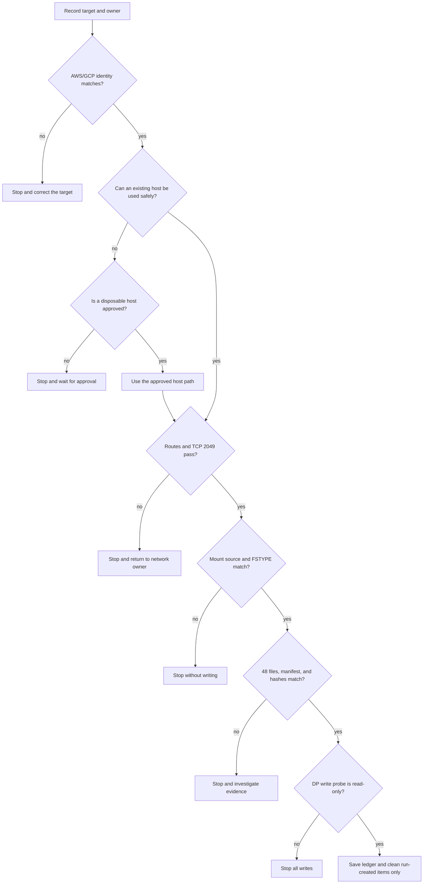
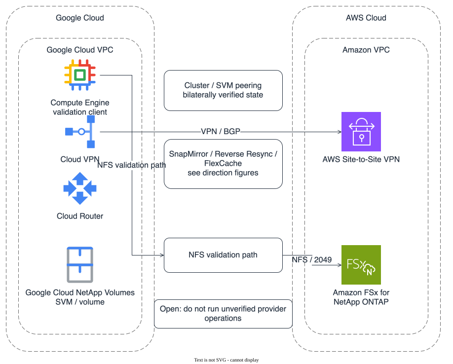

# GCP and Amazon FSx for NetApp ONTAP read-only preflight and sample validation

[🏠 Repository home](../../en/README.md) | [Reference](../../ja/reference/README.md)

> **Audience**
>
> This guide is for operators with limited AWS or Google Cloud experience who need to validate reachability and data integrity without changing an existing environment. The Japanese document is the authoring reference; this document mirrors its structure.
>
> **Evidence handling**
>
> Public documents use placeholders only. A `field-observation` describes a state observed in one environment and does not define a service limit. Environment details, account IDs, IP addresses, DNS names, ARNs, secret names, and passwords stay in the private run ledger.

## Conclusion

This procedure covers read-only identity checks, console inspection, route checks, TCP 2049 reachability, safe inspection of an existing mount, creation of a dedicated 48-file fixture, manifest and SHA-256 comparison, and DP-volume read-only validation. It does not execute AWS or Google Cloud create, update, stop, resume, reverse, or delete operations during authoring.

SnapMirror, Reverse Resync, FlexCache, cluster peering, and SVM peering are separated into a guarded mutation handoff. An operation remains `Open` when its provider control-plane interface, inverse operation, or evidence is not established.

| Status | Meaning in this procedure |
|---|---|
| `documented` | A prerequisite or operation shape is stated in public documentation. It does not prove that the operation works in this environment. |
| `field-observation` | A state observed once in one environment. It is not a general service guarantee. |
| `verified` | A reproducible result with run ID, environment, date, settings, and output retained in the private ledger. |
| `open` | Required evidence, inverse operation, or provider interface is missing. |

> **Authoring boundary**
>
> No AWS or Google Cloud mutation is performed while authoring this guide or rebuilding the deck. Read-only command output must not contain secrets, account IDs, internal IPs, DNS names, or ARNs.

## Get started

| Phase | Purpose | Pass condition | Action on failure |
|---|---|---|---|
| 1 | Fix the target and owner | Owner, direction, run ID, and target match the ledger | Stop and return to the owner |
| 2 | Read identity and console state | AWS/GCP identities and target lists are recorded | Stop on a mismatch |
| 3 | Choose EC2 and authentication path | Existing or approved disposable host is ready | Stop without creating a host |
| 4 | Check network reachability | Forward route, return route, and TCP 2049 pass | Do not change route or firewall |
| 5 | Validate NFS and fixture | Mount source, FSTYPE, 48 files, and manifest match | Do not continue |
| 6 | Validate DP read-only and record evidence | Write fails specifically as read-only | Stop on success or another error |

### Execution checklist

- [ ] The authoring boundary and no-mutation rule are confirmed.
- [ ] Target, owner, direction, run ID, and time window are in the private ledger.
- [ ] AWS and GCP identities match the selected profiles and project.
- [ ] The existing EC2 host is the first choice and its route is verified.
- [ ] The cluster management endpoint and SVM management endpoint are distinguished.
- [ ] GCP learned routes and the AWS return route are checked separately.
- [ ] TCP 2049 succeeds from the verification client.
- [ ] Mount source, FSTYPE, and export path match the ledger.
- [ ] The fixture is new and has 48 files and 48 manifest entries.
- [ ] The DP write probe returns `Read-only file system`.
- [ ] Expected output, stop reasons, and cleanup boundaries are recorded.

## Common misconceptions

- A valid `gcloud` or AWS CLI identity does not prove that a GCP client can reach NFS. Routes, return routes, security rules, and export policy are separate checks.
- The SVM management endpoint and the file-system cluster management endpoint have different roles. In this verification, `fsxadmin` SSH used the cluster management endpoint.
- A probe from Cloud Shell or a local laptop is not evidence for a client inside the GCP VPC.
- TCP 2049 being open does not prove that the mount is the expected volume. Compare the `findmnt` source.
- A matching file count does not prove matching content. Compare the manifest and SHA-256 values.
- Any `touch` failure is not enough to prove DP read-only state. The error must be `Read-only file system`.

## Selection flow



The flow closes read-only discrepancies before any provider mutation. The diagram is only a summary; record each decision in the tables and private ledger.

## Architecture diagram



*Figure 1: GCP and Amazon FSx for NetApp ONTAP routes, NFS validation path, and management-plane stop boundary.* ([dark theme](../../_assets/images/gcp-fsx-ontap-peering-overview-en-dark.svg))

Direction-specific figures cover [SnapMirror FSx for ONTAP to GCNV](../../_assets/images/gcp-fsx-ontap-snapmirror-fsx-to-gcnv-en.svg), [Reverse Resync GCNV to FSx for ONTAP](../../_assets/images/gcp-fsx-ontap-reverse-resync-gcnv-to-fsx-en.svg), [FlexCache FSx for ONTAP origin to GCNV cache](../../_assets/images/gcp-fsx-ontap-flexcache-fsx-origin-to-gcnv-cache-en.svg), and [FlexCache GCNV origin to FSx for ONTAP cache](../../_assets/images/gcp-fsx-ontap-flexcache-gcnv-origin-to-fsx-cache-en.svg). Each figure has a matching dark-theme asset.

## Prerequisites and ledger

### Intake

Before starting, name the AWS operator, GCP operator, network owner, storage owner, and approver. Fix source, destination, direction, target volumes, verification client, time window, and rollback owner. Do not start while any of these is unknown.

### Environment ledger

Store real values only in the private ledger.

| Item | Placeholder | Record |
|---|---|---|
| GCP project / Region | `<gcp-project-id>` / `<gcp-region>` | Active project and Region |
| GCP VPC / VPN / Router | `<gcp-vpc>` / `<vpn-name>` / `<router-name>` | Owner and tunnel/BGP state |
| GCP client | `<gce-instance-id>` | Owner, zone, VPC, subnet, OS |
| AWS account / Region / VPC | `<aws-account-id>` / `<aws-region>` / `<aws-vpc-id>` | Caller identity and target VPC |
| AWS VPN / route table | `<vpn-id>` / `<route-table-id>` | Owner, association, return route |
| File system / SVM | `<file-system-id>` / `<fsx-svm-name>` | State and endpoint type |
| NFS endpoint / export | `<nfs-endpoint>` / `<export-path>` | Source and export-policy result |
| Run | `<sample-run-id>` | Start, end, operator, approval |

### Stop conditions

Stop when owner, project, account, Region, VPC, SVM, volume, endpoint, direction, or run ID differs from the ledger. Do not change or delete shared VPNs, Cloud Routers, route tables, security rules, SVMs, or volumes unless the run created them and ownership is proven.

## Identity and console read-only verification

### AWS identity

Do not copy the account ID into public documents.

```bash
aws sts get-caller-identity \
  --query '{Account:Account,Arn:Arn,UserId:UserId}'
aws fsx describe-file-systems \
  --region "<aws-region>" \
  --file-system-ids "<file-system-id>" \
  --query 'FileSystems[].{Id:FileSystemId,Lifecycle:Lifecycle,Endpoints:OntapConfiguration.Endpoints}'
aws fsx describe-storage-virtual-machines \
  --region "<aws-region>" \
  --filters "Name=file-system-id,Values=<file-system-id>" \
  --query 'StorageVirtualMachines[].{Id:StorageVirtualMachineId,Name:Name,State:Lifecycle}'
```

Store the output in a permission-controlled private ledger. Never place secrets, passwords, endpoint values, or account identifiers in an issue, chat, shell history, deck, or public Markdown.


*Figure 2: Volume list for the target SVM; environment identifiers and timestamps are masked.*


*Figure 3: SVM endpoint fields; management, NFS, and iSCSI values are masked.*

### GCP identity

```bash
gcloud auth list --filter=status:ACTIVE --format='value(account)'
gcloud config get-value project
gcloud projects describe "<gcp-project-id>" \
  --format='value(projectId,projectNumber)'
gcloud compute instances describe "<gce-instance-name>" \
  --zone "<gce-zone>" \
  --project "<gcp-project-id>" \
  --format='yaml(name,zone,networkInterfaces,labels)'
```

Confirm the exact Google Cloud NetApp Volumes SVM, volume, and external-replication selectors in the current console or public CLI contract. Do not infer selectors from names.

## EC2 selection

### Existing host

Use an existing host first. In the EC2 console, read the instance ID, state, owner tag, VPC, subnet, security group, route table, and SSM or SSH path. Do not use the host when its owner, purpose, route, OS tools, or cleanup owner is unclear.

### Disposable host

If no existing host is safe, prepare a disposable EC2 host only after approval. Fix the AMI, subnet, restricted security group, IAM instance profile, SSH or SSM path, cost limit, termination owner, and evidence-retention period in the ledger. Do not allow SSH from `0.0.0.0/0`, overwrite a shared security group, or change a shared route table.

The public AWS launch location is **EC2 > Instances > Launch instances**. After creation, re-read the VPC, subnet, route, security group, OS tools, and connectivity before using the host.

## Credential and endpoint handling

### Secrets Manager JSON

Treat the credential as JSON and never print its password.

```bash
umask 077
secret_file="$(mktemp)"
trap 'rm -f "$secret_file"' EXIT
aws secretsmanager get-secret-value \
  --secret-id "<fsx-admin-secret-id>" \
  --query SecretString \
  --output text >"$secret_file"
jq -e '.username | type == "string" and length > 0' \
  "$secret_file" >/dev/null
jq -e '.password | type == "string" and length > 0' \
  "$secret_file" >/dev/null
```

Do not use `echo`, `printf`, command arguments, shell history, debug logs, PowerPoint, public documents, or `sshpass` for the password. Use an approved interactive handoff or public-key authentication.

### SSH endpoint

Keep the file-system cluster management endpoint and the SVM management endpoint in separate ledger fields. Use the cluster management endpoint for `fsxadmin` in this procedure.

```bash
ssh "<fsx-admin-user>@<cluster-management-endpoint>"
```

Once connected, use read-only commands only. Do not enter `cluster peer create`, `vserver peer accept`, `volume flexcache create`, `snapmirror initialize`, or `snapmirror resync` without the guarded mutation approval.

## AWS VPC resource creation procedure

This section describes the order for an approved disposable network. It is not a request to change shared network resources, and it was not executed during this authoring run. Do not change an existing VPC, subnet, route table, security group, NACL, virtual private gateway, VPN, or Cloud Router unless the ledger proves the run created it.

### Creation order

Use this order:

1. Record AWS/GCP CIDRs, owners, cost limit, and cleanup owner.
2. Create the VPC and subnets, then associate route tables.
3. Create the AWS Site-to-Site VPN virtual private gateway, remote-site gateway, and VPN connection.
4. Enable route propagation or add approved static routes.
5. Add only the required management, NFS, and intercluster rules to security groups and NACLs.
6. Read the FSx for ONTAP endpoints, Cloud VPN, Cloud Router, BGP, and return routes.
7. Verify TCP 22, TCP 2049, and intercluster TCP 11104 / 11105.

AWS states that the virtual private gateway ASN is selected at creation and cannot be changed later ([How AWS Site-to-Site VPN works](https://docs.aws.amazon.com/vpn/latest/s2svpn/how_it_works.html)). Approve the ASN, CIDRs, and gateway type before creation.

### VPC and subnets

Preconditions are non-overlapping CIDRs, AZ, subnet type, route table, DNS behavior, owner, cleanup, and the subnet used by FSx for ONTAP.

```bash
set -euo pipefail
export AWS_REGION="<aws-region>"
export VPC_CIDR="<aws-vpc-cidr>"
export SUBNET_CIDR="<aws-fsx-subnet-cidr>"
export AZ="<availability-zone>"

aws ec2 create-vpc \
  --region "$AWS_REGION" \
  --cidr-block "$VPC_CIDR" \
  --tag-specifications 'ResourceType=vpc,Tags=[{Key=Name,Value=<run-vpc-name>}]'
aws ec2 create-subnet \
  --region "$AWS_REGION" \
  --vpc-id "<vpc-id>" \
  --cidr-block "$SUBNET_CIDR" \
  --availability-zone "$AZ"
aws ec2 create-route-table \
  --region "$AWS_REGION" \
  --vpc-id "<vpc-id>"
aws ec2 associate-route-table \
  --region "$AWS_REGION" \
  --route-table-id "<route-table-id>" \
  --subnet-id "<subnet-id>"
```

The expected state is non-overlapping CIDRs and an explicit route-table association for the FSx for ONTAP subnet. Do not create a VPC or subnet when it is shared or existing; return the decision to its owner.

### Virtual private gateway and remote-site gateway

Create the identifiers for a virtual-private-gateway AWS Site-to-Site VPN. Use the GCP Cloud VPN public endpoint, BGP ASN, and AWS ASN from the ledger.

```bash
aws ec2 create-vpn-gateway \
  --region "$AWS_REGION" \
  --type ipsec.1 \
  --amazon-side-asn "<aws-private-asn>"
aws ec2 attach-vpn-gateway \
  --region "$AWS_REGION" \
  --vpn-gateway-id "<vgw-id>" \
  --vpc-id "<vpc-id>"
aws ec2 create-customer-gateway \
  --region "$AWS_REGION" \
  --type ipsec.1 \
  --public-ip "<gcp-vpn-public-ip>" \
  --bgp-asn "<gcp-bgp-asn>"
```

If the remote-site gateway is behind NAT, follow the public-IP, UDP 500 / 4500, and NAT-traversal requirements in [AWS gateway options](https://docs.aws.amazon.com/vpn/latest/s2svpn/cgw-options.html). Stop when the IP, ASN, or owner differs from the ledger.

### VPN connection and route propagation

```bash
aws ec2 create-vpn-connection \
  --region "$AWS_REGION" \
  --type ipsec.1 \
  --customer-gateway-id "<customer-gateway-id>" \
  --vpn-gateway-id "<vgw-id>" \
  --options "StaticRoutesOnly=<true-or-false>"
aws ec2 enable-vgw-route-propagation \
  --region "$AWS_REGION" \
  --route-table-id "<route-table-id>" \
  --gateway-id "<vgw-id>"
```

For static routing, record both the GCP client CIDR and AWS VPC CIDR and verify the route target according to [Route tables and AWS Site-to-Site VPN route priority](https://docs.aws.amazon.com/vpn/latest/s2svpn/vpn-route-priority.html). For BGP, verify propagation and learned routes on both sides.

### Security group and NACL

Limit security-group sources to the required CIDRs. Representative ports for this validation are:

| Port | Purpose | Source |
|---|---|---|
| TCP 22 | SSH to the cluster management endpoint | Approved EC2 client CIDR |
| TCP 2049 | NFS | GCP client CIDR or approved EC2 CIDR |
| TCP 11104 / 11105 | ONTAP intercluster communication | Origin / cache intercluster CIDRs |
| ICMP | Intercluster reachability check | Approved intercluster CIDRs |

```bash
aws ec2 create-security-group \
  --region "$AWS_REGION" \
  --group-name "<run-security-group>" \
  --description "Temporary FSx for ONTAP validation" \
  --vpc-id "<vpc-id>"
aws ec2 authorize-security-group-ingress \
  --region "$AWS_REGION" \
  --group-id "<security-group-id>" \
  --protocol tcp --port 2049 --cidr "<gcp-client-cidr>"
```

Allow TCP 22 only from the EC2 management CIDR. Allow TCP 11104 / 11105 only from approved intercluster CIDRs when FlexCache or cluster peering is part of the approved run. NACLs are stateless, so include return ephemeral ports and protocols. Security-group, NACL, and export-policy changes require separate approval.

### Post-create validation and rollback

After creation, fresh-read the AWS CLI, AWS console, GCP console, and ONTAP state.

```bash
aws ec2 describe-vpc-endpoints --region "$AWS_REGION" --filters "Name=vpc-id,Values=<vpc-id>"
aws ec2 describe-route-tables --region "$AWS_REGION" --route-table-ids "<route-table-id>"
aws ec2 describe-vpn-connections --region "$AWS_REGION" --vpn-connection-ids "<vpn-connection-id>" \
  --query 'VpnConnections[].VgwTelemetry'
```

Pass only when tunnels, BGP, learned routes, return routes, security rules, NFS endpoints, and ONTAP endpoints match the ledger. Do not mount or create a fixture when any item differs.

Record the dependency order before rollback: EC2 client, security rules, routes, VPN connection, remote-site gateway, virtual private gateway, subnet, and VPC. Do not delete shared resources, active tunnels, route tables used by FSx for ONTAP, or resources with unknown owners. A successful delete response is not proof of rollback; read the final state again.

### AWS console screen map

Follow the AWS console left-navigation order below. Resource IDs, names, CIDRs, IP addresses, and account information are masked in the images.

<details>
<summary>AWS VPC resource screens</summary>


*Figure 4: VPC create form. Confirm CIDR, IPv6, tenancy, and tags before creation.*


*Figure 5: VPC list. Use this page to select the target VPC.*


*Figure 6: Subnet list. Confirm VPC, AZ, CIDR, and route-table association.*


*Figure 7: Route-table list. Confirm subnet association and remote-CIDR routes.*


*Figure 8: Virtual private gateway list. Confirm VPC attachment state.*


*Figure 9: Remote-site gateway list. Confirm public endpoint, BGP ASN, and type.*


*Figure 10: VPN connection list. Confirm state and virtual-private-gateway association.*


*Figure 11: Security-group list. Use this page to reach VPC association and rule management.*


*Figure 12: Network ACL list. Confirm inbound and outbound rules and subnet association.*

</details>

## Network reachability

### GCP route

Read Cloud VPN tunnel state, Cloud Router BGP state, and the learned AWS VPC CIDR.

```bash
gcloud compute vpn-tunnels list \
  --project "<gcp-project-id>" \
  --regions "<gcp-region>" \
  --filter="name:<vpn-name>" \
  --format='table(name,status,router,peerIp)'
gcloud compute routers get-status "<router-name>" \
  --project "<gcp-project-id>" \
  --region "<gcp-region>" \
  --format=json
```

Use **VPC network > VPN > Cloud VPN tunnels** and **Network services > Cloud Routers** for the same target. Stop without changing AWS when tunnel, BGP, or learned-route state differs.

### AWS return route

Read the route table associated with the NFS subnet and VPN telemetry.

```bash
aws ec2 describe-vpn-connections \
  --region "<aws-region>" \
  --vpn-connection-ids "<vpn-id>" \
  --query 'VpnConnections[].VgwTelemetry'
aws ec2 describe-route-tables \
  --region "<aws-region>" \
  --filters "Name=association.subnet-id,Values=<nfs-subnet-id>" \
  --query 'RouteTables[].{Id:RouteTableId,Routes:Routes}'
```

Confirm the GCP client CIDR, next hop, and association match the ledger. Return security-rule, NACL, or export-policy changes to the network or storage owner.

### TCP 2049

```bash
NFS_ENDPOINT="<nfs-endpoint>"
timeout 5 bash -c "</dev/tcp/$NFS_ENDPOINT/2049"
```

Do not mount after a failed or ambiguous probe. Record the host, endpoint placeholder, time, result, and run ID.

## NFS mount safety

### Mount verification

Validate the mount root before creating a fixture. Do not unmount an existing mount.

```bash
SAMPLE_MOUNT="<existing-or-approved-mount-root>"
EXPECTED_SOURCE="<nfs-endpoint>:<export-path>"
mountpoint -q "$SAMPLE_MOUNT"
findmnt -T "$SAMPLE_MOUNT" -o TARGET,SOURCE,FSTYPE,OPTIONS
actual_source="$(findmnt -n -T "$SAMPLE_MOUNT" -o SOURCE)"
actual_type="$(findmnt -n -T "$SAMPLE_MOUNT" -o FSTYPE)"
test "$actual_type" = nfs || test "$actual_type" = nfs4
test "$actual_source" = "$EXPECTED_SOURCE"
```

Stop on a mount failure, local filesystem, source mismatch, export mismatch, existing fixture, or existing marker. Creating a root-required mount is a mutation and is outside this authoring run.

### NFS security boundary

Read the endpoint security group, NACL, and ONTAP export policy from their respective management planes. If the export policy cannot be read through an approved ONTAP interface, mark the step `Open` and do not write.

## Fixture and hash validation

### 48-file manifest

Create the fixture only in a new directory and leave the source data unchanged.

```bash
RUN_ID="<sample-run-id>"
FIXTURE_ROOT="$SAMPLE_MOUNT/gcp-fsx-ontap-$RUN_ID"
python3 - "$FIXTURE_ROOT" <<'PY'
from pathlib import Path
import hashlib
import sys

root = Path(sys.argv[1])
if root.exists():
    raise SystemExit(f"refusing existing fixture: {root}")
root.mkdir(parents=True)
manifest = []
for index in range(1, 49):
    name = f"sample-{index:03d}.txt"
    seed = f"gcp-fsx-ontap-sample-{index:03d}"
    payload = hashlib.sha256(seed.encode("ascii")).hexdigest().encode("ascii") + b"\n"
    path = root / name
    path.write_bytes(payload)
    manifest.append((hashlib.sha256(payload).hexdigest(), name))
(root / "manifest.sha256").write_text(
    "".join(f"{digest}\t{name}\n" for digest, name in sorted(manifest)),
    encoding="ascii",
)
PY

test "$(find "$FIXTURE_ROOT" -type f -name 'sample-*.txt' -print | wc -l)" -eq 48
test "$(awk -F '\t' 'END {print NR}' "$FIXTURE_ROOT/manifest.sha256")" -eq 48
```

Stop when the directory already exists, the count is not 48, or the manifest is not 48 lines. The earlier 48/48 observation remains `Open` until its retained run record is available.

### SHA-256 and DP read-only

Compare the manifest only after the DP mount source and volume role match the ledger.

```bash
DP_ROOT="<verified-dp-mount>/gcp-fsx-ontap-<sample-run-id>"
MANIFEST="$DP_ROOT/manifest.sha256"
test "$(find "$DP_ROOT" -type f -name 'sample-*.txt' | wc -l)" -eq 48
(
  cd "$DP_ROOT"
  sha256sum -c <(awk -F '\t' '{print $1 "  " $2}' "$MANIFEST")
)
if touch "$DP_ROOT/.write-test" 2>"$DP_ROOT/.write-error"; then
  rm -f "$DP_ROOT/.write-test" "$DP_ROOT/.write-error"
  exit 1
fi
```

The operator must confirm that the error contains `Read-only file system`. Permission denied, I/O error, timeout, and network errors do not prove DP read-only state. Keep individual hashes, real paths, and resource IDs in the private ledger only.

## Expected output and stop conditions

### Expected output

Record these fields under one `sample_run_id`:

- AWS/GCP caller, project, Region, and placeholder resource identities.
- Forward route, return route, and TCP 2049 result.
- Mount source, FSTYPE, export path, and protocol.
- Fixture total 48, manifest lines 48, hash success 48, failed 0, missing 0, extra 0.
- DP role, exact write-probe error category, and time.
- Command names and exit statuses without secrets or credentials.
- Stop condition, owner, approval, and cleanup result.

### Stop conditions

Stop immediately when identity, owner, Region, direction, endpoint, or volume role differs from the ledger; route or TCP 2049 fails; the mount is local or unexpected; fixture, manifest, hash, missing, or extra counts differ; a DP write succeeds; the error is not read-only; provider state is contradictory; the control-plane interface is unknown; or a password appears in output or logs.

## Cleanup boundary

### Run-created resource

Only the fixture directory and a run-created mount are candidates. Do not unmount an existing mount. A disposable EC2 client, security rule, route, or BGP advertisement may be cleaned up only when a fresh read proves the run created it and an owner approved it.

### Shared resource

Leave existing VPNs, Cloud Routers, VGWs, route tables, SVMs, volumes, peerings, replication relationships, and active transfers in place. Do not break, delete, or stop anything while dependencies or transfers remain. Cleanup is a mutation and is not performed during authoring.

## Guarded mutation handoff

This is a handoff for a separate approved run, not an execution record. Each operation remains `Open` when the target, owner, current state, expected state, inverse, approval, or public provider interface is missing. Contradictory provider output stops the sequence.

### Shared gate

Before each mutation:

1. Re-read the `sample_run_id`, target, direction, owner, and approval.
2. Fresh-read AWS/GCP state and ONTAP `snapmirror show`, `cluster peer show`, and `vserver peer show`.
3. Compare source, destination, volume role, relationship state, health, dependencies, and inverse to the ledger.
4. Confirm the command or console location against public documentation.
5. Record the expected post-state and rollback window.
6. Stop and leave the operation `Open` when anything is missing, unexpected, or contradictory.

### fsxadmin password update

The preconditions are file-system owner, password-rotation approval, secret schema, management endpoint, and post-reset verification. The public AWS console location is **Amazon FSx for NetApp ONTAP > File systems > target > Administration > ONTAP administrator password > Update**. AWS also documents the `update-file-system` CLI shape ([Updating file systems](https://docs.aws.amazon.com/fsx/latest/ONTAPGuide/updating-file-system.html)).

```bash
aws fsx update-file-system \
  --file-system-id "<file-system-id>" \
  --ontap-configuration FsxAdminPassword="<password-not-on-command-line>"
```

Do not place the password on the command line. Use the approved secret handoff, wait for the file system lifecycle, connect to the cluster management endpoint, and complete one read-only ONTAP command. Stop on a target-secret mismatch, an unavailable endpoint, a lifecycle failure, or contradictory AWS/ONTAP state.

### SVM and volume creation

The preconditions are file system, subnet, SVM name, root security style, volume type, size, junction path, export policy, owner, cleanup, and cost approval. Use the AWS console locations **Amazon FSx for NetApp ONTAP > Storage virtual machines > Create new storage virtual machine** and **Amazon FSx for NetApp ONTAP > Volumes > Create volume**. AWS documents the inputs in [Creating storage virtual machines](https://docs.aws.amazon.com/fsx/latest/ONTAPGuide/creating-svms.html) and [Creating volumes](https://docs.aws.amazon.com/fsx/latest/ONTAPGuide/creating-volumes.html).

The expected state is an SVM in `Created` state and a volume in `Created` state with the ledger role. The inverse is dependency-aware deletion after a fresh read; do not delete an existing or peered resource. Stop when state remains `Creating`, the target differs, or a relationship exists.

### Cluster and SVM peering

The preconditions are intercluster LIFs, TCP 11104/11105, ICMP, security rules, secure passphrase handoff, actors on both sides, peer identity, expiry, and inverse operations. The AWS FlexCache procedure documents the ONTAP command shapes.

```text
<cache-cluster>::> cluster peer create -address-family ipv4 -peer-addrs <peer-intercluster-addresses>
<source-cluster>::> cluster peer show
<cache-cluster>::> vserver peer create -vserver <cache-svm> -peer-vserver <origin-svm> -peer-cluster <origin-cluster> -applications <application>
<source-cluster>::> vserver peer accept -vserver <origin-svm> -peer-vserver <cache-svm> -local-name <local-name>
<source-cluster>::> vserver peer show
```

Do not substitute a guessed GCNV command or acceptance interface. The expected state is available/authenticated cluster peering and matching `peered` SVM state and applications on fresh reads. Stop on one-sided state, `Unavailable`, an unknown GCNV interface, or an identity mismatch.

### SnapMirror create and initialize

The preconditions are source and destination, `DP` destination role, cluster/SVM peering, schedule, network, external-replication resource, generated commands, destination operator, and common snapshot. The public ONTAP shape is:

```text
<destination-cluster>::> snapmirror create \
  -source-path <source-svm>:<source-volume> \
  -destination-path <destination-svm>:<destination-volume> \
  -type XDP -schedule <approved-schedule> -policy <approved-policy>
<destination-cluster>::> snapmirror initialize \
  -source-path <source-svm>:<source-volume> \
  -destination-path <destination-svm>:<destination-volume>
```

Run initialization from the destination cluster or SVM only after relationship identity matches. The expected state is a completed baseline and a matching mirror state, relationship status, and health. Stop on unavailable peering, missing generated GCNV commands, a non-DP destination, or a contradictory state. See [Create a SnapMirror relationship](https://docs.netapp.com/us-en/ontap/data-protection/create-replication-relationship-task.html) and [Initialize a SnapMirror relationship](https://docs.netapp.com/us-en/ontap/data-protection/initialize-replication-relationship-task.html).

### Stop and pause

For Google Cloud NetApp Volumes external replication, use the documented resource command or console operation first. The public CLI shape is:

```bash
gcloud netapp volumes replications stop "<replication-name>" \
  --volume="<destination-volume>" \
  --location="<region>"
```

For an ONTAP destination, read `snapmirror show` and execute only the `snapmirror break` command returned by `hybridReplicationUserCommands`. Stop when the returned state or command is missing.

### Resume

```bash
gcloud netapp volumes replications resume "<replication-name>" \
  --volume="<destination-volume>" \
  --location="<region>"
```

For an ONTAP destination, run only the returned `snapmirror resync` command after the state predicate passes. Do not infer a path from placeholders.

### Reverse and Reverse Resync

The replication must be stopped first. Start reverse on the Google Cloud side and read the returned `hybridReplicationUserCommands`. A generic ONTAP shape is not a substitute for the generated target-specific command.

```bash
gcloud netapp volumes replications reverse "<replication-name>" \
  --volume="<gcnv-volume>" \
  --location="<region>"
gcloud netapp volumes replications list \
  --volume="<gcnv-volume>" \
  --location="<region>"
```

The new destination can revert to a common checkpoint and discard later changes. The expected state is a new direction, a valid mirror state, and separate content evidence. Stop when common snapshot, generated command, client cutover, or rollback is missing. See [Manage external replications](https://docs.cloud.google.com/netapp/volumes/docs/protect-data/replicate-ontap/manage-external-replication) and [Reactivate the original ONTAP source volume](https://docs.netapp.com/us-en/ontap/data-protection/reactivate-original-source-volume-task.html).

### Create FlexCache

The preconditions are intercluster LIFs, TCP 11104/11105, cluster/SVM peering, cache size, security style, junction path, write mode, owner, client path, and post-state query.

```text
<cache-cluster>::> volume flexcache create \
  -vserver <cache-svm> \
  -size <size> \
  -volume <cache-volume> \
  -origin-volume <origin-volume> \
  -origin-vserver <origin-svm> \
  -junction-path <junction-path> \
  -aggr-list <aggregate>
<cache-cluster>::> volume flexcache show
```

Stop until cluster peer is `Available`, SVM peer is `peered`, the application is `flexcache`, identities match, and the inverse is documented. The current GCNV cache-creation interface remains `Open`. See [Creating a FlexCache](https://docs.aws.amazon.com/fsx/latest/ONTAPGuide/create-flexcache.html), [Create ONTAP FlexCache volumes](https://docs.netapp.com/us-en/ontap/flexcache/create-volume-task.html), and [TR-4743](https://docs.netapp.com/us-en/ontap-technical-reports/nas-containers.html).

### Delete

Only delete an external replication after it is stopped, no outdated SnapMirror connection remains, and the last-replication and peer-cleanup decisions are approved.

```bash
gcloud netapp volumes replications delete "<replication-name>" \
  --volume="<destination-volume>" \
  --location="<region>"
```

For ONTAP, follow the generated state-specific sequence. Do not delete or release a relationship during an active transfer. Do not delete shared VPNs, routes, security groups, SVMs, volumes, or peerings unless ownership is proven.

## Security and audit

This procedure requires network separation, least-privilege read-only access, explicit TCP 2049 and intercluster-port checks, secret non-disclosure, and ledger records for commands and results. Encryption, retention, and regulatory suitability are design considerations, not legal or compliance judgments. Separate secret owners, console operators, ONTAP actors, and cleanup owners. Keep post-state evidence for every approved state-changing operation.

## Beginner execution procedure

Use this order when handing the runbook to an operator who has not worked with FSx for ONTAP before. Each step links to the detailed section above and stops on contradictory state.

### 0. Inputs before execution

Fill the private ledger with the AWS/GCP identities, target file system and SVM, EC2 client, cluster management endpoint, NFS endpoint, secret placeholder, and `sample_run_id`. Do not put real values in this document or the deck.

### 1. Read AWS target state

Run the AWS identity and `describe-*` commands in [AWS identity](#aws-identity). Match the lifecycle, SVM, volume role, size, and junction path to the ledger.

### 2. Read the AWS Management Console

Open Amazon FSx for NetApp ONTAP in the target Region, inspect the SVM **Endpoints** and **Volumes** tabs, and compare them with the CLI results. The masked screenshots in this document show the fields to locate.

### 3. Choose the EC2 client

Use an existing host when its route, security group, OS tools, owner, and cleanup path are known. Otherwise obtain approval before creating a disposable host.

### 4. Read credentials safely

Use the Secrets Manager JSON procedure without printing the password. Connect to the cluster management endpoint, not an assumed SVM endpoint, and keep the password out of arguments and logs.

### 5. Read ONTAP state

Run `version`, `vserver show`, `volume show`, `snapmirror show`, `vserver peer show`, and `cluster peer show`. Save the output privately and stop when the states disagree.

### 6. Check network and NFS

Confirm GCP route, AWS return route, TCP 2049, mount source, fixture, manifest, hash result, DP role, and read-only write probe in that order.

### 7. Record evidence and clean up

Save the expected outputs and stop reasons under one run ID. Clean only run-created fixture, mount, and approved disposable client resources. Leave shared resources for owner review.

## Related documents

- [Evidence policy](../evidence-policy.md)
- [Localization workflow](../../agent/localization.md)
- [FSx for ONTAP S3 Access Points constraints](../../ja/domains/data-utilization/notes/s3-access-point-constraints.md) (日本語)
- [GCP / FSx for ONTAP preflight and sample validation](gcp-to-fsx-ontap-preflight-and-sample-validation.md)
- [GCP / FSx for ONTAP peering and replication open items](gcp-to-fsx-ontap-peering-and-replication-open-items.md)

## Sources

- [AWS: Updating file systems](https://docs.aws.amazon.com/fsx/latest/ONTAPGuide/updating-file-system.html)
- [AWS: Updating the fsxadmin account password](https://docs.aws.amazon.com/fsx/latest/ONTAPGuide/updating-admin-password.html)
- [AWS: Creating storage virtual machines](https://docs.aws.amazon.com/fsx/latest/ONTAPGuide/creating-svms.html)
- [AWS: Creating volumes](https://docs.aws.amazon.com/fsx/latest/ONTAPGuide/creating-volumes.html)
- [AWS: Creating a FlexCache](https://docs.aws.amazon.com/fsx/latest/ONTAPGuide/create-flexcache.html)
- [Google Cloud: External replication overview](https://docs.cloud.google.com/netapp/volumes/docs/protect-data/replicate-ontap/overview)
- [Google Cloud: Managing external replications](https://docs.cloud.google.com/netapp/volumes/docs/protect-data/replicate-ontap/manage-external-replication)
- [NetApp: Create an ONTAP SnapMirror replication relationship](https://docs.netapp.com/us-en/ontap/data-protection/create-replication-relationship-task.html)
- [NetApp: Initialize a SnapMirror replication relationship](https://docs.netapp.com/us-en/ontap/data-protection/initialize-replication-relationship-task.html)
- [NetApp: Reactivate the original ONTAP source volume](https://docs.netapp.com/us-en/ontap/data-protection/reactivate-original-source-volume-task.html)
- [NetApp: Create ONTAP FlexCache volumes](https://docs.netapp.com/us-en/ontap/flexcache/create-volume-task.html)
- [NetApp TR-4743 index](https://docs.netapp.com/us-en/ontap-technical-reports/nas-containers.html)
- [NetApp TR-4015 index](https://docs.netapp.com/us-en/ontap-technical-reports/data-protection-disaster-recovery.html)
- [AWS Blog: Scalable replication with FSx for ONTAP and SnapMirror](https://aws.amazon.com/blogs/storage/highly-scalable-solution-design-to-replicate-data-using-amazon-fsx-for-netapp-ontap-and-snapmirror/)

<!-- lang-switcher:start -->
🌐 [日本語](../../ja/reference/gcp-to-fsx-ontap-preflight-and-sample-validation.md) | [English](gcp-to-fsx-ontap-preflight-and-sample-validation.md) | [🏠 Repository home](../README.md)
<!-- lang-switcher:end -->
