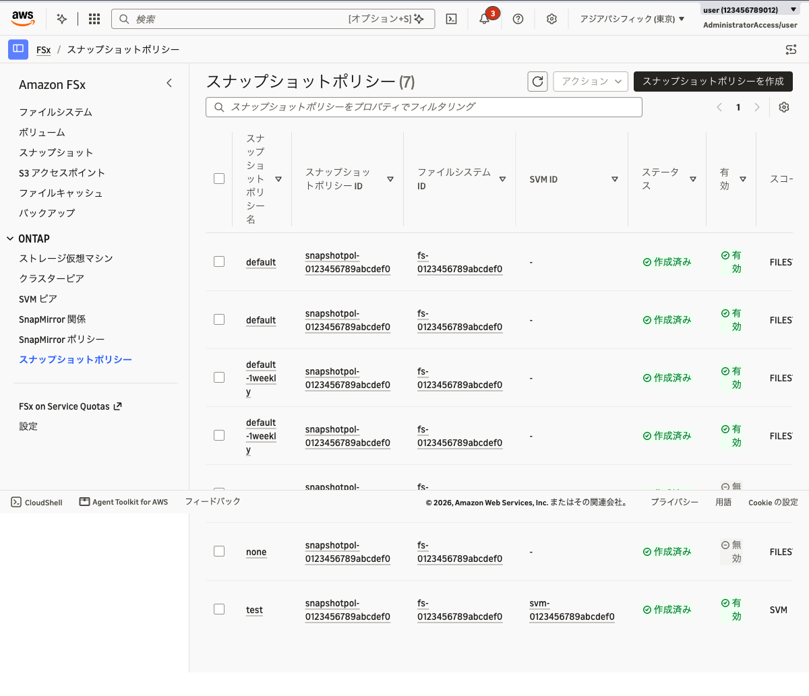
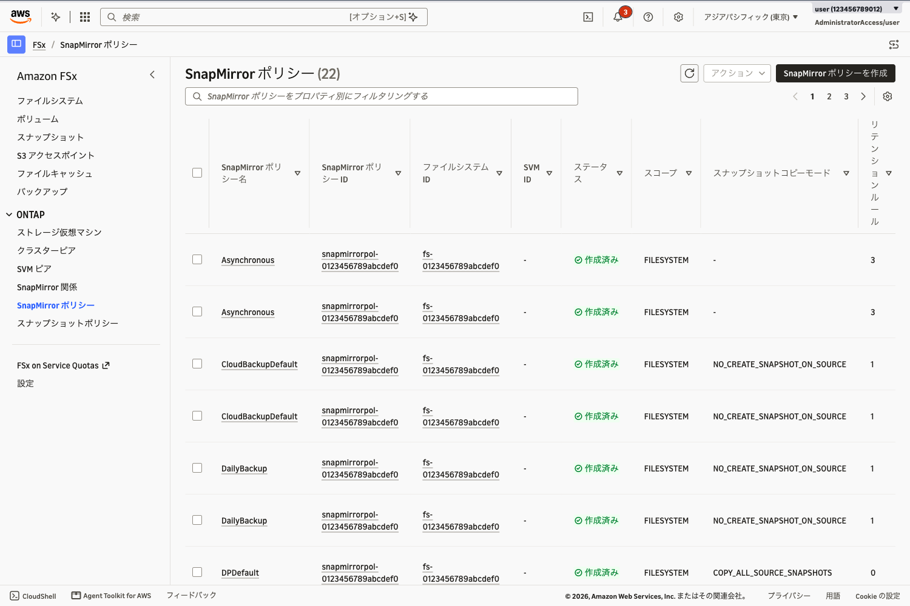
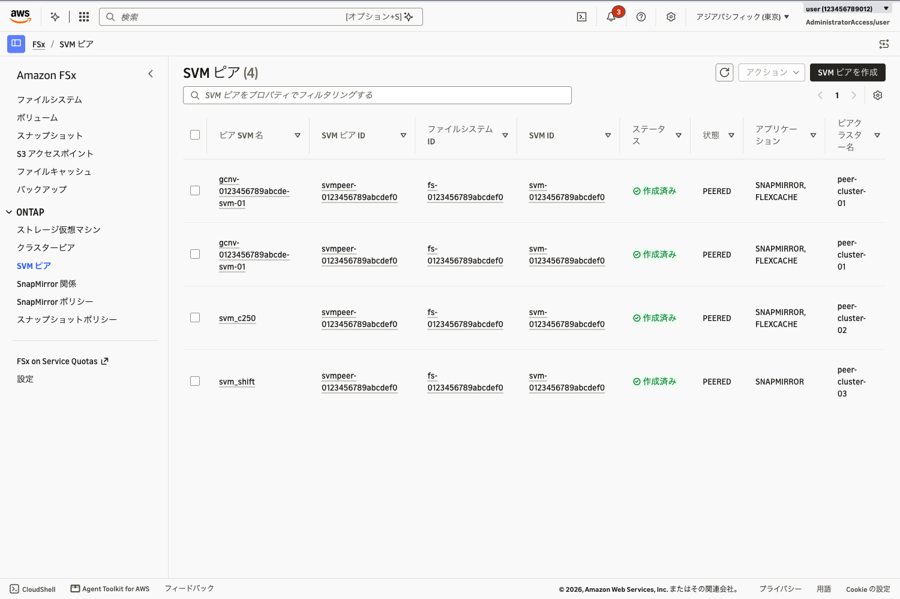

# コンソールの SnapMirror とスナップショットポリシーは AWS CLI から使えるか？

今は使えると書けません。コンソールは Amazon FSx API の操作を呼んでいますが、公開 SDK のモデルにもユーザーガイドにも載っていません。


英語の画面は[こちら](../../../../_assets/images/aws-console-fsx-en-ontap-navigation.png)です（ID、アカウント、相手のボリューム名はマスクした）。


図の内容は本文の表と同じです（[暗い背景の版](../../../../_assets/images/fsx-console-snapmirror-planes-dark.svg)）。

## このノートで学べること

- FSx for ONTAP のコンソールに、クラスターピア、SVM ピア、SnapMirror 関係、SnapMirror ポリシー、スナップショットポリシーの画面があること（第 1 世代のファイルシステムで確認。第 3 世代に限った機能ではない）
- 各画面が呼ぶ Amazon FSx API の操作名（CloudTrail で確認）
- その操作が署名付きリクエストでは通る一方、公開 SDK のモデルとユーザーガイドにないこと

## このノートが答えないこと

- 更新（変更）の操作名と、各操作の入力項目の全体（作成と削除は動かして確認したが、入力項目の一覧は確認していない）
- これらの操作が今後も同じ名前と形で残ること（未公開で、保証はない）
- SnapMirror 関係を作るときの権限、料金、転送の挙動（測っていない）

## 前提レベル

intermediate

## 本文

> **区分**: `verified`（検証日 2026-11-22）— 一覧画面が呼ぶ読み取り操作は `ap-northeast-1` の `SINGLE_AZ_1`（第 1 世代、1 HA ペア）、作成と削除は `us-east-1` の第 3 世代 2 台で確認しました。**変更（更新）の操作は実行していません。削除の確認は、HTTP 200 の応答と、直後の `Describe` で一覧から消えたかの読み戻しのうち、前者だけです。**

### 画面が呼ぶ操作

一覧画面を開くと、CloudTrail に次の読み取りイベントが `fsx.amazonaws.com` から残ります。

| 画面 | CloudTrail のイベント名 | 公開 SDK のモデル（2026-11-20 時点） | 署名付きリクエストでの応答 |
|---|---|---|---|
| スナップショットポリシー | `DescribeSnapshotPolicies` | なし | HTTP 200 |
| SnapMirror ポリシー | `DescribeSnapmirrorPolicies` | なし | HTTP 200 |
| SnapMirror 関係 | `DescribeSnapmirrorRelationships` | なし | HTTP 200 |
| クラスターピア | `DescribeClusterPeers` | なし | HTTP 200 |
| SVM ピア | `DescribeStorageVirtualMachinePeers` | なし | HTTP 200 |

操作名の `Snapmirror` は m が小文字です。`DescribeSnapMirrorPolicies` のように大文字で送ると `UnknownOperationException` が返ります。





### 作成と削除の操作

第 3 世代の 2 つのファイルシステム（`us-east-1`、2026-11-22）で、コンソールから作成し、署名付きリクエストで削除しました。操作名は CloudTrail の記録です。

| 対象 | 作成（コンソールが呼んだ） | 削除（署名付きリクエストで呼んだ） |
|---|---|---|
| クラスターピア | `CreateClusterPeer` | `DeleteClusterPeer`（HTTP 200） |
| SVM ピア | `CreateStorageVirtualMachinePeer` | `DeleteStorageVirtualMachinePeer`（HTTP 200） |
| SnapMirror ポリシー | `CreateSnapmirrorPolicy` | `DeleteSnapmirrorPolicy`（HTTP 200） |
| SnapMirror 関係 | `CreateSnapmirrorRelationship` | `DeleteSnapmirrorRelationship`（HTTP 200） |
| スナップショットポリシー | `CreateSnapshotPolicy` | `DeleteSnapshotPolicy`（HTTP 200） |

10 操作とも、2026-11-20 時点の公開 SDK のモデルにありません。手順と所要時間は [コンソールの SnapMirror は、SVM ピアを宛先側から作らないと関係を作れない](console-snapmirror-needs-the-svm-peer-on-the-destination-side.md) にあります。

### 応答の内容

スナップショットポリシーの応答は、ポリシー ID、スコープ（ファイルシステムまたは SVM）、有効かどうか、スケジュール（件数、プレフィックス、保持期間、SnapMirror ラベル）を返します。これまで ONTAP の CLI や REST API で見ていた内容が、AWS のリソースとして ID と ARN を持つ形になっています。

### 公開情報との差

| 確認先 | 結果 |
|---|---|
| 公開 SDK（botocore）の Amazon FSx モデル、2026-11-20 | 上の 5 操作とも存在しない。ボリュームの `SnapshotPolicy` は文字列で指定するだけ |
| 公開 SDK（botocore 1.44.9、2026-11-22 22:58 JST 時点の最新版） | 15 操作とも存在しない。`CreateVolume` にクローンの指定もない |
| ユーザーガイドの「Creating volumes」、2026-11-22 に読んだ内容 | SnapMirror やクラスターピアのコンソール手順の記載なし。カスタムのスナップショットポリシーは ONTAP の CLI か REST API で作ると書かれている |
| [ユーザーガイドのドキュメント履歴](https://docs.aws.amazon.com/fsx/latest/ONTAPGuide/document-history.html)、2026-11-22 22:58 JST | これらの機能の項目なし。第 3 世代の項目もまだない |
| [What's New](https://aws.amazon.com/new/) の最新 100 件、2026-11-22 22:58 JST | FSx for ONTAP の項目は第 3 世代の告知（2026-11-20）の 1 件だけで、これらの画面には触れていない |

| [Amazon FSx API リファレンスの操作一覧](https://docs.aws.amazon.com/fsx/latest/APIReference/API_Operations.html)、2026-11-22 23:40 JST | 45 操作。上の 15 操作はない |
| [サービス認可リファレンス（Amazon FSx）](https://docs.aws.amazon.com/service-authorization/latest/reference/list_fsx.html)、同日 | 上の 15 操作に対応する IAM アクションの記載なし |
| AWS CloudFormation のレジストリ（`aws cloudformation list-types`、`us-east-1` と `ap-northeast-1`）、同日 | `AWS::FSx::ClusterPeer`、`AWS::FSx::StorageVirtualMachinePeer`、`AWS::FSx::SnapmirrorPolicy`、`AWS::FSx::SnapmirrorRelationship` が 2026-11-06 に、`AWS::FSx::SnapshotPolicy` が 2026-10-30 に、公開の型として登録されている。型の定義（`describe-type`）は、作成に `fsx:CreateClusterPeer` などの IAM アクションを求める。`AWS::FSx::Volume` の定義には `CloneConfiguration` がある |
| [CloudFormation テンプレートリファレンス](https://docs.aws.amazon.com/AWSCloudFormation/latest/TemplateReference/)、同日 | 上の 5 つの型のページはない（URL が入門ページへ転送される）。`AWS::FSx::Volume` のページに `CloneConfiguration` はない |
| AWS Cloud Control API（`aws cloudcontrol list-resources` / `get-resource`、`ap-northeast-1`）、同日 | 5 つの型とも読み取れた。件数はコンソールの一覧と一致した。SnapMirror 関係は `State`、`Healthy`、`LagTimeInMinutes` を返した。作成と削除は Cloud Control API からは試していない |
| AWS CDK と AWS Cloud Control プロバイダー（Terraform）の変更履歴、同日 | 上の 5 つの型の記載なし |
| [AWS Storage Blog](https://aws.amazon.com/blogs/storage/) の最新 20 件、同日 | これらの画面に触れた記事なし |

確認した範囲では、告知も文書化もされていない画面です。ただし、CloudFormation のレジストリには型があり、公開されている Cloud Control API から読み取れます。段階的な展開か、プレビューか、一部のアカウントに限ったものかは分かりません。画面を確認したのは 1 つのアカウントの `ap-northeast-1` と `us-east-1` だけです。

**したがって、`aws fsx` の AWS CLI や SDK から使える、とは書けません。** 読み取りは、`aws cloudcontrol` から型の名前を指定して行えました。 署名付きリクエストで通ることは確認しましたが、公開されていない操作は仕様が変わる可能性があります。自動化の前提にせず、公開されるまではコンソールと ONTAP の CLI・REST API の併用として設計してください。

### 設計への影響

| これまでの前提 | 今回確認したこと |
|---|---|
| スナップショットポリシーは ONTAP の CLI か REST API でしか作れず、AWS 側からは名前を指定するだけ | コンソールにポリシーの一覧と作成ボタンがあり、作成は `CreateSnapshotPolicy` を呼ぶ（上の表） |
| SnapMirror のピアリングと関係の作成は ONTAP 側で行う | コンソールに専用の画面がある。`aws fsx` の CLI には操作がない。Cloud Control API（`aws cloudcontrol`）からは読み取れた |
| （前提ではなく観測）一覧に何が出るか | SnapMirror 関係 2 件、クラスターピア 5 件が表示された。作った経路（ONTAP 側か AWS 側か）は区別していない |

東京の既存のファイルシステムでは、コンソールにこれらの画面が現れる前（2026-09 の時点で存在）に ONTAP の CLI・REST API で作ったクラスターピア、SVM ピア、SnapMirror 関係が、コンソールの一覧に表示されました。AWS 側で取り込みの操作はしていません。画面を開いた時点で、すでに一覧に入っていました。相手は、Google Cloud NetApp Volumes とオンプレミスの ONTAP です（ID、IP アドレス、クラスター名、相手のボリューム名はマスクした）。




Cloud Control API で読んだ SnapMirrored の関係は、`Healthy` が `true` で、`LagTimeInMinutes` が 68,200（約 47 日）でした。`Healthy` だけでは遅れを判断できないので、遅延の閾値は別に決めてください（1 回の確認）。

### SVM ピアで選べるアプリケーションと設計で読む資料

SVM ピアの作成画面では、許可するアプリケーションとして SnapMirror、FlexCache、ファイルコピー、LUN コピーの 4 つを選べます。確認日の時点で、コンソールに作成画面があるのは SnapMirror の関係だけです。FlexCache、ファイルコピー、LUN コピーは、SVM ピアで許可できても、作る操作は ONTAP の CLI・REST API で行います（FlexCache は FSx for ONTAP のユーザーガイドに ONTAP の CLI での手順がある）。コンソールが今後これらに対応するかは分かりません。

画面は ONTAP の設定をそのまま項目にしているので、設計は ONTAP の資料で行います。

| 設計すること | 読む資料 |
|---|---|
| クラスターピアの前提（インタークラスター LIF、経路、ファイアウォール） | [NetApp: クラスターピアリングの前提条件](https://docs.netapp.com/us-en/ontap/peering/prerequisites-cluster-peering-reference.html)、[AWS: セキュリティグループで許可する通信](https://docs.aws.amazon.com/fsx/latest/ONTAPGuide/limit-access-security-groups.html) |
| クラスターピアと SVM ピアの作り方 | [NetApp: クラスターピアの作成](https://docs.netapp.com/us-en/ontap/peering/create-cluster-relationship-93-later-task.html)、[NetApp: SVM ピアの作成](https://docs.netapp.com/us-en/ontap/peering/create-intercluster-svm-peer-relationship-93-later-task.html)、[NetApp: vserver peer create（アプリケーションの指定）](https://docs.netapp.com/us-en/ontap-cli/vserver-peer-create.html) |
| SnapMirror のポリシーと保持 | [NetApp: 統合レプリケーション](https://docs.netapp.com/us-en/ontap/data-protection/snapmirror-unified-replication-concept.html)、[AWS: SnapMirror によるレプリケーション](https://docs.aws.amazon.com/fsx/latest/ONTAPGuide/scheduled-replication.html)、[AWS: SnapMirror による移行](https://docs.aws.amazon.com/fsx/latest/ONTAPGuide/migrating-fsx-ontap-snapmirror.html) |
| FlexCache | [NetApp: FlexCache](https://docs.netapp.com/us-en/ontap/flexcache/index.html)、[NetApp: FlexCache で使える機能](https://docs.netapp.com/us-en/ontap/flexcache/supported-unsupported-features-concept.html)、[AWS: FlexCache によるデータの複製](https://docs.aws.amazon.com/fsx/latest/ONTAPGuide/using-flexcache.html)、[AWS: FlexCache の作成](https://docs.aws.amazon.com/fsx/latest/ONTAPGuide/create-flexcache.html) |
| ファイルコピー | [NetApp: ファイルコピーの開始（REST API）](https://docs.netapp.com/us-en/ontap-restapi/post-storage-file-copy.html) |
| LUN コピー | [NetApp: lun copy start](https://docs.netapp.com/us-en/ontap-cli/lun-copy-start.html) |

資料はどれも 2026-11-22 に開けることを確かめました。FSx for ONTAP で使える ONTAP の機能と版には制約があるので、ONTAP の資料と FSx for ONTAP のユーザーガイドの両方を確かめてください。

## 自環境での確認手順

| # | 手順 | 確認できること |
|---|---|---|
| 1 | Amazon FSx コンソールで「SnapMirror ポリシー」「スナップショットポリシー」の画面を開く | 画面があること |
| 2 | 数分後に CloudTrail で `eventSource` が `fsx.amazonaws.com` のイベントを引き、`Describe` で始まる名前を調べる | **その画面が呼んだ操作名** |
| 3 | 手順 2 の名前が `aws fsx help` の一覧にあるか調べる | **CLI から使えるか** |

手順 2 と 3 は読み取りだけで、リソースを変更しません。

### 期待結果

```text
手順 2 に Snapmirror / SnapshotPolicies / ClusterPeers など、aws fsx help にない名前が出る
手順 3 で一覧にない名前は、`aws fsx` の CLI から呼べない（`aws cloudcontrol` で型の名前を指定すれば読み取れる場合がある）
```

## Read next

[Snapshot は復旧計画ではない](snapshots-are-not-a-recovery-plan.md)
