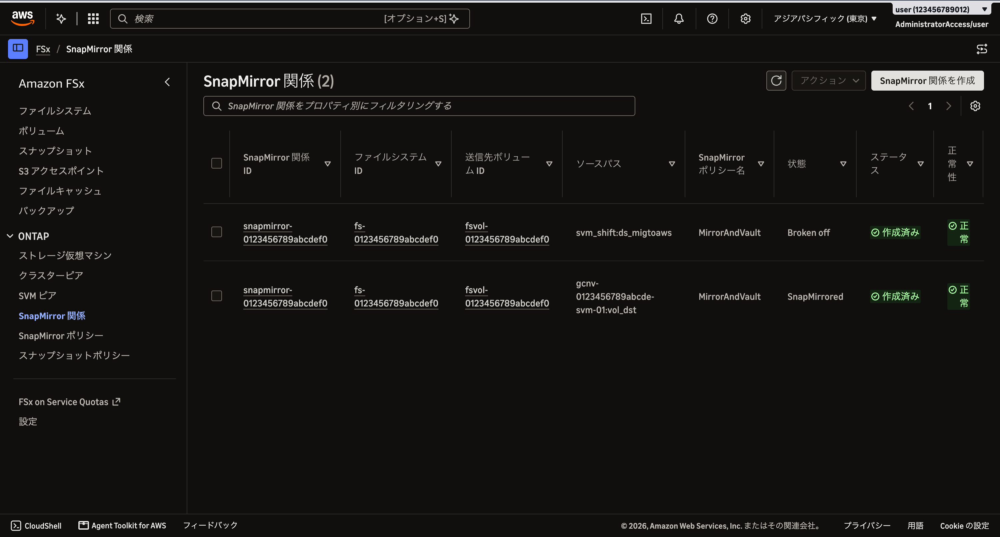
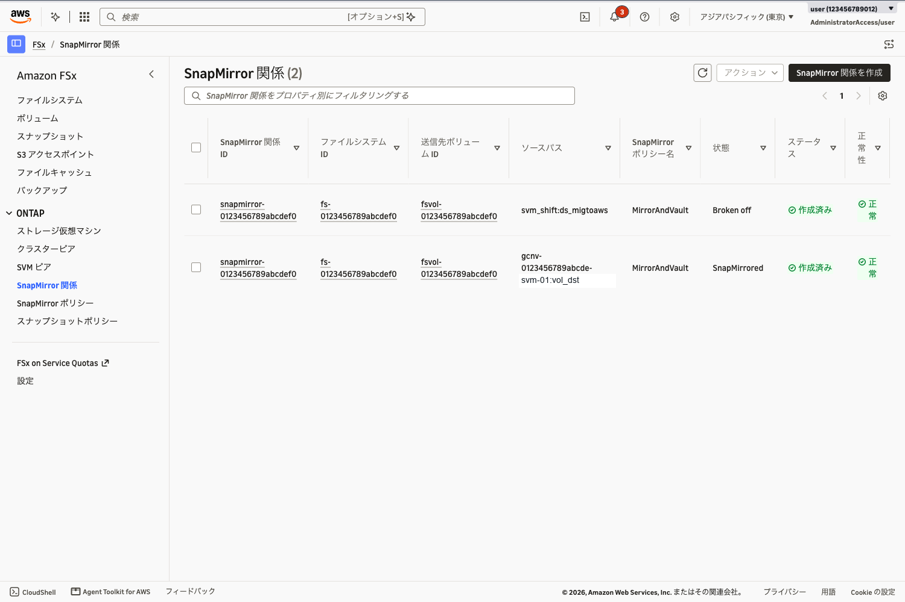

# コンソールの SnapMirror とスナップショットポリシーは AWS CLI から使えるか？

使えます。2026-11-23 に、スナップショット、クローン、SnapMirror による複製を、Amazon FSx コンソール、Amazon FSx API、AWS CloudFormation から管理できるようになったと告知されました。

[What's New: Amazon FSx for NetApp ONTAP adds AWS CloudFormation and Console support for snapshots, clones, and data replication](https://aws.amazon.com/about-aws/whats-new/2026/11/amazon-fsx-for-netapp-ontap-additional-resources/)



英語の画面は[こちら](../../../../_assets/images/aws-console-fsx-en-ontap-navigation.png)です（ID、アカウント、相手のボリューム名はマスクした）。


図の内容は本文の表と同じです（[暗い背景の版](../../../../_assets/images/fsx-console-snapmirror-planes-dark.svg)）。

## このノートで学べること

- Amazon FSx for NetApp ONTAP（以下 FSx for ONTAP）で、クラスターピア、SVM ピア、SnapMirror 関係、SnapMirror ポリシー、スナップショットポリシーを、AWS の API・CLI・CloudFormation で扱えること
- 追加された 20 の API 操作と、最初に対応した AWS CLI と SDK の版
- ONTAP の CLI・REST API で以前に作った関係が、AWS の API からも読めること（実測）
- 告知とユーザーガイドが書いていない点と、実機で確かめた差

## このノートが答えないこと

- 更新（`Update*`）の操作の挙動（実行していない）
- 作成した関係の転送の性能と料金（測っていない）
- CloudFormation でこれらのリソースを作成・削除したときの挙動（試していない）

## 前提レベル

intermediate

## 本文

> **区分**: 告知の内容、API・CLI・CloudFormation の記載は `documented`（2026-11-24 に閲覧）。作成と削除の操作は `us-east-1` の第 3 世代 2 台（2026-11-22）、公開 SDK での読み取りは `ap-northeast-1` の第 1 世代 `SINGLE_AZ_1`（2026-11-24）で確かめた `verified` です。

### 告知の内容

What's New（2026-11-23）は、スナップショット、ボリュームのクローン、SnapMirror による複製を、Amazon FSx コンソール、Amazon FSx API、AWS CloudFormation から管理できるようになったと告知しています。これまでは ONTAP の CLI か REST API でしか設定できなかったもので、ONTAP の CLI・REST API も引き続き使えます。FSx for ONTAP が提供されているすべてのリージョンが対象です。

### 追加された API 操作

Amazon FSx API リファレンスの操作一覧は 68 操作になりました（2026-11-22 には 45 操作）。FSx for ONTAP 向けに次の 20 操作が加わり、AWS CLI と SDK でも呼べます。

| 対象 | 操作 |
|---|---|
| クラスターピア | `CreateClusterPeer`、`DescribeClusterPeers`、`UpdateClusterPeer`、`DeleteClusterPeer` |
| SVM ピア | `CreateStorageVirtualMachinePeer`、`DescribeStorageVirtualMachinePeers`、`UpdateStorageVirtualMachinePeer`、`DeleteStorageVirtualMachinePeer` |
| SnapMirror 関係 | `CreateSnapmirrorRelationship`、`DescribeSnapmirrorRelationships`、`UpdateSnapmirrorRelationship`、`DeleteSnapmirrorRelationship` |
| SnapMirror ポリシー | `CreateSnapmirrorPolicy`、`DescribeSnapmirrorPolicies`、`UpdateSnapmirrorPolicy`、`DeleteSnapmirrorPolicy` |
| スナップショットポリシー | `CreateSnapshotPolicy`、`DescribeSnapshotPolicies`、`UpdateSnapshotPolicy`、`DeleteSnapshotPolicy` |

あわせて、次の点が変わりました。

- 既存の `CreateSnapshot`、`DescribeSnapshots`、`UpdateSnapshot`、`DeleteSnapshot` のページが FSx for ONTAP を対象に含めるようになった
- `CreateVolume` の `OntapConfiguration` に `CloneConfiguration`（親ボリューム ID と、任意でスナップショット ID）が載った。クローンの分割は `UpdateVolume` の `CloneConfiguration`（`SplitAction=START`）で行う
- 操作名の `Snapmirror` は m が小文字。`DescribeSnapMirrorPolicies` のように大文字で送ると `UnknownOperationException` が返る（2026-11-22 に実測）

| 経路 | 最初に対応した版 |
|---|---|
| botocore（AWS SDK for Python の基盤） | 1.44.10（2026-11-23 公開） |
| AWS CLI v2 | 2.42.2（2026-11-23 公開） |
| AWS CloudFormation | `AWS::FSx::ClusterPeer`、`AWS::FSx::StorageVirtualMachinePeer`、`AWS::FSx::SnapmirrorPolicy`、`AWS::FSx::SnapmirrorRelationship`、`AWS::FSx::SnapshotPolicy` のテンプレートリファレンス。`AWS::FSx::Volume` の `OntapConfiguration` に `CloneConfiguration` |

古い版の AWS CLI と SDK には、これらの操作がありません。

### ONTAP で作った関係が AWS の API から見えること

公開 SDK（botocore 1.44.10）で `DescribeSnapmirrorRelationships`、`DescribeClusterPeers`、`DescribeStorageVirtualMachinePeers` を呼びました（`ap-northeast-1`、2026-11-24）。告知の前に ONTAP の CLI・REST API で作ったクラスターピア、SVM ピア、SnapMirror 関係も、AWS 側で取り込みの操作をせずに結果に含まれていました。相手は Google Cloud NetApp Volumes とオンプレミスの ONTAP です。コンソールの一覧でも同じでした（ID、IP アドレス、クラスター名、相手のボリューム名はマスクした）。




ユーザーガイドは、ONTAP の CLI・REST API で作った関係が API に現れるかを書いていません（2026-11-24 に閲覧したページの範囲）。

Google Cloud NetApp Volumes から複製している SnapMirrored の関係は、`Healthy` が `true` で、`LagTimeInMinutes` が 70,240（約 49 日）でした。API リファレンスは `LagTimeInMinutes` を、宛先へ転送した最新のスナップショットを作ってからの経過時間と説明しています。`Healthy` だけでは遅れを判断できないので、遅れの閾値は別に決めてください。

### 実機で確かめた点とドキュメントの差

| 項目 | ドキュメントの記載（2026-11-24） | 実機で確かめたこと |
|---|---|---|
| SVM ピアを作る側 | ユーザーガイドは「片側から作る」と書く。クラスターピアがすべての SVM を許可していれば、作成した時点で使える | コンソールで送信元側だけに作ると、宛先側の関係の作成画面が「デスティネーション SVM には、ソース SVM との SVM ピアがありません」と表示した（2026-11-22、[詳細](console-snapmirror-needs-the-svm-peer-on-the-destination-side.md)）。ユーザーガイドのスクリプト例のコメントは、宛先の SVM から作るとしている |
| クラスターピアのパスフレーズ | Secrets Manager のシークレットで渡す。ユーザーガイドの CLI の手順はカスタマー管理の KMS キーを使う。API リファレンスは `PassphraseSecretArn` を必須、CloudFormation のリファレンスは必須ではないと書いており、食い違う | カスタマー管理の KMS キーで暗号化したシークレットで作成できた。既定の AWS 管理キー（`aws/secretsmanager`）のシークレットでは、作成が `PassphraseSecretArn is not accessible` で断られた（2026-11-22、[詳細](console-snapmirror-needs-the-svm-peer-on-the-destination-side.md#パスフレーズのシークレットに必要なカスタマー管理の-kms-キー)） |
| SVM ピアのアプリケーション | `SNAPMIRROR`、`FILE_COPY`、`LUN_COPY`、`FLEXCACHE` を選べる。別のクラスターとのピアで File copy と LUN copy を使えないという記載はない | Google Cloud NetApp Volumes とのピアに File copy と LUN copy を指定すると、ONTAP がエラー 9895996 で拒否し、ピアは `Failed` になった（2026-11-23、[詳細](../../../playbooks/03-migrate/notes/lun-copy-and-file-copy-stay-inside-one-file-system.md)） |
| クローンへの S3 Access Points のアタッチ | 記載なし | コンソールのクローン作成画面から、S3 Access Points をアタッチできた（2026-11-22、[詳細](../../data-utilization/notes/a-console-clone-attaches-s3-access-points-in-minutes.md)） |
| ユーザーガイドのドキュメント履歴 | この機能の項目はまだない（最新の項目は 2026-11-06） | — |

### 設計への影響

| これまでの前提 | 2026-11-23 以降 |
|---|---|
| スナップショットポリシーは ONTAP の CLI か REST API で作り、AWS 側からは名前を指定するだけ | AWS の API と CloudFormation で作れる。作成後にスケジュールは変えられず、CloudFormation ではスケジュールの変更がリソースの置き換えになる |
| SnapMirror のピアリングと関係の作成は、ONTAP の管理エンドポイントに入って行う | AWS の API と CloudFormation で作れる。ONTAP の資格情報を自動化の仕組みに持たせずに済み、操作は CloudTrail に残る |
| 複製の状態を見るには ONTAP に入る | `DescribeSnapmirrorRelationships` で `State`、`Healthy`、`LagTimeInMinutes`、`UnhealthyReason`、`TransferState` を読める |
| 誰が操作できるかは ONTAP のロールで決める | IAM のアクションとリソースタイプで決められる。クラスターピアは AWS の外の ONTAP につながる入口なので、`CreateClusterPeer` を許す範囲を絞る。その名前を SCP や権限境界に書いて、コンソールの操作を止められるかは確かめていない |

SVM ピアで File copy と LUN copy を許可しても、コピーそのもの（LUN copy、file copy）は引き続き ONTAP の CLI・REST API の操作です。FlexCache の作成も ONTAP の CLI で行います（ユーザーガイドに手順がある）。

### SVM ピアで選べるアプリケーションと設計で読む資料

画面と API は ONTAP の設定をそのまま項目にしているので、設計は ONTAP の資料とユーザーガイドの両方で行います。

| 設計すること | 読む資料 |
|---|---|
| クラスターピアの前提（インタークラスター LIF、経路、ファイアウォール） | [AWS: クラスターピアの作成](https://docs.aws.amazon.com/fsx/latest/ONTAPGuide/creating-cluster-peers.html)、[NetApp: クラスターピアリングの前提条件](https://docs.netapp.com/us-en/ontap/peering/prerequisites-cluster-peering-reference.html)、[AWS: セキュリティグループで許可する通信](https://docs.aws.amazon.com/fsx/latest/ONTAPGuide/limit-access-security-groups.html) |
| SVM ピアの作り方とアプリケーション | [AWS: SVM ピアの作成](https://docs.aws.amazon.com/fsx/latest/ONTAPGuide/creating-svm-peers.html)、[NetApp: vserver peer create（アプリケーションの指定）](https://docs.netapp.com/us-en/ontap-cli/vserver-peer-create.html) |
| SnapMirror の関係とポリシー | [AWS: SnapMirror 関係の作成](https://docs.aws.amazon.com/fsx/latest/ONTAPGuide/creating-snapmirror-relationships.html)、[AWS: SnapMirror ポリシーの作成](https://docs.aws.amazon.com/fsx/latest/ONTAPGuide/creating-snapmirror-policies.html)、[AWS: SnapMirror によるレプリケーション](https://docs.aws.amazon.com/fsx/latest/ONTAPGuide/scheduled-replication.html)、[NetApp: 統合レプリケーション](https://docs.netapp.com/us-en/ontap/data-protection/snapmirror-unified-replication-concept.html) |
| スナップショットとポリシー | [AWS: スナップショット](https://docs.aws.amazon.com/fsx/latest/ONTAPGuide/snapshots-ontap.html)、[AWS: スナップショットポリシーの作成](https://docs.aws.amazon.com/fsx/latest/ONTAPGuide/creating-snapshot-policies.html) |
| クローン | [AWS: ボリュームのクローン](https://docs.aws.amazon.com/fsx/latest/ONTAPGuide/managing-volumes.html#volume-clones)、[AWS: ボリュームの作成](https://docs.aws.amazon.com/fsx/latest/ONTAPGuide/creating-volumes.html) |
| FlexCache | [AWS: FlexCache によるデータの複製](https://docs.aws.amazon.com/fsx/latest/ONTAPGuide/using-flexcache.html)、[NetApp: FlexCache で使える機能](https://docs.netapp.com/us-en/ontap/flexcache/supported-unsupported-features-concept.html) |
| CloudFormation | [AWS::FSx::SnapmirrorRelationship](https://docs.aws.amazon.com/AWSCloudFormation/latest/TemplateReference/aws-resource-fsx-snapmirrorrelationship.html) ほか、上の表の型のテンプレートリファレンス |

資料はどれも 2026-11-24 に開けることを確かめました。

## 自環境での確認手順

| # | 手順 | 確認できること |
|---|---|---|
| 1 | `aws --version` で AWS CLI v2 が 2.42.2 以降かを確かめる | これらのコマンドが使える版か |
| 2 | `aws fsx describe-snapmirror-relationships` と `aws fsx describe-storage-virtual-machine-peers` を実行する | ONTAP で作った関係とピアが含まれるか |
| 3 | 結果の `Healthy` と `LagTimeInMinutes` を並べて見る | 遅れが `Healthy` に現れているか |

どの手順も読み取りだけで、リソースを変更しません。

### 期待結果

```text
手順 2 の結果に、ONTAP の CLI・REST API で作った SnapMirror 関係と SVM ピアも含まれる
手順 3 で、Healthy が true でも LagTimeInMinutes が大きい関係がありうる
```

## Read next

[Snapshot は復旧計画ではない](snapshots-are-not-a-recovery-plan.md)

このノートの確認をまとめた解説記事: [2026-11-22 時点、FSx for ONTAP のコンソールに告知なしで表示された SnapMirror・スナップショットポリシーの画面と、公開情報との照合](https://hakobiya.hatenablog.com/entry/fsxn-console-snapmirror-snapshot-policy-cli-api)（はてなブログ。英語版は [dev.to](https://dev.to/aws-builders/fsx-for-ontap-console-snapmirror-and-snapshot-policies-can-the-aws-cli-and-api-use-them-reading-2cd9)。2026-11-23 の告知を記事にも追記した）
