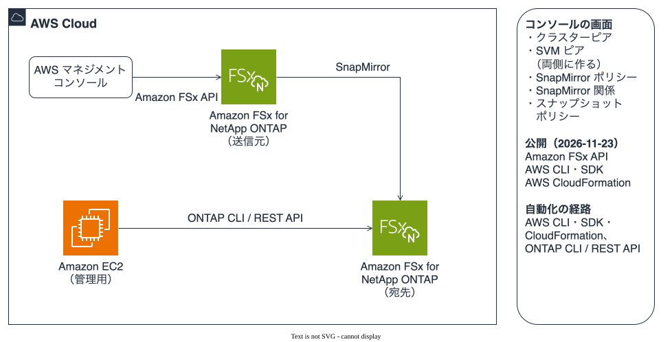

# コンソールの SnapMirror とスナップショットポリシーは AWS CLI から使えるか？

今は使えると書けません。コンソールは Amazon FSx API の操作を呼んでいますが、公開 SDK のモデルにもユーザーガイドにも載っていません。



図の内容は本文の表と同じです（[暗い背景の版](../../../../_assets/images/fsx-console-snapmirror-planes-dark.svg)）。

## このノートで学べること

- FSx for ONTAP のコンソールに、クラスターピア、SVM ピア、SnapMirror 関係、SnapMirror ポリシー、スナップショットポリシーの画面があること（第 1 世代のファイルシステムで確認。第 3 世代に限った機能ではない）
- 各画面が呼ぶ Amazon FSx API の操作名（CloudTrail で確認）
- その操作が署名付きリクエストでは通る一方、公開 SDK のモデルとユーザーガイドにないこと

## このノートが答えないこと

- 更新（変更）の操作名と、各操作の入力項目の全体（作成と削除は動かして確認したが、入力項目の一覧は確認していない）
- これらの操作が今後も同じ名前と形で残ること（未公開で、保証はない）
- SnapMirror 関係を作るときの権限、料金、転送の挙動（測っていない）

## 前提レベル

intermediate

## 本文

> **区分**: `verified`（検証日 2026-11-22）— 一覧画面が呼ぶ読み取り操作は `ap-northeast-1` の `SINGLE_AZ_1`（第 1 世代、1 HA ペア）、作成と削除は `us-east-1` の第 3 世代 2 台で確認しました。**変更（更新）の操作は実行していません。削除の確認は、HTTP 200 の応答と、直後の `Describe` で一覧から消えたかの読み戻しのうち、前者だけです。**

### 画面が呼ぶ操作

一覧画面を開くと、CloudTrail に次の読み取りイベントが `fsx.amazonaws.com` から残ります。

| 画面 | CloudTrail のイベント名 | 公開 SDK のモデル（2026-11-20 時点） | 署名付きリクエストでの応答 |
|---|---|---|---|
| スナップショットポリシー | `DescribeSnapshotPolicies` | なし | HTTP 200 |
| SnapMirror ポリシー | `DescribeSnapmirrorPolicies` | なし | HTTP 200 |
| SnapMirror 関係 | `DescribeSnapmirrorRelationships` | なし | HTTP 200 |
| クラスターピア | `DescribeClusterPeers` | なし | HTTP 200 |
| SVM ピア | `DescribeStorageVirtualMachinePeers` | なし | HTTP 200 |

操作名の `Snapmirror` は m が小文字です。`DescribeSnapMirrorPolicies` のように大文字で送ると `UnknownOperationException` が返ります。


### 作成と削除の操作

第 3 世代の 2 つのファイルシステム（`us-east-1`、2026-11-22）で、コンソールから作成し、署名付きリクエストで削除しました。操作名は CloudTrail の記録です。

| 対象 | 作成（コンソールが呼んだ） | 削除（署名付きリクエストで呼んだ） |
|---|---|---|
| クラスターピア | `CreateClusterPeer` | `DeleteClusterPeer`（HTTP 200） |
| SVM ピア | `CreateStorageVirtualMachinePeer` | `DeleteStorageVirtualMachinePeer`（HTTP 200） |
| SnapMirror ポリシー | `CreateSnapmirrorPolicy` | `DeleteSnapmirrorPolicy`（HTTP 200） |
| SnapMirror 関係 | `CreateSnapmirrorRelationship` | `DeleteSnapmirrorRelationship`（HTTP 200） |
| スナップショットポリシー | `CreateSnapshotPolicy` | `DeleteSnapshotPolicy`（HTTP 200） |

10 操作とも、2026-11-20 時点の公開 SDK のモデルにありません。手順と所要時間は [コンソールの SnapMirror は、SVM ピアを宛先側から作らないと関係を作れない](console-snapmirror-needs-the-svm-peer-on-the-destination-side.md) にあります。

### 応答の内容

スナップショットポリシーの応答は、ポリシー ID、スコープ（ファイルシステムまたは SVM）、有効かどうか、スケジュール（件数、プレフィックス、保持期間、SnapMirror ラベル）を返します。これまで ONTAP の CLI や REST API で見ていた内容が、AWS のリソースとして ID と ARN を持つ形になっています。

### 公開情報との差

| 確認先 | 結果 |
|---|---|
| 公開 SDK（botocore）の Amazon FSx モデル、2026-11-20 | 上の 5 操作とも存在しない。ボリュームの `SnapshotPolicy` は文字列で指定するだけ |
| ユーザーガイドの「Creating volumes」、2026-11-22 に読んだ内容 | SnapMirror やクラスターピアのコンソール手順の記載なし。カスタムのスナップショットポリシーは ONTAP の CLI か REST API で作ると書かれている |
| ユーザーガイドのドキュメント履歴 | これらの機能の項目なし（最新の項目は 2026-11-06 の S3 Access Points のリージョン追加） |

**したがって、AWS CLI や SDK から使える、とは書けません。** 署名付きリクエストで通ることは確認しましたが、公開されていない操作は仕様が変わる可能性があります。自動化の前提にせず、公開されるまではコンソールと ONTAP の CLI・REST API の併用として設計してください。

### 設計への影響

| これまでの前提 | 今回確認したこと |
|---|---|
| スナップショットポリシーは ONTAP の CLI か REST API でしか作れず、AWS 側からは名前を指定するだけ | コンソールにポリシーの一覧と作成ボタンがあり、作成は `CreateSnapshotPolicy` を呼ぶ（上の表） |
| SnapMirror のピアリングと関係の作成は ONTAP 側で行う | コンソールに専用の画面がある。AWS CLI からの操作は、モデルにないので今は使えない |
| （前提ではなく観測）一覧に何が出るか | SnapMirror 関係 2 件、クラスターピア 5 件が表示された。作った経路（ONTAP 側か AWS 側か）は区別していない |

## 自環境での確認手順

| # | 手順 | 確認できること |
|---|---|---|
| 1 | Amazon FSx コンソールで「SnapMirror ポリシー」「スナップショットポリシー」の画面を開く | 画面があること |
| 2 | 数分後に CloudTrail で `eventSource` が `fsx.amazonaws.com` のイベントを引き、`Describe` で始まる名前を調べる | **その画面が呼んだ操作名** |
| 3 | 手順 2 の名前が `aws fsx help` の一覧にあるか調べる | **CLI から使えるか** |

手順 2 と 3 は読み取りだけで、リソースを変更しません。

### 期待結果

```text
手順 2 に Snapmirror / SnapshotPolicies / ClusterPeers など、aws fsx help にない名前が出る
手順 3 で一覧にない名前は、AWS CLI から呼べない
```

## Read next

[Snapshot は復旧計画ではない](snapshots-are-not-a-recovery-plan.md)
