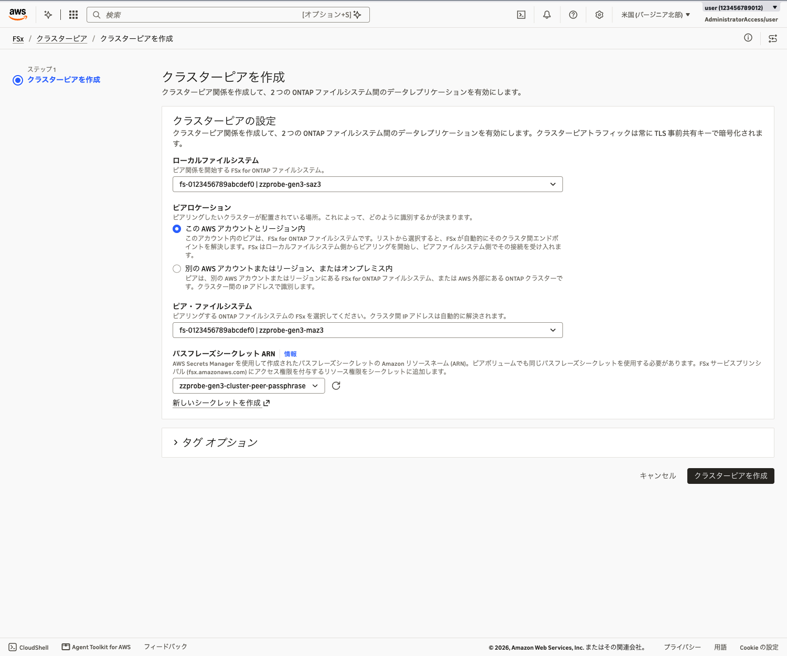
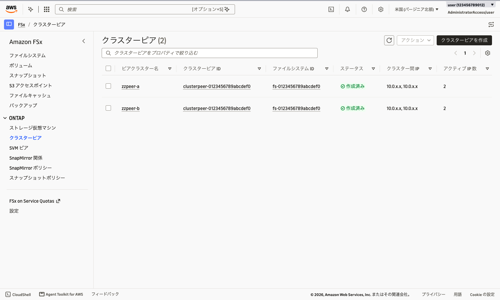
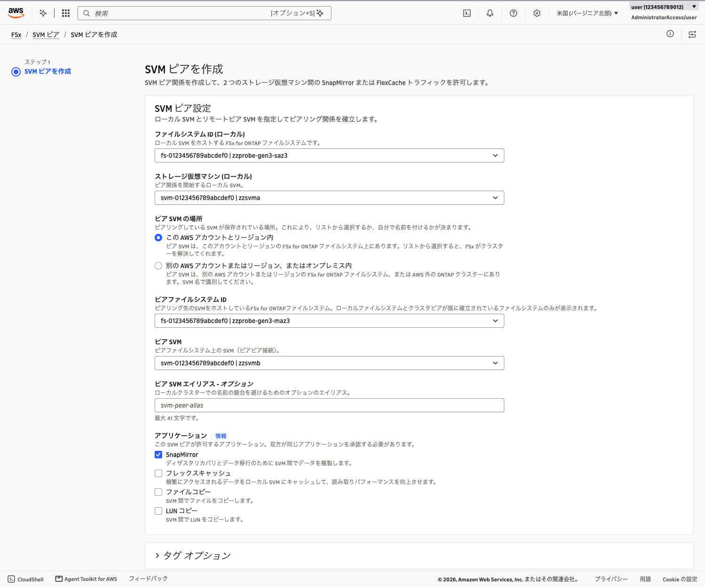
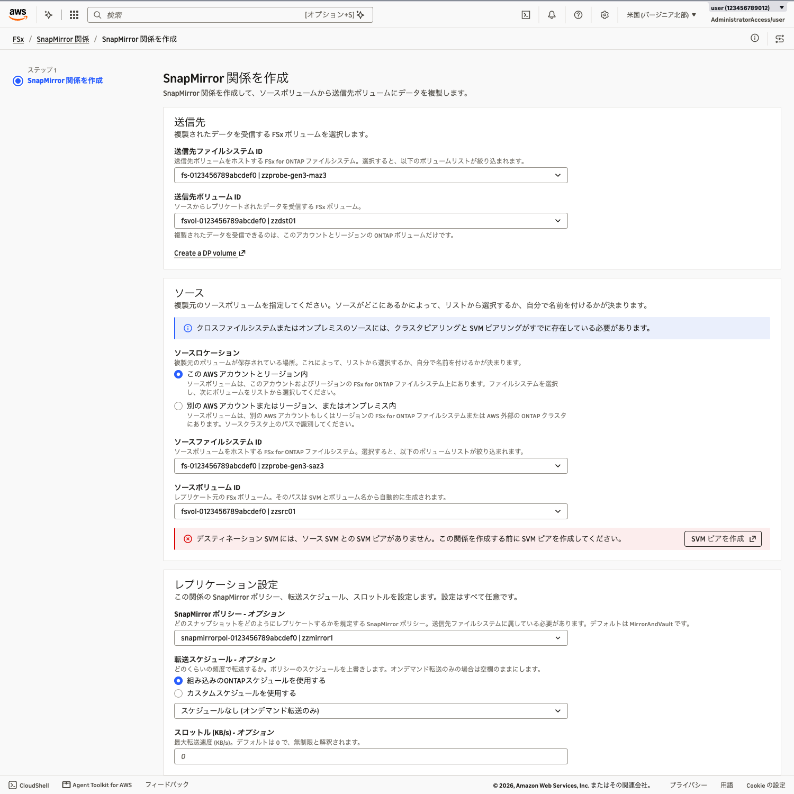
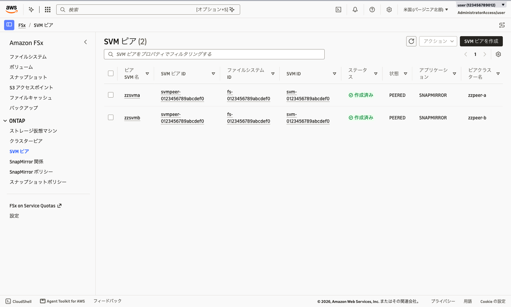
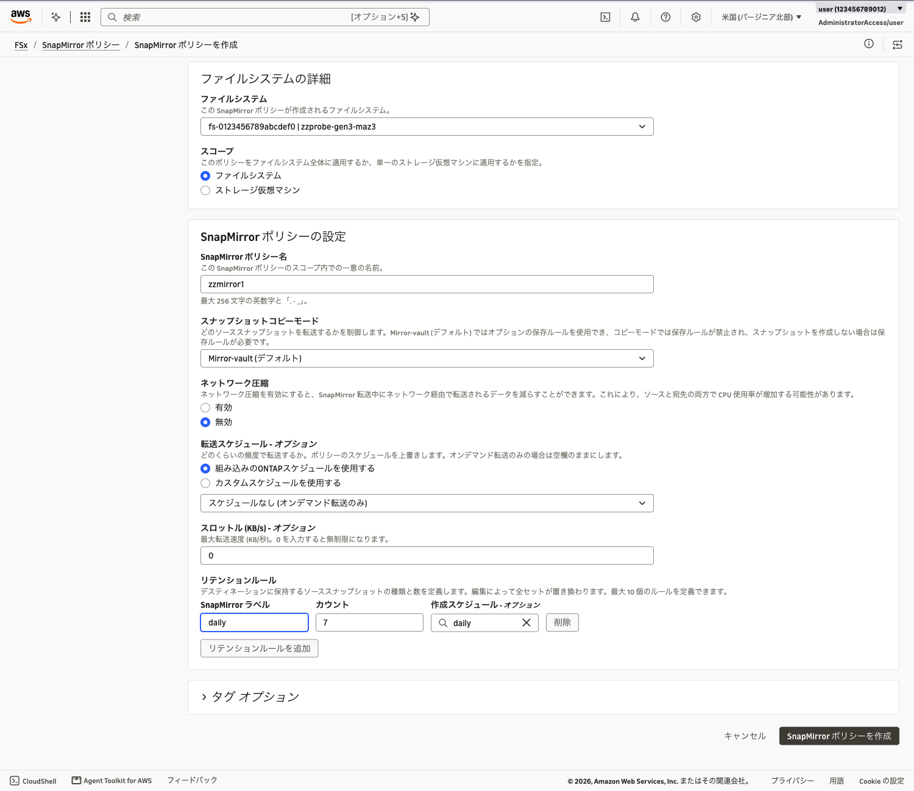
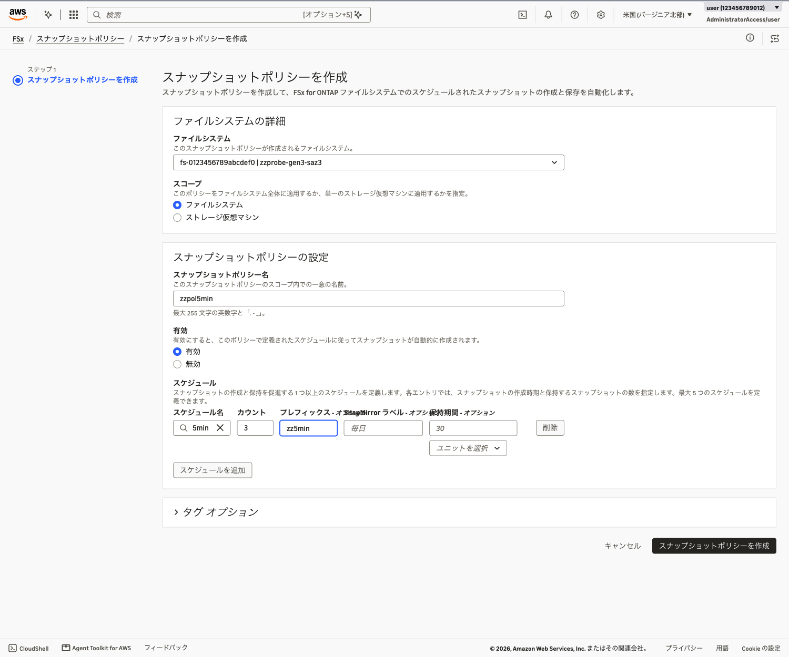
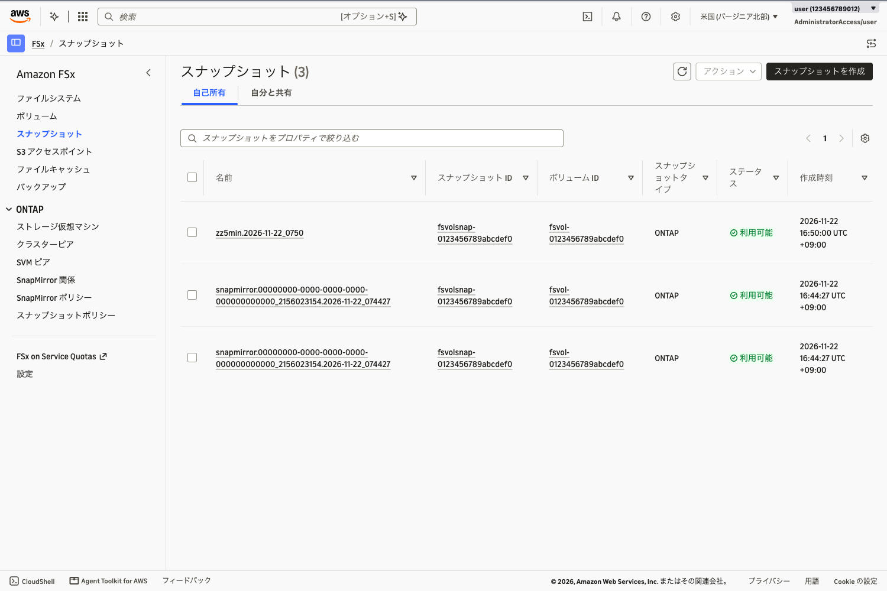
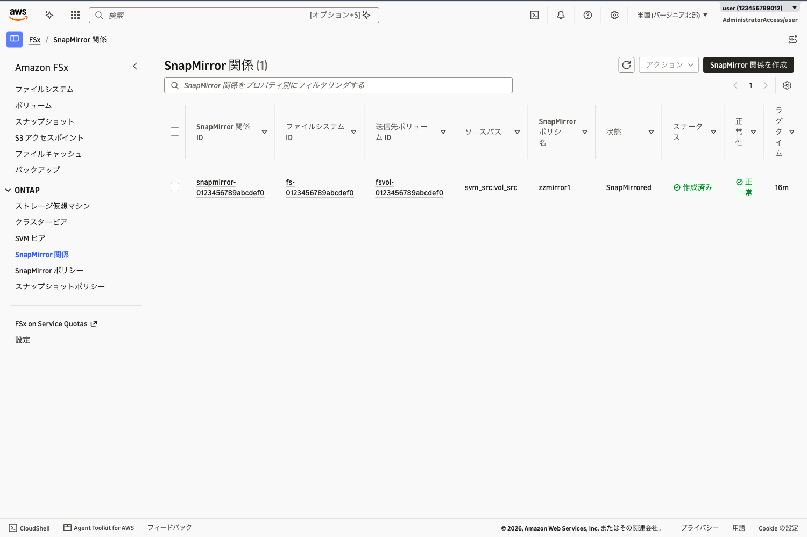

# コンソールだけで SnapMirror をつなぐとき、何をどの順に作るか？

クラスターピア、SVM ピア、SnapMirror 関係の順に作り、SVM ピアは宛先側のファイルシステムから作ります。

## このノートで学べること

- Amazon FSx コンソールで、クラスターピア、SVM ピア、SnapMirror ポリシー、スナップショットポリシー、SnapMirror 関係を作る画面と入力項目
- クラスターピアを作る 2 つの方法（同じアカウントとリージョン内、別のアカウントやリージョン、オンプレミス）の違い
- 関係の作成が断られる条件（宛先 SVM から見た SVM ピアがない）と、パスフレーズのシークレットが読めない条件（カスタマー管理の KMS キー）
- 各手順にかかった時間（各 1 回の観測）

## このノートが答えないこと

- AWS 以外の ONTAP クラスターを相手にした作成（ネットワーク経路を用意していない。画面の説明と、既存の関係の表示だけを確認した）
- 大きなデータの転送時間、転送スループット、料金（空のボリュームの初回転送だけを見た）
- これらの操作を AWS CLI から呼べること（[公開 SDK にない操作名を呼ぶ](console-snapmirror-and-snapshot-policies-use-unpublished-api-operations.md)ので、使えるとは書かない）

## 前提レベル

intermediate

## 本文

> **区分**: `verified`（検証日 2026-11-22、`us-east-1`、第 3 世代の `SINGLE_AZ_3` と `MULTI_AZ_3`、各 1 HA ペア、384 MBps、SSD 1,024 GiB。同じ VPC の同じセキュリティグループに置いた）— 手順の順序、入力項目、所要時間。**各手順 1 回ずつの観測です。ONTAP のバージョンは確認していません。**

### 作る順序

| 順 | 作るもの | 画面 | 作る側のファイルシステム | 観測した所要 |
|---|---|---|---|---|
| 1 | パスフレーズのシークレットと専用の KMS キー | Secrets Manager と KMS | なし | なし |
| 2 | クラスターピア | クラスターピア | 片方（同じアカウントとリージョン内の方法）。両方（外部の方法） | 作成の呼び出しは数秒で成功。ステータスが `available` になるまでは後述 |
| 3 | SVM ピア | SVM ピア | **宛先側**（SnapMirror 関係の宛先ボリュームがある側） | 作成の呼び出しから `PEERED` まで約 20 秒 |
| 4 | SnapMirror ポリシー（任意） | SnapMirror ポリシー | 宛先側 | 数秒 |
| 5 | SnapMirror 関係 | SnapMirror 関係 | 宛先側 | 作成から最初の転送の成功まで約 25 秒（空の 1 GiB ボリューム） |

### パスフレーズのシークレットに必要なカスタマー管理の KMS キー

クラスターピアの作成画面は、パスフレーズを入れた Secrets Manager のシークレットの ARN を求めます。画面の説明は、ピア側でも同じシークレットを使うことと、Amazon FSx のサービスプリンシパル（`fsx.amazonaws.com`）にシークレットへのアクセスを許すリソースポリシーを付けることを求めています。



**シークレットに既定の AWS 管理キー（`aws/secretsmanager`）を使うと、作成が `BadRequest` で断られました。** メッセージは `PassphraseSecretArn is not accessible` で始まり、シークレットが存在すること、リソースポリシーと KMS キーポリシーが Amazon FSx にアクセスを許していることを確かめるよう求めます。シークレットのリソースポリシーに `fsx.amazonaws.com` を許可しても、これは変わりませんでした。

次の構成にして通りました。

| 項目 | 設定 |
|---|---|
| KMS キー | カスタマー管理キー（対称）。キーポリシーに、アカウントの管理者に加えて `fsx.amazonaws.com` の `kms:Decrypt` と `kms:DescribeKey` を許可する文を足す |
| キーポリシーの条件 | `kms:ViaService` は `secretsmanager.<リージョン>.amazonaws.com`、`aws:SourceAccount` は自分のアカウント、`aws:SourceArn` は `file-system/*` と `storage-virtual-machine/fs-*/svm-*` の ARN |
| シークレット | 上のキーで暗号化し、値はパスフレーズの文字列 1 つ。リソースポリシーで `fsx.amazonaws.com` に `secretsmanager:GetSecretValue` と `secretsmanager:DescribeSecret` を許可し、`aws:SourceAccount` で絞る |

キーポリシーの形は、ユーザーガイドの「Storing Active Directory credentials using AWS Secrets Manager」の節にあるものと同じ型です。クラスターピア用のシークレットの条件は、ユーザーガイドの本文には見つかりませんでした（2026-11-22 に検索）。

### クラスターピアを作る 2 つの方法

| | この AWS アカウントとリージョン内 | 別の AWS アカウントまたはリージョン、またはオンプレミス内 |
|---|---|---|
| 指定するもの | ローカルのファイルシステムと、ピアのファイルシステム（リストから選ぶ） | ピアのクラスター間 IP アドレス（1 から 24 個）、エイリアス（任意、44 文字まで） |
| 相手側の作成 | Amazon FSx がローカル側から始め、ピア側で受け入れる | **相手側のクラスターが、同じパスフレーズで対になるクラスターピアを作る必要がある。** それまで `pending` |
| 画面の説明 | 「クラスタ間エンドポイントを自動で解決する」 | 「ピアが AWS 外の ONTAP クラスターの場合に使う」 |

同じアカウントとリージョン内の方法で、後続の画面（SVM ピアのピアファイルシステム、SnapMirror 関係のソースファイルシステム）にもう一方のファイルシステムが選択肢として出ました。外部の方法でクラスターピアを作ったときは、SVM ピアのピアファイルシステムの選択肢が空で、ピアの SVM 名とクラスター名（エイリアス）を文字で入れる形になりました。

**ステータスの反映には時間がかかりました。** 外部の方法で、先に作った側は `pending`、後に作った側は直後から `available` でした。先に作った側が `available` になったのは、後に作った側の作成から 12 分以内でした（5 分後の確認までは `pending` のままでした）。同じアカウントとリージョン内の方法では、受け入れ側が作成の直後に `available`、ローカル側は 8 分以上 `pending` のままでしたが、その状態で SVM ピアと SnapMirror 関係は作れました。**ステータスだけを見て次に進めないと判断しないでください。次の手順の画面が実際に通るかで確かめてください。**



### SVM ピアの作成と、宛先側から作る必要

ローカルの SVM とピアの SVM を指定し、許可するアプリケーションを選びます。選べるのは SnapMirror、FlexCache、ファイルコピー、LUN コピーで、SVM ピアのエイリアスは 41 文字までです。



**ここで踏んだ落とし穴が 1 つあります。** 送信元側のファイルシステムから SVM ピアを作っても、宛先側から SnapMirror 関係を作る画面は「デスティネーション SVM には、ソース SVM との SVM ピアがありません。この関係を作成する前に SVM ピアを作成してください」と断りました。同じアカウントとリージョン内の方法でも、外部の方法でも同じでした。宛先側のファイルシステムからも SVM ピアを作ると、約 20 秒で両側が `PEERED` になり、関係を作れました。



SVM ピアの一覧では、両側に 1 件ずつ表示されます。



### SnapMirror ポリシーとスナップショットポリシー

どちらもファイルシステムまたは SVM のスコープで作ります。

**SnapMirror ポリシー**は、スナップショットコピーモード（既定は Mirror-vault）、ネットワーク圧縮、転送スケジュール（組み込みの ONTAP スケジュールまたはカスタム）、スロットル、リテンションルール（最大 10 個）を持ちます。リテンションルールは、SnapMirror ラベル、カウント、作成スケジュールの 3 つ組です。ポリシーは宛先側のファイルシステムに作ります。



**スナップショットポリシー**は、有効かどうかと、最大 5 つのスケジュール（スケジュール名、カウント、プレフィックス、SnapMirror ラベル、保持期間）を持ちます。スケジュール名の選択肢は `10min`、`5min`、`8hour`、`daily`、`hourly`、`weekly`、`monthly` でした。



作ったスナップショットポリシーは、ボリュームの `SnapshotPolicy` にその名前を指定すると使えます。観測では、更新の呼び出しの直後は `default` が返り、約 2 分後に新しい名前になりました。`5min` のスケジュールで、次の 5 分の境界（呼び出しの約 2 分後）にプレフィックス付きのスナップショットが作られ、次に確認した 1 分後には `describe-snapshots` の一覧に出ていました。



### SnapMirror 関係の作成

宛先のファイルシステムと DP ボリュームを選び、ソースを指定します。ソースが同じアカウントとリージョンなら、ファイルシステムとボリュームをリストから選びます。ソースが外部なら、ソースパスを `SVM 名:ボリューム名` の形で入れます。ポリシー、転送スケジュール、スロットルは任意です。

SnapMirror ポリシーを選ばずに作った関係のポリシーは `Asynchronous` でした。画面の説明は「デフォルトは MirrorAndVault です」と書いていて、食い違います。

作成から約 25 秒で状態が `SnapMirrored`、転送の状態が `success` になりました（空の 1 GiB ボリューム。作成時に ONTAP が取ったスナップショットを使った最初の転送）。作成した SnapMirror ポリシーを指定した関係も、同じ秒数で `SnapMirrored` になりました。



### 他のクラウドやオンプレミスの ONTAP とつなぐ場合

**確認できたこと:**

- クラスターピアとソースパスの画面に、AWS 外の ONTAP クラスターを相手にする入力（クラスター間 IP アドレスと `SVM 名:ボリューム名` のパス）がある
- 画面の説明は「ソースがクロスファイルシステムまたはオンプレミスの場合、クラスタピアリングと SVM ピアリングが先に存在している必要がある」としている
- 東京の既存のファイルシステム（第 1 世代）の一覧に、他クラウドの ONTAP が相手のクラスターピアと SVM ピア、その SVM を送信元とする `SnapMirrored` の関係が表示された（作った経路は確認していない）。コンソールの一覧には、AWS 外のクラスターを相手にした関係も出る
- このノートで確かめた範囲では、ピアリング、ポリシー、関係の作成に追加の管理ツールを使わなかった。ユーザーガイドの SnapMirror の節は、スケジュール設定の手段として NetApp 側の管理ツールと ONTAP CLI を挙げている（2026-11-22 に読んだ）

**確認していないこと:** コンソールから AWS 外のクラスターに対してピアリングを作ること。IP アドレスで相手を指定する方法の動作は、同じ VPC の 2 つの FSx for ONTAP で、相手のクラスター間 IP アドレスを入れて確かめました。VPN や Direct Connect の経路、ファイアウォールの許可ポート、相手側の ONTAP の版の条件は未確認です。

## 自環境での確認手順

| # | 手順 | 確認できること |
|---|---|---|
| 1 | カスタマー管理の KMS キーで暗号化したシークレットを作り、クラスターピアの作成画面で選ぶ | **「PassphraseSecretArn is not accessible」が出ないこと** |
| 2 | 同じアカウントとリージョンの 2 つのファイルシステムで、クラスターピアを作る | 2 つのクラスターピアが一覧に出ること |
| 3 | 宛先側のファイルシステムから SVM ピアを作る | **両側が `PEERED` になること** |
| 4 | DP ボリュームを宛先に、SnapMirror 関係を作る | 状態が `SnapMirrored` になるまでの秒数 |
| 5 | 関係、SVM ピア、クラスターピアの順に消す | それぞれ数十秒で一覧から消えること |

後片付けは、作成の逆順（関係、SVM ピア、クラスターピアの順）で行い、この順序で全部消えました。他の順序は試していません。

### 期待結果

```text
手順 1: 既定の AWS 管理キーのシークレットは断られ、カスタマー管理キーのシークレットは通る
手順 3: 宛先側から作った SVM ピアがあって初めて、宛先側の関係の作成が通る
手順 4: 空のボリュームなら 1 分以内に SnapMirrored になる
```

## Read next

[コンソールの SnapMirror とスナップショットポリシーは、公開 SDK にない Amazon FSx API を呼んでいる](console-snapmirror-and-snapshot-policies-use-unpublished-api-operations.md)
