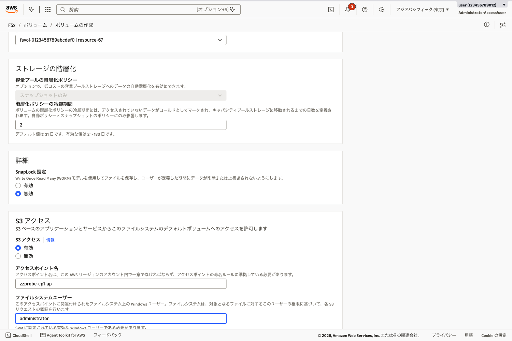
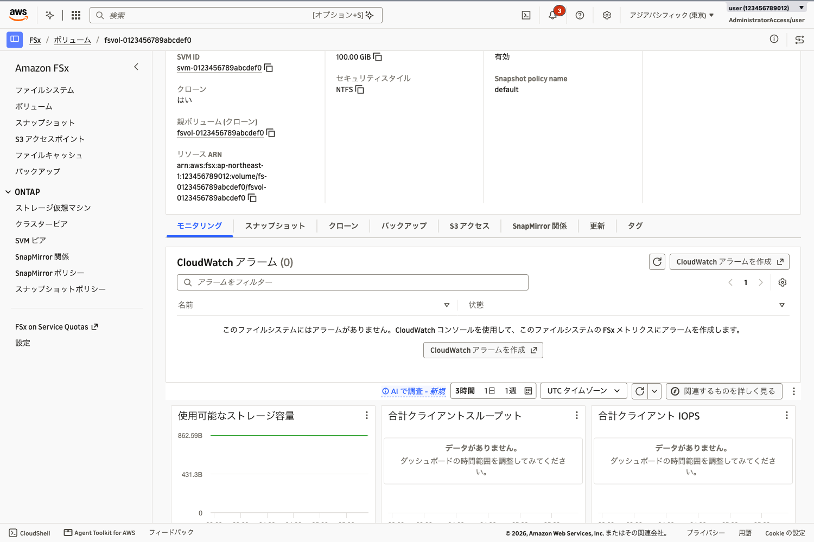

# クローンを S3 Access Points につなぐまでの待ち時間は、作る経路で変わるか？

変わります。AWS の管理コンソールで作ると API に即座に現れ、ONTAP 側で作ると数百秒から千数百秒以上かかります。

## このノートで学べること

- コンソールの「既存のボリュームからクローン」と「S3 アクセス: 有効」を同時に指定すると、クローンの作成と S3 Access Points のアタッチが 1 回の操作で済むこと
- そのクローンが `describe-volumes` に現れるまでの待ちがないこと（クリックの約 7 秒後に `CREATING` で現れた）
- 待ちが残るのは ONTAP REST API や CLI で作ったクローンで、経路による差であること
- コンソールが使う `CloneConfiguration` が、[2026-11-23 の告知](https://aws.amazon.com/about-aws/whats-new/2026/11/amazon-fsx-for-netapp-ontap-additional-resources/)で API リファレンス、SDK、CloudFormation、ユーザーガイドに載ったこと

## このノートが答えないこと

- 大きいデータを持つボリュームのクローン、第 2・第 3 世代、Multi-AZ での所要時間（未測定）
- ONTAP 側で作ったクローンの反映時間の再測定（今回は測っていない。値は [姉妹プロジェクトの記録](https://github.com/Yoshiki0705/FSx-for-ONTAP-S3AccessPoints-Serverless-Patterns/blob/main/solutions/flexcache/devops-cicd/README.md) と [比較表](../../../reference/comparison/data-protection-methods.md#ontap-で作ったボリュームが-aws-の-api-に現れるまでの時間) を引く）
- クローンに S3 Access Points をアタッチできること（ユーザーガイドと API リファレンスには記載がない。このノートはコンソールで 1 回確かめた）

## 前提レベル

intermediate

## 本文
>
> **区分**: `verified`（検証日 2026-11-22、`ap-northeast-1`、`SINGLE_AZ_1` 第 1 世代 1 HA ペア、128 MBps）— 経路ごとの現れるまでの時間と、CloudTrail の呼び出し。**各経路 1 回ずつの観測で、ばらつきは測っていません。**
>
### 3 つの経路の違い

| 作り方 | `describe-volumes` に現れるまで | S3 Access Points が `AVAILABLE` になるまで | 根拠 |
|---|---|---|---|
| ONTAP REST API / CLI でクローンを作り、現れてからアタッチ | 数百秒から千数百秒、別の回では千数百秒でも未出現。上限は不明 | 現れた後にのみアタッチできる | [姉妹プロジェクトの記録](https://github.com/Yoshiki0705/FSx-for-ONTAP-S3AccessPoints-Serverless-Patterns/blob/main/solutions/flexcache/devops-cicd/README.md)（約 30 分と記載）、[比較表](../../../reference/comparison/data-protection-methods.md#ontap-で作ったボリュームが-aws-の-api-に現れるまでの時間)（再現しない） |
| コンソールで「既存のボリュームからクローン」と「S3 アクセス: 有効」を指定 | 作成の約 7 秒後に `CREATING` で現れた | 作成開始から約 93 秒（ボリュームは約 61 秒で `CREATED`） | 本ノートの観測 1 回 |
| コンソールと同じ項目を署名付きリクエストで `CreateVolume` に送り、CLI でアタッチ | 即座に `CREATING` | アタッチの要求から 22 秒（ボリュームは作成済み） | 本ノートの観測 1 回 |

**遅れるのは、クローンを ONTAP 側で作り、AWS のコントロールプレーンが後から気づく経路です。** AWS 側でクローンを作る経路では、AWS が最初からボリュームを知っているので、この待ちが起きません。

### コンソールの操作

ボリュームの作成画面で次を指定します。

1. ファイルシステムと SVM を選ぶ。
2. 「ソーススナップショットまたはボリューム（クローン）」で「既存のボリュームからクローン」を選び、親ボリュームを選ぶ。
3. 「S3 アクセス」で「有効」を選び、アクセスポイント名とファイルシステムユーザーを入れる。


英語の画面: [クローンの選択肢](../../../../_assets/images/aws-console-fsx-en-create-volume-clone.png)、[S3 アクセスの欄](../../../../_assets/images/aws-console-fsx-en-create-volume-s3-access.png)
クローンは親ボリュームから、ボリュームスタイル、ストレージ効率、容量プールの階層化ポリシー、冷却期間、セキュリティスタイル、スナップショットポリシーを引き継ぎます。画面の説明によれば、作成時には変更できません。NTFS のボリュームをクローンすると、アクセスポイントには Windows ユーザーが必要です。
作成後のボリューム詳細には、クローンであることと親ボリュームが出ます。


### コンソールが呼ぶ API

CloudTrail には、同じ秒の前後で 2 つの呼び出しが残ります。

| 時刻（UTC） | イベント | 要点 |
|---|---|---|
| 05:53:00 | `CreateVolume` | `ontapConfiguration.cloneConfiguration.parentVolumeId` に親のボリューム ID |
| 05:53:01 | `CreateAndAttachS3AccessPoint` | 作ったばかりのボリューム ID を指定（ボリュームは `CREATING` のまま） |

**`CloneConfiguration` は、[2026-11-23 の告知](https://aws.amazon.com/about-aws/whats-new/2026/11/amazon-fsx-for-netapp-ontap-additional-resources/)で公開されました。** botocore 1.44.10 と AWS CLI v2 2.42.2 から、`CreateVolume` の `OntapConfiguration` に `CloneConfiguration`（`ParentVolumeId` と、任意で `SnapshotId`）を指定できます。CloudFormation の `AWS::FSx::Volume` にもあります。ユーザーガイドの [ボリュームの作成](https://docs.aws.amazon.com/fsx/latest/ONTAPGuide/creating-volumes.html) と [ボリュームのクローン](https://docs.aws.amazon.com/fsx/latest/ONTAPGuide/managing-volumes.html#volume-clones) は、クローンは親と同じ SVM に作られ、クローンがある間は親を削除できないと書いています（2026-11-24 に閲覧）。告知の前に署名付きリクエストで直接送ったときは、`JunctionPath` が必須でした（2026-11-22）。

### この観測の範囲

| 項目 | 条件 |
|---|---|
| ファイルシステム | `SINGLE_AZ_1`、1 HA ペア、128 MBps、SSD 1,024 GiB |
| 親ボリューム | NTFS、割り当て 100 GiB（データ量は未確認） |
| アクセスポイント | ネットワークオリジンはインターネット、ファイルシステムユーザーは Windows |
| 回数 | 各経路 1 回 |

親のデータ量が大きい場合や、第 2・第 3 世代、Multi-AZ での値は測っていません。**クローン作成は ONTAP の参照コピーですが、AWS 側の処理時間がデータ量に依存しないとは確認していません。**

## 自環境での確認手順

| # | 手順 | 確認できること |
|---|---|---|
| 1 | コンソールでクローンと S3 アクセスを同時に指定して作成し、開始時刻を控える | 1 回の操作で両方が作られること |
| 2 | `aws fsx describe-volumes --volume-ids <クローンの ID>` を 5 秒間隔で実行する | **現れるまでの秒数と `CREATED` までの秒数** |
| 3 | `aws fsx describe-s3-access-point-attachments --query 'S3AccessPointAttachments[?Name==`<名前>`].Lifecycle'` を同じ間隔で実行する | **`AVAILABLE` までの秒数** |
| 4 | 比べるときは、同じ親ボリュームから ONTAP CLI で `volume clone create` し、手順 2 と同じ方法で現れるまでを測る | 経路による差。**自環境の値が運用手順のタイムアウトの根拠** |

手順 2 は読み取り専用です。確認後は、作ったアクセスポイントを `aws fsx detach-and-delete-s3-access-point --name <名前>` で、クローンを `aws fsx delete-volume` で消してください。

### 期待結果

```text
コンソール経路: クローンが数秒で CREATING として現れ、1〜2 分で CREATED。アクセスポイントも同じ桁で AVAILABLE
ONTAP 経路: 現れるまでの時間が数百秒以上でばらつく
```

## Read next

[SnapMirror の宛先は break せずに S3 API で読める](serving-a-replication-destination-over-s3.md)
