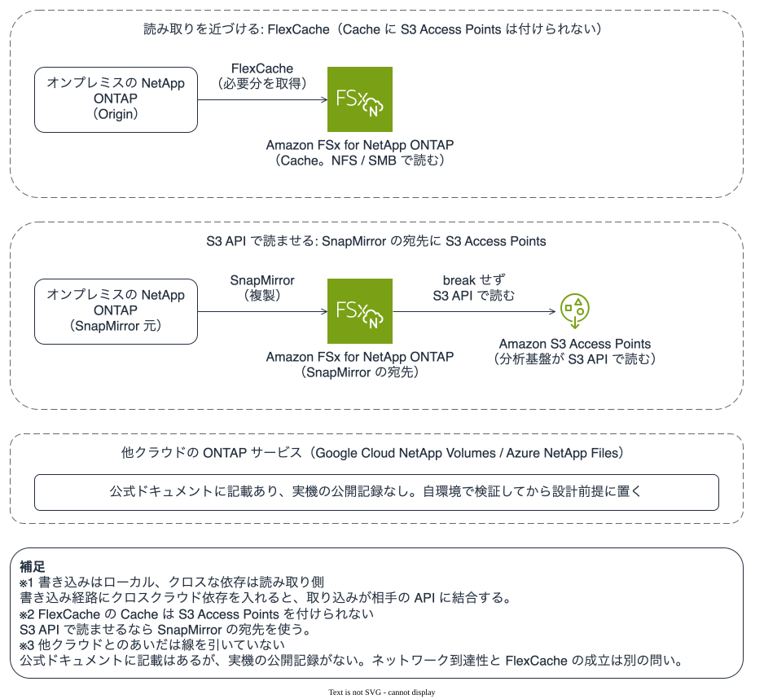

# クロスクラウド分析でコピーを増やさないにはどうするか

書き込みパスはローカルに寄せ、クロスクラウド依存は読み取り側に置きます。同じ原則を ONTAP のデータモビリティにあてはめたとき、引ける範囲と未確認の範囲を分けます。

## このノートで学べること

- クロスクラウド・クロスリージョン分析で、エグレスと遅延と障害点を増やす構造と、それを避ける設計原則（書き込みはローカル・短く、クロスクラウドは読み取り側）
- その原則を ONTAP のデータモビリティ（SnapMirror / FlexCache）にあてはめたときに、FSx for ONTAP 内・オンプレミス連携で引ける範囲
- 他クラウドの ONTAP ベースサービスを相手にした構成のうち、このリポジトリで未確認の範囲

## このノートが答えないこと

- 特定のエグレス単価やリージョン間転送料の実額（[課金の構造](../../cost/notes/provisioned-versus-consumed.md)と各社の料金ページ）
- 他クラウドの ONTAP サービスを Origin にした FlexCache の実機挙動（未確認。本文に明示）

## 前提レベル

advanced

## 本文

[🏠 リポジトリトップ](../../../../../README.md) | [Domain — データ活用](../README.md)

---

### 結論

**クロスクラウドやクロスリージョンでデータを分析するとき、コピーを増やすほどコスト・遅延・障害点が積み上がります。** 公開事例が共通して行き着く設計原則は 1 つです。

**書き込みパスはローカルで短く保ち、クラウドやリージョンをまたぐ依存は読み取り側に置く。**

**書き込み経路にクロスクラウドの依存を入れると、相手側の書き込み API の可用性と遅延に、自分の取り込みが結合します。** 読み取り側の問題が書き込み側の障害に化けます。クロスクラウドの難しさは、リトライが効き・キャッシュでき・取り込みに影響しない読み取り側に寄せるのが扱いやすい形です。

> **Evidence**: `documented` — 設計原則は AWS 公開事例（複数クラウドにまたがるニアリアルタイム分析）の記載に基づきます（2026-11-02 に確認）。**ONTAP のデータモビリティにあてはめた範囲のうち、FSx for ONTAP 内とオンプレミス連携は公式ドキュメントと sibling の実測に基づき、他クラウドの ONTAP サービスを相手にした構成は未確認です**（後述）。

---

### 原則の出どころ

**ある公開事例では、AWS 上のオペレーション基盤と他クラウド上の分析基盤をまたいでいました。** 最初はストリーミングの書き込みを相手クラウドのテーブルへ直接書く設計を試し、取り込みが相手側の書き込み API に結合して脆くなりました。作り直した形は、**データの物理コピーを片側に 1 つ保持し、両方のクラウドからそれぞれのツールでそのまま読み取る**というものです。「どちらのクラウドか」が分岐ではなくアクセスパスの選択になりました。

**この教訓はストレージ製品を問いません。** コピーを増やすたびに、そのコピーの権限・保持・削除・転送料を別に管理することになります。コピーを増やさない設計の価値はコストだけではない、という点は [コピーを増やさずにデータへ届く](reaching-data-without-copies.md) と同じです。

---

### ONTAP のデータモビリティへのあてはめ

**同じ原則を ONTAP の仕組みで実現する手段が 2 つあります。** ただし「引ける範囲」を正確に分けます。

| 手段 | 何をするか | 書き込み/読み取りの位置づけ |
|---|---|---|
| **SnapMirror** | ボリュームを別のファイルシステムへ非同期に複製する | 書き込みは Origin（ローカル）。宛先は読み取り。**宛先は break せずに S3 Access Point で読める**（[別ノート](serving-a-replication-destination-over-s3.md)） |
| **FlexCache** | 必要な分だけ Origin から取得する疎なキャッシュ | 読み取りを Cache 側（遠い側）に近づける。既定は書き込みを Origin が確認する（[機構](reaching-data-without-copies.md#flexcache-が効く条件)） |

**どちらも「書き込みはローカル、クロスな依存は読み取り側」という原則に沿います。** SnapMirror は書き込みを Origin に閉じ、複製先で読ませます。FlexCache は読み取りを遠い側へ運び、キャッシュミスと書き込み確認だけが Origin への依存になります。機構はこの 2 つのノートにあるので再説明しません。

図 1: 書き込みはローカルに閉じ、クロスな依存を読み取り側（Cache）に置くデータモビリティ。他クラウドの ONTAP サービスを Origin にした FlexCache は未確認。

---

### 引ける範囲と未確認の範囲

**ここが最も取り違えやすいところです。** ONTAP のデータモビリティは「どの ONTAP 同士か」で確認状況が違います。

| 構成 | 確認状況 |
|---|---|
| FSx for ONTAP ⇄ FSx for ONTAP（同一アカウント / クロスリージョン） | SnapMirror・FlexCache ともに公式ドキュメントに記載。sibling の実測あり |
| オンプレミスの NetApp ONTAP ⇄ FSx for ONTAP | 公式ドキュメントに FlexCache の 3 構成として記載。[reaching-data-without-copies](reaching-data-without-copies.md#flexcache-が効く条件) に出典 |
| **他クラウドの ONTAP サービス（Google Cloud NetApp Volumes, Azure NetApp Files）を Origin にした FlexCache で、FSx for ONTAP を Cache にする** | **このリポジトリでは未確認です。** 未解決の範囲は [GCNV ⇄ FSx for ONTAP のピアリングとレプリケーションの未解決項目](../../../reference/gcp-to-fsx-ontap-peering-and-replication-open-items.md) に整理しています |

**他クラウド ONTAP サービス同士のネットワーク到達性**（マネージドな相互接続か、相互接続プロバイダ経由か）と、その上で ONTAP のレプリケーション/キャッシュが成立するかは別の問いです。到達性の検証と未解決項目は [GCNV ⇄ FSx for ONTAP の事前確認とサンプル検証](../../../reference/gcp-to-fsx-ontap-preflight-and-sample-validation.md) にあります。**ネットワークが届くことと、ONTAP のレプリケーション/キャッシュがその経路で機能することを混同しないでください。**

**だから、クロスクラウドのデータモビリティを ONTAP で設計するときは、FSx for ONTAP 内とオンプレミス連携に閉じる範囲と、他クラウド ONTAP サービスを相手にする範囲を分けて、後者は自環境で検証してから設計の前提に置いてください。** 未検証の構成を「できる」として設計根拠にしないことが、このリポジトリの区分の目的です（[知見の分類ポリシー](../../../evidence-policy.md)）。

---

### データ主権・リージョン制約が効く場面

**ライフサイエンス・公共・金融では、クロスクラウド/クロスリージョンの「どこにコピーが落ちるか」が規制の問題になります。** エグレスコストより先に、データの所在が許されるかが制約になります。

- **コピーを増やさない設計は、データ主権の観点でも整理しやすくなります。** 物理コピーが 1 か所に閉じるなら、「どのリージョン・どのクラウドにデータが存在するか」を 1 点に絞って説明できます。
- ただし **これはガバナンスの設計の出発点であって、法務・コンプライアンス・規制の判断ではありません。** どのデータがどこに置けるかの最終判断は、各組織の規制要件に照らして行ってください。区分の考え方は [知見の分類ポリシー](../../../evidence-policy.md) に準じます。

---

### よくある誤解

| 誤解 | 実際 |
|---|---|
| クロスクラウド分析は相手クラウドにテーブルを作って書き込むのが素直 | **書き込みにクロスクラウド依存を入れると取り込みが相手の API に結合して脆くなります。** 書き込みはローカルに寄せます |
| コピーを複数持てば各クラウドで速く読める | コピーごとに権限・保持・削除・転送料が増えます。片側に 1 コピーで両方から読む形が扱いやすい |
| ネットワークが相手クラウドに届けば FlexCache も組める | **ネットワーク到達性と ONTAP のキャッシュ/複製の成立は別の問いです。** 他クラウド ONTAP を Origin にした FlexCache は未確認です |
| SnapMirror 宛先を分析に使うには break が要る | **要りません。** 宛先を mount すれば読み取りで S3 Access Point を取り付けられます（[別ノート](serving-a-replication-destination-over-s3.md)） |
| コピーが 1 か所ならデータ主権は自動的に満たされる | 整理はしやすくなりますが、**どこに置けるかの最終判断は規制要件に照らす必要があり、ガバナンスの設計はその判断ではありません** |

---

### 関連ドキュメント

- [Domain — データ活用](../README.md) — このモジュールのハブ
- [コピーを増やさずにデータへ届く](reaching-data-without-copies.md) — SnapMirror / FlexCache / FlexClone の機構・権限・制約
- [SnapMirror の宛先は break せずに S3 API で読める](serving-a-replication-destination-over-s3.md) — 複製先を読み取りで分析に使う
- [AI・HPC ワークロードのデータ層に FSx for ONTAP を経由させるかを決める](../../../reference/decision-trees/ai-workload-data-layer.md) — クロスクラウドの分岐を含む決定木
- [課金は「確保した量」と「使った量」に分かれる](../../cost/notes/provisioned-versus-consumed.md) — コピーと転送料のコスト構造
- [知見の分類ポリシー](../../../evidence-policy.md)

---

[🏠 リポジトリトップ](../../../../../README.md) | [Domain — データ活用](../README.md)
