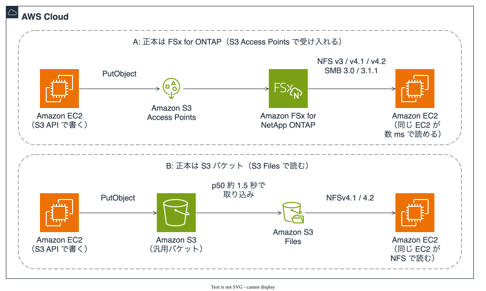

# S3 Access Points で書いたファイルを NFS で読むまで、NFS の版と属性キャッシュでどれだけ違うか

## 結論

Amazon FSx for NetApp ONTAP（以下 FSx for ONTAP）のボリュームに付けた S3 Access Points へ `PutObject` したファイルを、同じボリュームを NFS でマウントした EC2 から読むまでの時間を、NFSv3、NFSv4.1、NFSv4.2 で測りました（2026-11-25、ap-northeast-1、各 30 回）。

- 新しいキーへ書いたファイルは、どの版でも `stat` が p50 0.4〜3.3 ms で成功し、64 B の中身は p50 1.5〜8.0 ms で読めました。版による差より、属性キャッシュの設定（既定か `actimeo=0` か）による差の方が大きく出ました
- 既存のファイルを `PutObject` で上書きすると、NFS で新しい中身が読めるまで p50 1.5〜4.6 ms でした。既定の属性キャッシュのままでも、ファイルを開き直す読み方なら遅れは見えませんでした
- 例外が 1 回ありました。NFSv3 の既定のマウントで、まだ存在しないディレクトリの下に最初に書いたファイルが、見えるまで 27.9 秒かかりました。存在しないという結果がクライアントのキャッシュに残ったためと考えています（未確認）
- `PutObject` で書いたファイルの所有者は、NFSv3 で `0:1`、NFSv4.1 / 4.2 で `0:2`、モードはどれも `644` でした

## 背景

S3 API でデータを受け入れ、ファイルとして読む構成には、正本の置き場所で 2 つの形があります。正本を FSx for ONTAP のボリュームに置いて S3 Access Points で受け入れる形と、正本を S3 のバケットに置いて Amazon S3 Files で読む形です。後者の反映の待ちは、S3 API で書いてファイルで読めるまで p50 約 1.5 秒でした（[S3 Files の実測記録](https://github.com/Yoshiki0705/S3-Burst-on-ONTAP-Files/blob/main/docs/ja/verification/s3files-measured.md)、2026-09-01）。前者は NFSv3 で p50 3 ms の記録があり（[書いた側と読む側が違うと、見えるまでの時間は方向で決まる](how-long-until-a-write-is-visible.md)）、NFSv4.x は測っていませんでした。このノートは、前者を NFS の版ごとに測った記録です。

図の内容は本文の表と同じです（[暗い背景の版](../../../../_assets/images/s3api-in-files-out-ab-dark.svg)、[English](../../../../_assets/images/s3api-in-files-out-ab-en.svg)）。

## 詳細

### 新しいキーへの `PutObject` から読めるまで

時間は `PutObject` の API 完了から、同じ EC2 で読めるまでです。10 ms ごとに確かめました。「stat」は `stat` が成功するまで、「中身」は読んだファイルの SHA-256 が書いた内容と一致するまでです。p50 と p90 は、30 回の値を小さい順に並べて 15 番目と 27 番目です。30 秒のタイムアウトは 0 件でした。単位は ms です。

| NFS | 属性キャッシュ | 大きさ | stat（p50 / p90 / max） | 中身（p50 / p90 / max） |
|---|---|---|---|---|
| v3 | 既定 | 64 B | 0.4 / 0.4 / 27,915.4 | 1.6 / 1.7 / 27,916.4 |
| v3 | 既定 | 8 MiB | 0.4 / 0.5 / 1.1 | 38.1 / 39.5 / 46.9 |
| v3 | `actimeo=0` | 64 B | 3.2 / 3.4 / 4.6 | 7.5 / 7.9 / 18.2 |
| v3 | `actimeo=0` | 8 MiB | 3.2 / 3.5 / 4.2 | 44.3 / 45.4 / 46.7 |
| v4.1 | 既定 | 64 B | 0.4 / 0.5 / 2.7 | 1.5 / 1.6 / 4.2 |
| v4.1 | 既定 | 8 MiB | 0.4 / 0.5 / 1.0 | 38.0 / 38.8 / 41.5 |
| v4.1 | `actimeo=0` | 64 B | 3.2 / 3.3 / 3.4 | 7.8 / 8.1 / 8.2 |
| v4.1 | `actimeo=0` | 8 MiB | 3.2 / 3.4 / 3.9 | 43.8 / 44.7 / 44.9 |
| v4.2 | 既定 | 64 B | 0.4 / 0.5 / 2.9 | 1.5 / 1.6 / 4.0 |
| v4.2 | 既定 | 8 MiB | 0.4 / 0.5 / 0.9 | 37.9 / 38.8 / 40.1 |
| v4.2 | `actimeo=0` | 64 B | 3.3 / 3.4 / 3.5 | 8.0 / 8.2 / 8.5 |
| v4.2 | `actimeo=0` | 8 MiB | 3.3 / 3.4 / 3.7 | 44.5 / 45.2 / 46.5 |

- 8 MiB の「中身」の約 38〜45 ms は、8 MiB を NFS で読み出して SHA-256 を計算する時間を含みます
- `actimeo=0` では、`stat` のたびにクライアントがサーバーへ属性を問い合わせるので、`stat` が約 3 ms 長くなったと考えています（未確認）
- NFSv3 の既定のマウントで 64 B の max が 27,915.4 ms になったのは、30 回のうち最初の 1 回だけです。この 1 回は、まだ存在しないディレクトリ（`s3fa/`）の下に書いた最初のファイルでした。2 回目以降の p90 は 0.4 ms です。同じ症状は、別のディレクトリに最初に書いたファイルでも 1 回出ました（下の所有者の表）

### 既存のファイルの上書き

既存のファイル（64 B）を NFS で一度読んでから、同じキーへ `PutObject` で上書きし、NFS で新しい中身が読めるまでを測りました（各 30 回、タイムアウト 120 秒、タイムアウトは 0 件）。単位は ms です。

| マウント | p50 / p90 / max |
|---|---|
| v3 既定 | 1.7 / 2.0 / 2.0 |
| v3 `actimeo=0` | 4.3 / 4.5 / 5.6 |
| v4.1 既定 | 1.5 / 1.6 / 1.7 |
| v4.1 `actimeo=0` | 4.5 / 4.6 / 5.2 |
| v4.2 既定 | 1.5 / 1.6 / 1.6 |
| v4.2 `actimeo=0` | 4.6 / 5.0 / 6.3 |

測定は読むたびにファイルを開き直しました。NFS のクライアントは、ファイルを開くときに属性を確かめ直す（close-to-open の一貫性）ので、既定の属性キャッシュでも遅れが見えなかったと考えています（未確認）。ファイルを開いたまま読み続けるアプリでは、属性キャッシュの期間だけ古い中身が見える可能性があります。測っていません。

### 所有者とモード

| マウント | `stat` の所有者とモード |
|---|---|
| v3 既定 | 30 秒以内に見えず取得できなかった。別の 1 件で `0:1 644` |
| v3 `actimeo=0` | `0:1 644` |
| v4.1 既定、v4.1 `actimeo=0` | `0:2 644` |
| v4.2 既定、v4.2 `actimeo=0` | `0:2 644` |

Access Point のファイルシステムユーザーは UNIX の root です。所有者は root（0）になり、グループは NFSv3 で 1、NFSv4.x で 2 に見えました。同じファイルを版の違うマウントで見たときにグループが違う理由は、確かめていません。グループで権限を分けるアプリは、版ごとに実機で確かめてください。

### 設計への含意

| 気にすること | 対処 |
|---|---|
| 新しいディレクトリへ S3 API で書き始めた直後に、ファイルが見えない | 読む側のマウントの属性キャッシュが、存在しないという結果を持っている可能性があります。ディレクトリを先に作っておくか、読む側で `actimeo=0` や `lookupcache=positive` を検討します（`lookupcache` は測っていません） |
| 上書きを確実に読みたい | ファイルを開き直して読みます。開いたまま読み続ける場合は、属性キャッシュの期間を短くします |
| `actimeo=0` の費用 | `stat` が約 3 ms 長くなり、サーバーへの問い合わせが増えます。全部のマウントに付けず、反映を待つ必要のある読み手だけに付けます |

> **区分**: 時間と所有者は、下の環境で 2026-11-25 に測った値です。性能の測定ではなく、本番の値を保証するものではありません。

## 検証環境

| 項目 | 値 |
|---|---|
| ONTAP バージョン | 9.19.1P4D1 |
| リージョン | ap-northeast-1 |
| 構成 | FSx for ONTAP 第 1 世代 `SINGLE_AZ_1`、128 MBps。UNIX セキュリティスタイルのボリュームに S3 Access Points を付けた。ネットワークオリジンはインターネット、ファイルシステムユーザーは UNIX の root。SVM の NFS は v3、v4.0、v4.1、v4.2 が有効 |
| クライアント | EC2（ap-northeast-1a）、Amazon Linux 2023、カーネル 6.18.62、nfs-utils 2.5.4、boto3 1.40.31。`PutObject` と NFS の読み取りは同じ EC2 で、同じ時計を使った |
| マウント | NFSv3、NFSv4.1、NFSv4.2 を、既定のオプションと `actimeo=0` の 6 通り。共通の実効値は `rsize=65536,wsize=65536,hard,proto=tcp,timeo=600,retrans=2,sec=sys` |
| 検証日 | 2026-11-25 |

> **注意**: 上記はこの環境での実測であり、一般的なサービス上限や本番環境での再現を
> 保証するものではありません。

## 自環境での確認手順

| # | 手順 | 確認できること |
|---|---|---|
| 1 | 読む側のマウントで `grep <マウントポイント> /proc/mounts` を見る | NFS の版と、属性キャッシュの実効値 |
| 2 | `aws s3api put-object --bucket <Access Point のエイリアス> --key new-dir/a.bin --body a.bin` の後、NFS のマウントで `stat new-dir/a.bin` を繰り返す | 新しいディレクトリの下に書いたファイルが見えるまでの時間 |
| 3 | 同じキーへ別の中身で `put-object` し、NFS で `sha256sum` を繰り返す | 上書きが見えるまでの時間 |

適用手順の全体像は [本番に取り入れる前の確認](../../../evidence-policy.md#本番に取り入れる前の確認) を参照してください。

## よくある誤解

| 誤解 | 実際 |
|---|---|
| NFSv4.x にすると、S3 API で書いたファイルが早く見える | 版による差は小さく、属性キャッシュの設定の方が大きく効きました（既定で stat p50 0.4 ms、`actimeo=0` で 3.2〜3.3 ms） |
| 既定の属性キャッシュでは、上書きが数十秒見えない | ファイルを開き直す読み方では、既定でも p50 1.5〜1.7 ms で新しい中身が読めました |
| S3 API で書いたファイルは、すぐに必ず見える | 存在しないディレクトリの下に書いた最初のファイルは、NFSv3 の既定のマウントで約 28 秒見えないことがありました |

## 関連ドキュメント

- [書いた側と読む側が違うと、見えるまでの時間は方向で決まる](how-long-until-a-write-is-visible.md)
- [S3 Files のバケットと FSx for ONTAP のボリュームをサーバー側コピーでつなぐ](s3-files-and-access-points-bridged-by-copy.md)
- [FSx for ONTAP S3 Access Points は S3 として使えるか](s3-access-point-constraints.md)
