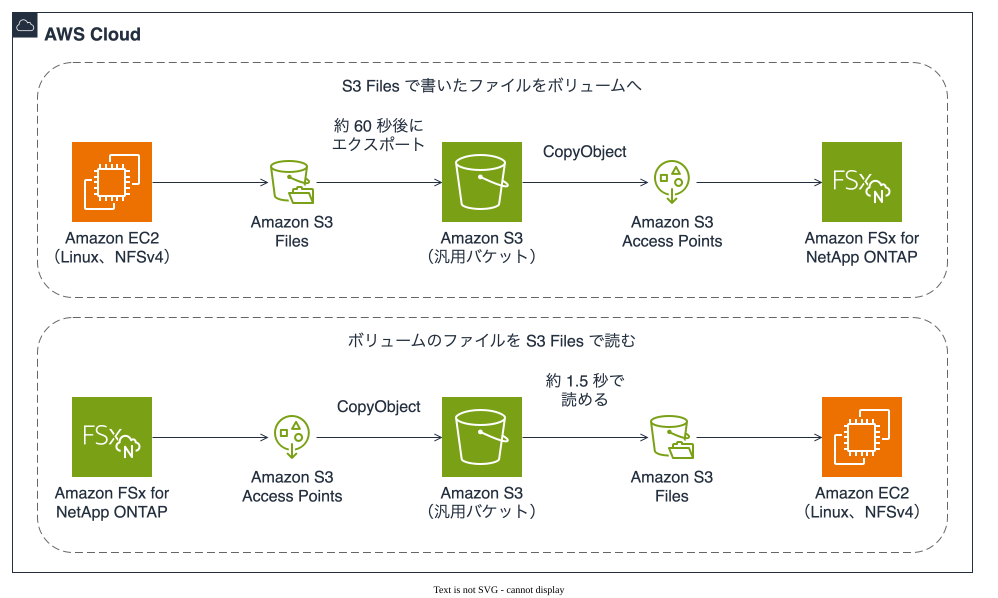

# S3 Files のバケットと FSx for ONTAP のボリュームをサーバー側コピーでつなぐと、何が写り、どれだけ待つか

## 結論

データの正本を Amazon S3 のバケットに置き Amazon S3 Files でファイルとして読む構成と、正本を Amazon FSx for NetApp ONTAP（以下 FSx for ONTAP）のボリュームに置き S3 Access Points で S3 API から読む構成は、S3 Access Points のサーバー側コピーで、選んだファイルだけを行き来させられます。2026-11-25 に東京リージョンで 1 回ずつ（反復は下の表）確かめた結果は次のとおりです。

- ボリュームの Access Point からバケットへ `CopyObject` したファイルは、S3 Files のマウントで p50 約 1.5 秒（64 B）、p50 約 1.1 秒（8 MiB）で読めました
- S3 Files で書いたファイルがバケットに出るまでは p50 約 64 秒で、S3 Files のエクスポートの待ち（約 60 秒）がそのまま乗ります。その後のバケットからボリュームへのコピーにかかった時間は記録していません。逆向き（ボリュームからバケット）の 64 B の `CopyObject` は 21 回とも 0.07〜0.35 秒でした
- ファイルの所有者とモードは、既定では写りません。S3 Files 側では `root:root`、`0644`、FSx for ONTAP 側では Access Point に設定したファイルシステムユーザーになります。バケットへ写すときに S3 Files のメタデータ（`file-owner`、`file-group`、`file-permissions`）を付ければ、S3 Files 側の所有者とモードは指定した値になりました

コピーはファイル単位の複製です。どちらを正本にするかを決め、もう片方は写しとして扱います。

図の内容は下の表と同じです（[暗い背景の版](../../../../_assets/images/s3files-s3ap-copy-bridge-dark.svg)、[English](../../../../_assets/images/s3files-s3ap-copy-bridge-en.svg)）。

## 背景

S3 Files と FSx for ONTAP の S3 Access Points は、どちらも同じデータをファイルと S3 API の両方で扱えます。違いは正本の位置で、S3 Files はバケット、FSx for ONTAP はボリュームです。2026-11 までは、両方を使う組織が一方から他方へファイルを渡すには、クライアントでファイルを読み出して書き直す必要がありました。S3 Access Points のサーバー側コピーで、バケットと Access Point の間をクライアントを通さずに写せるようになりました（[What's New](https://aws.amazon.com/about-aws/whats-new/2026/11/s3-access-points-server-side-copy-fsx/)）。

| 組み合わせ | 正本 | ファイルとして読む | S3 API で読む | 向く場面 |
|---|---|---|---|---|
| 1. FSx for ONTAP と S3 Access Points | ボリューム | NFS（v3、v4.x）、SMB | ボリュームに付けた Access Point | NAS の利用者がいて、同じデータを分析や AI のサービスにも読ませたい |
| 2. S3 バケットと S3 Files | バケット | NFSv4.1 / 4.2（AWS 上の Linux） | バケット | データがすでにバケットにあり、Linux のアプリにファイルとして読ませたい |
| 3. 1 と 2 をサーバー側コピーでつなぐ | 用途ごとに決める | 両方 | 両方 | 2 つの正本の間で、選んだファイルだけを渡したい |

組み合わせ 3 は、1 と 2 の制約をどちらも引き受けます。写しが増えるので、どちらを更新するかの約束と、写しを消す手順が要ります。

## 詳細

### 反映までの時間

時間は、コピーを呼ぶ API の完了から、同じ EC2 で読めるようになるまでです。0.5 秒ごとに確かめたので、値は 0.5 秒刻みに近くなります。タイムアウト（300 秒）は 0 件でした。

| # | 方向 | 大きさ | 存在が見えるまで（p50 / p90 / max） | 中身が一致するまで（p50 / p90 / max） | n |
|---|---|---|---|---|---|
| 1 | Access Point → バケット（`CopyObject`）→ S3 Files で読む | 64 B | 1.516 / 1.517 / 1.517 秒 | 1.568 / 1.575 / 1.623 秒 | 10 |
| 2 | 同上 | 8 MiB | 1.014 / 1.517 / 1.517 秒 | 1.117 / 1.601 / 1.609 秒 | 10 |
| 3 | 同上、`aws s3 cp`（マルチパートのコピー） | 1 GiB | 1.516 秒 | 6.973 秒（読み出しと SHA-256 の計算を含む） | 1 |
| 4 | S3 Files で書く → バケットの `GetObject` で読める | 64 B | p50 63.578 / p90 65.626 / max 65.626 秒 | - | 5 |

- 1 と 2 のコピーの API そのものは、64 B で p50 0.075 秒、8 MiB で p50 0.192 秒でした。1 GiB の `aws s3 cp` は 4.65 秒でした
- 4 の値は、S3 Files のドキュメントにある「60 秒間書き込みがないとエクスポートを始める」（[同期](https://docs.aws.amazon.com/AmazonS3/latest/userguide/s3-files-synchronization.html)）と合います。CloudWatch の `AWS/S3/Files` の `ExportAge`（Maximum）は 61.887〜65.509 秒で、クライアント側の値とほぼ一致しました
- `ImportAge`（Maximum）は 2.01〜6.895 秒でした。`ImportAge` は 1 回ごとの反映時間と対応していないので、1〜3 の対照には使っていません
- 4 で写ったオブジェクトを、バケットからボリュームの Access Point へ `CopyObject` すると、NFS でボリュームを読んだ SHA-256 が 5 件とも一致しました

### 属性の扱い

| 方向 | コピーの指定 | 読んだ側の所有者とモード | 出典 |
|---|---|---|---|
| ボリューム → バケット → S3 Files | 既定（メタデータを写す） | `root:root`、`0644`（コピー元のファイルは 1234:5678、640） | 実測、10 + 10 件 |
| ボリューム → バケット → S3 Files | `--metadata-directive REPLACE --metadata file-owner=1234,file-group=5678,file-permissions=0100640` | `1234:5678`、`0640` | 実測、1 件 |
| S3 Files → バケット → ボリューム | 既定 | NFS の `stat` で `0:1`、`0644`。Access Point に設定したファイルシステムユーザー（UNIX の root）による | 実測、5 件 |

- Access Point の `HeadObject` は、ボリュームのファイルの所有者やモードをメタデータとして返しません。そのため、そのまま写すと S3 Files は、POSIX のメタデータがないオブジェクトの既定値（ファイルは `root:root`、`0644`）を使います（[POSIX permissions in S3 Files](https://docs.aws.amazon.com/AmazonS3/latest/userguide/s3-files-posix-permissions.html)）
- S3 Files がエクスポートしたオブジェクトには、ユーザー定義のメタデータが 8 つ付いていました。`file-owner`、`file-group`、`file-permissions`、`file-mtime`、`file-atime`、`file-btime`、`fs-id`、`user-agent` です。ドキュメントが挙げるのは前の 3 つで、残りは観測した値です
- この 8 つのメタデータは、ボリュームの Access Point へ写した後も `HeadObject` で返りました。ボリュームの UNIX の所有者とモードには反映されません
- 所有者とモードを保つ必要があるファイルは、写す前にコピー元の `stat` を記録し、バケットへ写すときに上の 3 つのメタデータを付けます。ボリュームへ写す方向では、写した後に NFS で付け直すか、属性を保つ方法（rsync、AWS DataSync）を使います

### 組み合わせの選び方

| 手元の状況 | 素直な組み合わせ | 引き受けること |
|---|---|---|
| NAS の利用者（SMB、NFSv3）がいて、同じデータを S3 API のサービスにも読ませたい | 1 | 正本はボリューム。S3 API の機能は Access Point の対応表の範囲（[FSx for ONTAP S3 Access Points は S3 として使えるか](s3-access-point-constraints.md)） |
| データがバケットにあり、AWS 上の Linux から NFSv4 で読みたい | 2 | バケットにバージョニングが必須。ファイル側の書き込みがバケットに出るまで約 60 秒 |
| データレイクのバケットから、NAS の利用者に選んだファイルだけを渡したい | 3（バケット → Access Point） | 所有者はコピー先の Access Point のユーザーになる。渡した後の更新はどちらが正本かを決める |
| NAS の成果物を、S3 Files を使う Linux のアプリに渡したい | 3（Access Point → バケット） | 所有者とモードを保つには、S3 Files のメタデータを付けて写す |
| 同じデータを両方から常に更新したい | どれも合わない | コピーは同期ではありません。片方を正本にし、もう片方は読むだけにします |

> **区分**: 時間と属性は、下の環境で 2026-11-25 に測った値です。S3 Files の機能、メタデータのキー、エクスポートの待ちの記載は AWS のドキュメントに基づきます（2026-11-25 に閲覧）。性能の測定ではなく、本番の値を保証するものではありません。

## 検証環境

| 項目 | 値 |
|---|---|
| リージョン | ap-northeast-1 |
| 検証日 | 2026-11-25（UTC） |
| コピー元のボリューム | FSx for ONTAP 第 1 世代 `SINGLE_AZ_1`、128 MBps、ONTAP 9.19.1P4、UNIX セキュリティスタイル。Access Point のネットワークオリジンはインターネット、ファイルシステムユーザーは UNIX の root |
| コピー先のボリューム | 別の FSx for ONTAP 第 1 世代 `SINGLE_AZ_1`、128 MBps。Access Point の設定は同上 |
| S3 Files | 新しく作った汎用バケット（バージョニング有効、SSE-S3）の全体をスコープにしたファイルシステム。同期設定は既定（`ON_DIRECTORY_FIRST_ACCESS`、`sizeLessThan` 131072、`daysAfterLastAccess` 30） |
| クライアント | EC2 `t3.large`、Amazon Linux 2023（カーネル 6.18.62）、`amazon-efs-utils` 4.0.0、AWS CLI 2.38.0。S3 Files は NFSv4.2（属性キャッシュ 0 秒）、FSx for ONTAP は NFSv3 でマウント |
| 測り方 | コピーの API と読み取りを同じ EC2 で実行。0.5 秒ごとに確認、タイムアウト 300 秒 |

> **注意**: 上記はこの環境での実測であり、一般的なサービス上限や本番環境での再現を
> 保証するものではありません。ディレクトリへの初回アクセスの直後や、高性能ストレージから期限切れになったファイルの反映は測っていません。

## 自環境での確認手順

| # | 手順 | 確認できること |
|---|---|---|
| 1 | `aws s3api copy-object --bucket <S3 Files のバケット> --key check/a.bin --copy-source <Access Point のエイリアス>/check/a.bin` の後、S3 Files のマウントで `stat` と `sha256sum` を繰り返す | 写したファイルが読めるまでの時間と、所有者とモードの既定値 |
| 2 | 同じコピーに `--metadata-directive REPLACE --metadata file-owner=<uid>,file-group=<gid>,file-permissions=0100640` を付ける | S3 Files 側の所有者とモードが指定どおりになるか |
| 3 | S3 Files のマウントでファイルを書き、`aws s3api get-object` が成功するまでの時間を測る。その後、Access Point へ `copy-object` し、ボリュームを NFS で `stat` する | エクスポートの待ちと、ボリューム側の所有者 |

適用手順の全体像は [本番に取り入れる前の確認](../../../evidence-policy.md#本番に取り入れる前の確認) を参照してください。

## よくある誤解

| 誤解 | 実際 |
|---|---|
| サーバー側コピーで、S3 Files とボリュームの間を同期できる | コピーは 1 回ごとのファイルの複製です。変更を追い続ける仕組みはありません |
| ボリュームから写したファイルは、S3 Files でも元の所有者とモードになる | 既定では `root:root`、`0644` になりました。S3 Files のメタデータを付けて写すと指定した値になります |
| S3 Files が付けたメタデータは、ボリュームへ写すと UNIX の属性になる | オブジェクトのメタデータとしては残りますが、NFS で見る所有者とモードは Access Point のファイルシステムユーザーで決まります |
| S3 Files で書いたファイルはすぐにボリュームへ写せる | バケットに出るまで約 60 秒かかります。写すのはその後です |
| S3 Files で編集中のファイルにバケット側から上書きコピーしても、編集は残る | S3 Files はバケットを正として扱い、編集中のファイルを `.s3files-lost+found-<ファイルシステム ID>` へ移します（[同期](https://docs.aws.amazon.com/AmazonS3/latest/userguide/s3-files-synchronization.html)）。S3 Files で編集するプレフィックスと、コピーで書き込むプレフィックスを分けます |

## 関連ドキュメント

- [S3 Access Points のサーバー側コピーは、どの用途で使い、どの用途で使わないか](s3-access-points-server-side-copy-use-cases.md)
- [書いた側と読む側が違うと、見えるまでの時間は方向で決まる](how-long-until-a-write-is-visible.md)
- [FSx for ONTAP S3 Access Points は S3 として使えるか](s3-access-point-constraints.md)
- [ファイルストレージの選択肢の比較](../../../reference/comparison/file-storage-options.md)
- [S3 Files と S3 Burst on ONTAP Files の比較検証（S3-Burst-on-ONTAP-Files）](https://github.com/Yoshiki0705/S3-Burst-on-ONTAP-Files/blob/main/docs/ja/verification/s3files-vs-flexcache.md)
