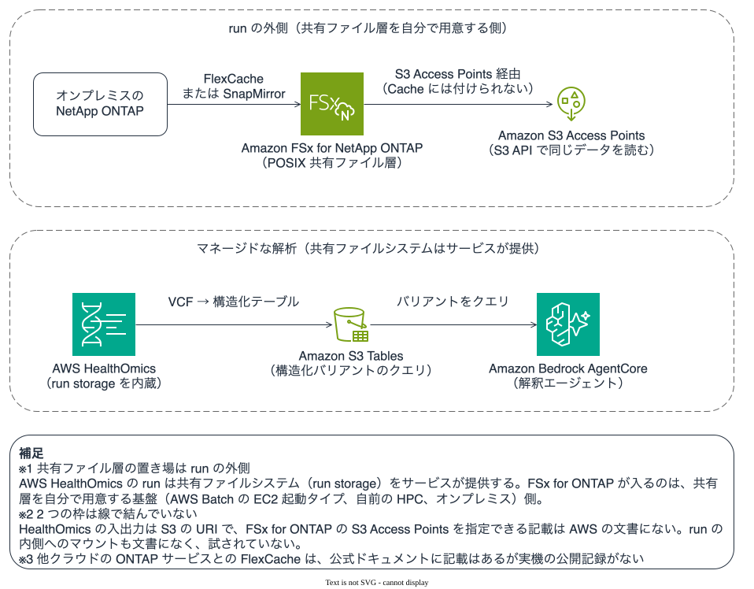

# ゲノム・HPC パイプラインのデータはどこに置かれるか

AWS HealthOmics の Sequence Store、Amazon S3、POSIX 共有ファイルシステムは役割が別です。オブジェクトストアは中間解析の共有層を置き換えません。

## このノートで学べること

- ゲノム二次解析の 3 つのデータ置き場（Sequence Store / S3・S3 Tables / POSIX 共有ファイルシステム）の役割の違い
- サーバーレスな実行基盤（AWS HealthOmics / AWS Batch）を選んでも、POSIX 共有ファイル層が要るかどうかはワークロードの形で別に決まること
- FSx for ONTAP がこの図のどこに入り、どの公開事例が同じ形を採っているか

## このノートが答えないこと

- HealthOmics のワークフロー課金や Sequence Store の階層別ストレージ料金の具体額
- FASTQ / BAM / VCF の具体的なサイズとパイプライン実行時間の実測値（二次解析の性能は[別ノート](../../performance/notes/where-throughput-is-determined-and-shared.md)とワークロード依存）

## 前提レベル

intermediate

## 本文

[🏠 リポジトリトップ](../../../../../README.md) | [Domain — データ活用](../README.md)

---

### 結論

**ゲノムやロングリードの二次解析パイプラインでは、データが役割の違う 3 か所に分かれて置かれます。** どれか 1 つに寄せられるものではありません。

| 置き場 | 役割 | アクセスの形 |
|---|---|---|
| **マネージドなシーケンスストア**（AWS HealthOmics Sequence Store など） | 生のシーケンスデータ（FASTQ / BAM / CRAM）を長期にコスト最適に保管し、ワークフローへ取り込ませる | サービス API 経由の取り込み・参照。**POSIX のファイルパスでマウントして読むものではありません** |
| **オブジェクトストア**（Amazon S3 / S3 Tables） | ワークフローの入出力（BAM / VCF）と、構造化したバリアントのクエリ対象 | S3 API。VCF を S3 Tables に変換するとコホート横断のクエリ性能が上がります |
| **POSIX 共有ファイルシステム**（FSx for ONTAP など） | 複数ホストが同時に読み書きする中間成果物、参照ゲノムやアノテーション DB、ツールが POSIX の入出力を前提とする工程 | NFS / SMB でマウント。複数ホストから同じパスが見えます |

**ここで取り違えやすいのは、マネージドなオブジェクトストアを導入すると共有ファイルシステムが不要になる、という読み方です。** 実際には役割が別で、**同じパイプラインの中で両方が要る場面があります。** Sequence Store は保管と取り込みの層で、解析ツールが数十キロ塩基のロングリードを POSIX のパスで読み書きする工程は別の層です。

> **Evidence**: `documented` — Sequence Store・ワークフロー・S3 Tables の役割は AWS HealthOmics の公式ドキュメントと AWS 公開ブログの記載に基づきます（2026-11-02 に確認）。**FASTQ / BAM / VCF のサイズや実行時間の実測値は含みません。** FSx for ONTAP を中間共有層に置く構成は、公開事例の構成を引いていますが、このリポジトリでの再現実測ではありません。

---

### サーバーレスな実行基盤での共有ファイル層の要否

AWS HealthOmics や AWS Batch のように、実行基盤の仮想マシンを運用者が意識しない形でも HPC 寄りのワークロードは動きます。**この「サーバーレス的に扱える」ことと、「POSIX 共有ファイル層が要らない」ことは別です。**

**共有ファイル層が要るかどうかは、実行基盤の種類ではなく、ワークロードの形で決まります。** 判断軸は 3 つです。

| 軸 | 共有ファイル層を経由する側 | オブジェクトストアで足りる側 |
|---|---|---|
| **複数ホストが同じデータを同時に読み書きするか** | する（例: 参照ゲノムを多数のジョブが同時参照、中間成果物を次工程が読む） | 各ジョブが独立にオブジェクトを取得して完結する |
| **ツールが POSIX の入出力を前提とするか** | する（多くのバイオインフォ / CAE / レンダリングツールはファイルパスとランダムアクセスを前提） | S3 SDK / オブジェクト API に対応している |
| **ファイルが大きく、ランダムアクセスや追記があるか** | ある（BAM のインデックス参照、レンダリングの中間フレーム） | 書いたら読むだけ（write-once-read-many） |

**3 つのどれかで左側に当たるなら、実行基盤がサーバーレスでも POSIX 共有ファイルシステムが要ります。** このとき FSx for ONTAP が中間共有層の候補になります。逆に 3 つとも右側なら、S3 と Sequence Store で完結し、共有ファイルシステムは要りません。

**どの形に当たるかを判断する決定木**は [AI・HPC ワークロードのデータ層に FSx for ONTAP を経由させるかを決める](../../../reference/decision-trees/ai-workload-data-layer.md) にあります。このノートは「3 か所に分かれる」という事実を示し、決定木が「自分はどこに当たるか」を引きます。

---

### FSx for ONTAP が入る位置

図 1: ゲノム・HPC パイプラインのデータが置かれる 3 層と、FSx for ONTAP が受け持つ POSIX 共有ファイル層。

**FSx for ONTAP が入るのは中間の共有ファイル層です。** シーケンスデータの長期保管は Sequence Store、構造化バリアントのクエリは S3 Tables が担い、その間で**複数ホストが POSIX で同時に触る中間成果物・参照 DB・ツールの作業領域**を FSx for ONTAP が受け持ちます。

**オンプレミスのシーケンサー施設や解析環境を持っている場合**は、ここに ONTAP のデータモビリティが重なります。オンプレミスの NetApp ONTAP を Origin、FSx for ONTAP を Cache にした FlexCache、または SnapMirror による複製で、**データを全量コピーせずにクラウドの解析環境へ届けられます。** 手段ごとの権限・管理経路・制約は [コピーを増やさずにデータへ届く](reaching-data-without-copies.md#コピーを増やさない-3-つの手段) にあります。ここでは機構を再説明しません。

**ただし他クラウドの ONTAP ベースサービス（Google Cloud NetApp Volumes, Azure NetApp Files）を Origin にした FlexCache 構成は、このリポジトリでは未確認です。** クロスクラウドのデータモビリティで引ける範囲と引けない範囲は [クロスクラウド分析でコピーを増やさない](cross-cloud-analytics-without-extra-copies.md) に分けて書いています。

---

### 同じ形を採っている公開事例

**以下は「シーケンス/HPC の解析で ONTAP または FSx for ONTAP が使われている」公開事例です。** 構成や数値は各組織が同意した範囲の記載で、ONTAP バージョン・リージョン・構成は明記されていないことが多いので、設計の根拠にする前に自環境で測ってください。

| 領域 | 事例 | この図での位置づけ |
|---|---|---|
| ライフサイエンス（データファブリック） | [AstraZeneca](https://www.netapp.com/customers/astrazeneca-data-fabric-case-study/) | 研究データをオンプレミスとクラウドにまたいで扱うデータファブリック。中間共有層とデータモビリティ |
| ハイブリッド HPC（研究） | [研究データを動かさずに HPC をクラウドへ拡張する](https://www.netapp.com/ja/blog/hybrid-hpc/) | 理研チームらが FlexCache でオンプレミスの研究データを Origin、クラウドを Cache にした技術検証。**まさに「データを動かさず HPC をクラウドへ」の形** |
| 生成 AI（研究・ライフサイエンス） | [NetApp と AWS — 広島大学との実証実験](https://www.netapp.com/ja/blog/hiroshima-university-aws-genai-2/) | 大学の研究データを FSx for ONTAP に置き、生成 AI から利用 |
| ハイブリッド ML 推論 | [Hybrid ML inferencing on Amazon EKS with Amazon FSx for NetApp ONTAP and on-premises NetApp](https://aws.amazon.com/blogs/storage/hybrid-ml-inferencing-on-amazon-eks-with-amazon-fsx-for-netapp-ontap-and-on-premises-netapp/) | オンプレミスの ONTAP と FSx for ONTAP をまたいだ ML 推論。モデル・特徴量の共有層 |
| EDA / 半導体（HPC） | [Arm](https://aws.amazon.com/solutions/case-studies/arm-ltd-case-study/) / [NetApp: Optimize HPC workloads on AWS](https://www.netapp.com/blog/optimize-hpc-aws-scalable-storage/) | 高度に並列な HPC ジョブが同じストレージを同時に叩く。中間共有層の典型 |
| CAE / CFD（HPC） | [FSx for ONTAP と SOCA による製品エンジニアリング](https://aws.amazon.com/blogs/industries/the-business-and-engineering-benefits-of-fsx-for-netapp-ontap-for-product-engineering-workloads/) / [3D シミュレーションの生産性](https://www.netapp.com/blog/3d-simulation-ontap/) | シミュレーションの入出力を共有ファイルシステムに置く。Scale-Out Computing on AWS（SOCA）と組み合わせた HPC |
| seismic（HPC） | [Petrobras が EC2 Spot で HPC のコストと容量を最適化](https://aws.amazon.com/jp/blogs/news/petrobras-optimizes-cost-and-capacity-of-hpc-applications-with-amazon-ec2-spot-instances/) / [upstream ワークロード](https://aws.amazon.com/jp/blogs/storage/enhance-your-upstream-workloads-with-amazon-fsx-for-netapp-ontap/) | 地震探査データの大規模並列処理。共有ファイルシステムが前提 |
| レンダリング / VFX | [映画『すずめの戸締まり』を支えた FSx for ONTAP（コミックス・ウェーブ・フィルム）](https://www.netapp.com/customers/cwf-case-study/) / [CGWorld の制作データ管理記事](https://cgworld.jp/article/202304-cgw294-szmdata.html) | ハイブリッドクラウドレンダリング。多数のレンダリングノードが中間フレームを同時に読み書きする共有層に FSx for ONTAP |

**レンダリングと EDA と seismic を同じ表に並べているのは理由があります。** どれも「多数のホストが同じ共有ファイルシステムを同時に叩く、大量ファイルの HPC」という**同じワークロードの形**で、だから同じ置き方になります。**自分の業種が表に無くても、形が近い行が参考になります。** 業種からの入口は [業種別リソースマップ](../../../reference/industry-resource-map.md) にあります。

---

### よくある誤解

| 誤解 | 実際 |
|---|---|
| マネージドなシーケンスストアを使えば共有ファイルシステムは要らない | **役割が別です。** 保管・取り込みの層と、POSIX で中間成果物を同時に触る層は別で、同じパイプラインで両方要ることがあります |
| 実行基盤がサーバーレス（HealthOmics / AWS Batch）なら POSIX 共有層は不要 | **要否は実行基盤ではなくワークロードの形で決まります。** 複数ホスト同時・POSIX 前提・大きいファイルのランダムアクセスのどれかに当たれば要ります |
| VCF は S3 に置けばよい | 長期保管とコホート横断クエリは S3 / S3 Tables が向きますが、**解析ツールが POSIX で触る中間 VCF は共有ファイルシステム側です** |
| オンプレのシーケンサーデータはクラウドへ全量コピーするしかない | FlexCache（必要分だけ取得）や SnapMirror（複製）で全量コピーを避けられます（[3 つの手段](reaching-data-without-copies.md#コピーを増やさない-3-つの手段)） |
| 他クラウドの ONTAP サービスを Origin にした FlexCache も同じように組める | **このリポジトリでは未確認です**（[クロスクラウドのノート](cross-cloud-analytics-without-extra-copies.md)） |

---

### 関連ドキュメント

- [Domain — データ活用](../README.md) — このモジュールのハブ
- [AI・HPC ワークロードのデータ層に FSx for ONTAP を経由させるかを決める](../../../reference/decision-trees/ai-workload-data-layer.md) — 自分がどの形に当たるかを引く決定木
- [コピーを増やさずにデータへ届く](reaching-data-without-copies.md) — FlexCache / FlexClone / SnapMirror の機構・権限・制約
- [クロスクラウド分析でコピーを増やさない](cross-cloud-analytics-without-extra-copies.md) — クロスクラウド・クロスリージョンでの引ける範囲と未確認の境界
- [スループットは 1 つの設定値では決まらない](../../performance/notes/where-throughput-is-determined-and-shared.md) — 共有ファイル層の性能が何で決まるか
- [業種別リソースマップ](../../../reference/industry-resource-map.md) — 業種とワークロードの形からの入口
- [知見の分類ポリシー](../../../evidence-policy.md)

---

[🏠 リポジトリトップ](../../../../../README.md) | [Domain — データ活用](../README.md)
