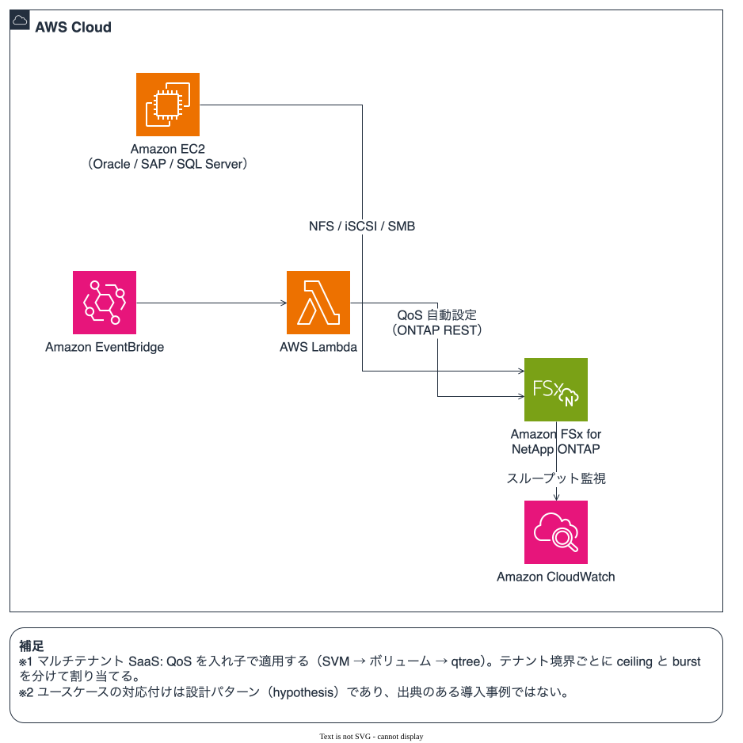
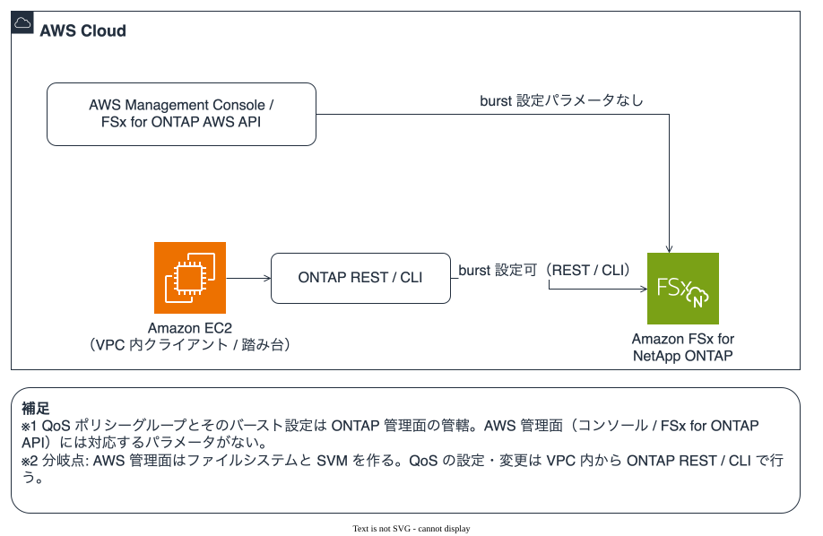

# QoS の上限とバーストは、どのワークロードに効くのか？

スループット上限（QoS ceiling）とバーストは、競合するワークロードを隔離し、短時間のスパイクを恒久的な増設なしに吸収するための手段です。どのワークロードに当てはめるか、そして上限を設ける他の手段とどう選び分けるかを整理します。

## このノートで学べること

- QoS の上限とバーストが、どの種類のワークロードのどの局面に当てはまるか。
- バーストのデフォルト値を変える（ONTAP 9.19.1 以降）ことが、用途ごとにどう効くか。
- 上限を設ける手段は QoS だけではないこと。他の手段との選び分けの観点。

## このノートが答えないこと

- 特定の利用者環境での導入事例そのもの（本ノートの用途マッピングは設計パターンであり、出典のある導入事例ではありません。区分を本文で明示します）。
- 各ワークロードでの具体的な上限値・バースト値の推奨（環境ごとに測って決める領域です）。
- QoS がアプリケーション全体のコストに与える影響の定量。

## 前提レベル

intermediate

## 本文

[🏠 リポジトリトップ](../../../../../README.md) | [Domain — 性能](../README.md)

---

### 結論

**QoS の上限は「あるワークロードが他を圧迫しないようにする」ための手段で、バーストは「短時間のスパイクを恒久増設なしに吸収する」ための緩衝です。** どちらも、複数のワークロードやテナントが 1 つのファイルシステムを共有するときに効きます。

**バーストのデフォルト値を変えられるようになった（ONTAP 9.19.1 以降、Amazon FSx for NetApp ONTAP でも可。[検証録](qos-burst-defaults-are-user-modifiable.md)）ことで、「上限の超え方」を用途に合わせて調整できます。** 上限そのものに加えて、超過の幅・持続時間・絶対量という緩衝の形を選べます。

> **区分**: この節の QoS の役割（ノイジーネイバーの隔離、競合がなくても一定量を超えさせない用途）は `documented` です。出典は [AWS: Using Quality of Service in Amazon FSx for NetApp ONTAP](https://aws.amazon.com/blogs/storage/using-quality-of-service-in-amazon-fsx-for-netapp-ontap/)。用途への当てはめ（どのワークロードにどう効くか）の多くは `hypothesis`（設計上の想定、未検証）で、本文で都度明示します。

図 1: QoS の上限とバーストが当てはまる AWS 連携のパターン（連携は設計上の想定を含みます）

---

### 上限とバーストが効く局面

**QoS の上限が効くのは、1 つのファイルシステムを複数のワークロードが共有する場面です。** `documented`: AWS は、QoS がノイジーネイバーを避けつつマルチワークロード／マルチテナントのファイルシステムを実現できること、競合がなくてもワークロードが一定量を超えないようにできることを挙げています（上記出典）。

**バーストが効くのは、定常は上限内で足りるが、起動・切り替えの瞬間だけ跳ねるワークロードです。** `documented`: データベースの起動や多数の VM のブートのような一時的なスパイクを、恒久的な容量増設なしに吸収するのがバーストの役割だと NetApp は説明しています（[ONTAP QoS throughput guarantee](https://docs.netapp.com/us-en/ontap/performance-admin/guarantee-throughput-qos-task.html)）。

**マルチテナントでは、ネストした QoS で階層的に上限を割り振れます。** `documented`: ONTAP 9.18.1 以降、SVM とその配下のボリューム・qtree の両方にポリシーを割り当てられ、最も厳しいものが適用されます（[QoS policy group assignment restrictions](https://docs.netapp.com/us-en/ontap/performance-admin/policy-group-assignment-restrictions.html)）。SVM 全体の上限をテナントのボリュームへ細分する設計に使えます。階層のどこにバーストを設定しても、実効の超過は最も厳しい ceiling に縛られます。

---

### 用途ごとの当てはめ

**次の表は設計パターンであり、出典のある導入事例ではありません。** ワークロードが FSx for ONTAP の対象として挙げられていること（`documented`）と、そこへバーストをどう当てはめるか（`hypothesis`）を分けています。

| ワークロード | 上限とバーストの当てはめ | ワークロードの区分 | 当てはめの区分 |
|---|---|---|---|
| Oracle / SQL Server / SAP（Amazon EC2 上、NFS / iSCSI / SMB 接続） | バッチ・レポート系に上限を設け、OLTP に帯域を残す。DB 起動時のスパイクはバーストで吸収 | documented（対象ワークロード） | hypothesis（当てはめ） |
| VMware（Amazon EC2 上）のデータストア | ブートストーム時のスパイクをバーストで、クラスタ単位の上限で隔離 | hypothesis | hypothesis |
| VDI（Amazon EC2 上の基盤） | ログインストームのバースト、プール単位の上限で公平性 | hypothesis | hypothesis |
| EDA（半導体設計）グリッド | 共有ファイルシステムでプロジェクトチーム単位に上限、コンパイル時のスパイクをバースト | documented（対象ワークロード） | hypothesis（当てはめ） |
| SaaS マルチテナント（1 ファイルシステム、SVM / qtree で分離） | ネスト QoS で上限を階層化し、テナントごとにバーストの形を変えて SLA 階層を表現 | documented（SaaS 用途 + ネスト QoS） | hypothesis（バースト階層） |

**バーストのデフォルト値変更が効くのは、この「当てはめ」の調整幅です。** 上限を固い壁に近づけたい（厳格な従量・チャージバック）なら burst-percent を下げ、起動スパイクを長く許したい（レイテンシに敏感なバースト型）なら burst-duration を延ばす、という調整が、ONTAP 9.19.1 以降は可能です（[検証録](qos-burst-defaults-are-user-modifiable.md)）。これらは `hypothesis`（設計上の想定）です。

---

### 連携する AWS サービス

**上限とバーストは、周辺の AWS サービスと組み合わせて運用します。** 次はいずれも仕組みとしては成立する組み合わせ（`hypothesis`、ただし各サービスの役割自体は `documented`）です。

| 連携 | 役割 |
|---|---|
| Amazon CloudWatch（FSx for ONTAP メトリクス） | スループットの時系列を監視し、上限に当たっているかを見る。ただしバースト専用のメトリクスはなく、スループットの時系列から読み取ります |
| ONTAP REST API 自動化（AWS Lambda / Amazon EventBridge） | プロビジョニング時にテナントごとの上限・バーストを自動設定。設定経路は ONTAP REST（[検証録](qos-burst-defaults-are-user-modifiable.md)） |
| AWS DataSync / SnapMirror によるデータ取り込み | 取り込み・複製が本番の読みを圧迫しないよう上限を設け、追いつきの時間帯だけバーストで緩める |

**ネイティブの CloudWatch メトリクスには QoS ポリシーグループを名指しする次元がありません。** ポリシーグループ単位・ワークロード単位で QoS を監視したい場合の経路は、[FSx-for-ONTAP-Observability-integrations](https://github.com/Yoshiki0705/FSx-for-ONTAP-Observability-integrations/blob/main/docs/ja/monitoring-design.md#ポリシーグループ単位の-qos-監視) が提供する counter manager → Lambda → CloudWatch のカスタムメトリクス収集です。ONTAP の counter manager をポーリングし、ワークロード単位の `FSxONTAP/QoS` メトリクスを公開します。実装の詳細（収集するカウンター、累積生値からレートを出す扱い）は Spoke 側が持ちます。ここでは「誰に効くか・いつ効くか」を扱い、実装は Spoke を引きます。

> **監視に関する補足**: バースト専用のカウンターは ONTAP になく、収集するのは実効スループット / IOPS です。「上限に張り付いている」は見えますが、「いま実際にバーストしている」は時系列から推定するもので、直接は測れません（Spoke のライブ検証、ONTAP 9.19.1P2）。

図 2: バースト設定の二面管理面（AWS 管理面には対応パラメータがなく、ONTAP 管理面から設定する）

---

### 上限を設ける他の手段との選び分け

**ワークロードを隔離し上限を設ける手段は、QoS だけではありません。** それぞれ向き不向きがあり、用途に応じて選びます。どれか 1 つが常に優れているわけではありません。

| 手段 | 向いている場面 | トレードオフ（この手段の制約） |
|---|---|---|
| QoS ポリシーグループ（上限・バースト） | 1 つのファイルシステムを共有したまま、ストレージ層で隔離したい | ストレージ層の制御で、アプリケーションの要求の意味は見ない。設定は ONTAP 管理面 |
| アプリケーション層のレート制限 | 要求の種類や優先度で細かく制御したい | アプリケーションごとに実装が要る。ストレージの競合そのものは防げない |
| ファイルシステムを分ける | テナント間を物理的に完全分離したい | 固定費と運用対象が増える。データ共有やクローンの利点を失う |
| スループットキャパシティを分けて割り当てる | 保証された帯域を確保したい | キャパシティの設定単位でのみ分けられ、ワークロード単位より粗い。コストが上がる |

**選び方**: まず「ストレージ層で足りるか、要求の意味まで見る必要があるか」で分かれます。要求の種類で制御したいならアプリケーション層、ストレージの競合を抑えたいだけなら QoS です。完全分離が要件ならファイルシステム分割、保証帯域が要件ならキャパシティ分割を検討します。QoS はこれらと排他ではなく、組み合わせられます。なお、ワークロードが 1 つだけで競合がないファイルシステムには、上限を設ける必要はありません。

---

### よくある誤解

| 誤解 | 実際 |
|---|---|
| QoS の上限はワークロードを速くする | **速くはしません。** 他を圧迫しないよう上限で抑える手段です。保証したいなら floor（下限）が別にあります |
| バーストはいつでも使える余剰帯域 | **蓄積したクレジットの範囲で、上限を一時的に超えられる緩衝です。** デフォルトは +50% を 1 秒 |
| バーストのデフォルトは変えられない | **ONTAP 9.19.1 以降は変えられます。** FSx for ONTAP でも可（[検証録](qos-burst-defaults-are-user-modifiable.md)）。9.18.1 以前は不可 |
| ここに挙げた用途は導入事例 | **設計パターンです。** 対象ワークロードは公式に挙げられていますが、バーストの当てはめは想定（hypothesis）です |
| 上限を設けるなら QoS 一択 | **アプリ層レート制限・ファイルシステム分割・キャパシティ分割も手段です。** 用途で選びます |

---

### 参照した一次情報

| 論点 | 出典 |
|---|---|
| QoS がノイジーネイバーを避けつつマルチワークロード／マルチテナントを実現すること、競合がなくても一定量を超えさせない用途 | [AWS: Using Quality of Service in Amazon FSx for NetApp ONTAP](https://aws.amazon.com/blogs/storage/using-quality-of-service-in-amazon-fsx-for-netapp-ontap/) |
| バーストが DB 起動や VM ブートのスパイクを恒久増設なしに吸収する役割、9.19.1 以降でデフォルト変更可 | [NetApp: ONTAP QoS throughput guarantee](https://docs.netapp.com/us-en/ontap/performance-admin/guarantee-throughput-qos-task.html) |
| ネスト QoS（9.18.1 以降、SVM / ボリューム / qtree の階層割り当て、最も厳しいものが適用） | [NetApp: QoS policy group assignment restrictions](https://docs.netapp.com/us-en/ontap/performance-admin/policy-group-assignment-restrictions.html) |
| FSx for ONTAP の対象ワークロード（Oracle / SAP / VMware / SQL Server、EDA ほか） | [AWS: FSI Services Spotlight — FSx for ONTAP](https://aws.amazon.com/blogs/industries/fsi-services-spotlight-featuring-amazon-fsx-for-netapp-ontap) |
| バーストのデフォルト値が FSx for ONTAP で変更可能であることの実機確認 | [QoS バーストのデフォルト値はユーザーが変更できる](qos-burst-defaults-are-user-modifiable.md) |

---

### 関連ドキュメント

- [Domain — 性能](../README.md) — このモジュールのハブ
- [QoS バーストのデフォルト値はユーザーが変更できる](qos-burst-defaults-are-user-modifiable.md) — 機能が使えるかの実機検証録（本ノートの前提）
- [知見の分類ポリシー](../../../evidence-policy.md)

---

[🏠 リポジトリトップ](../../../../../README.md) | [Domain — 性能](../README.md)

---

## 自環境での確認手順

**用途に当てはめる前に、まず自分のファイルシステムで競合が起きているかを確認します。**

| # | 手順 | 確認できること |
|---|---|---|
| 1 | Amazon CloudWatch で各ボリュームのスループットの時系列を見る | どのワークロードがいつ跳ねているか。上限に当たっているか |
| 2 | 競合しているワークロードを 1 つのファイルシステムで共有しているか棚卸しする | QoS で隔離すべき対象があるか |
| 3 | 検証用の QoS ポリシーグループを上限付きで作り、対象外のボリュームで挙動を確かめる | 上限とバーストの効き方（[検証録の手順](qos-burst-defaults-are-user-modifiable.md#自環境での確認手順)） |
| 4 | 上限を設ける他の手段（アプリ層・分割）と比べ、要件に合うものを選ぶ | ストレージ層で足りるか、要求の意味まで見る必要があるか |

手順 3 は [検証録](qos-burst-defaults-are-user-modifiable.md) の手順と同じです。**本番ボリュームのポリシーを直接変更すると I/O 挙動が即座に変わるため、検証は対象外のボリュームで行ってください。**

<!-- lang-switcher:start -->
🌐 [日本語](qos-ceiling-burst-use-cases.md) | [English](../../../../en/domains/performance/notes/qos-ceiling-burst-use-cases.md) | [🏠 リポジトリトップ](../../../../../README.md)
<!-- lang-switcher:end -->
