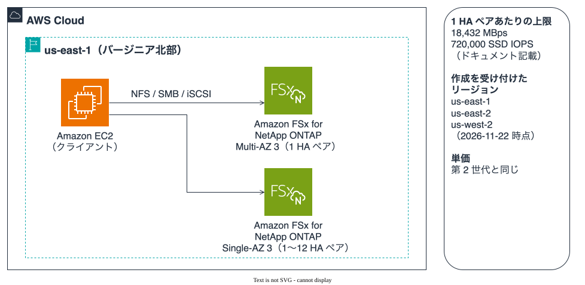
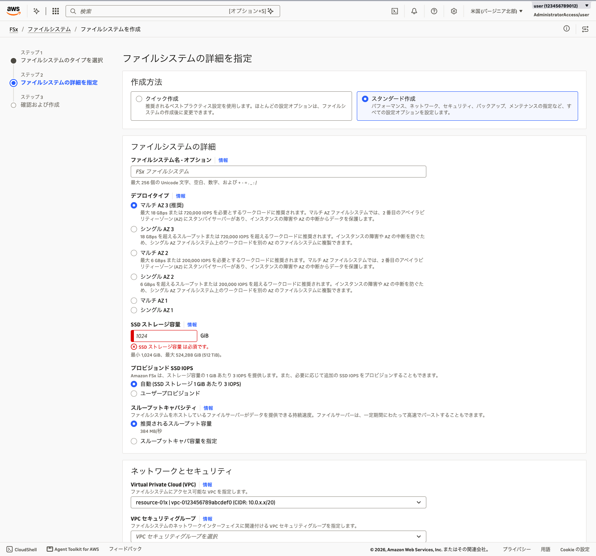

# 第 3 世代のファイルシステムは、どのリージョンで作れて、上限はいくつか？

2026-11-22 に確認した 7 リージョンのうち、受け付けたのは米国の 3 リージョンです。上限は 1 HA ペアあたり 18,432 MBps と 720,000 IOPS です。



図の内容は本文の表と同じです（[暗い背景の版](../../../../_assets/images/fsx-third-generation-overview-dark.svg)）。

## このノートで学べること

- 第 3 世代（`SINGLE_AZ_3`、`MULTI_AZ_3`）を作成要求で受け付けるリージョンの実測と、公式の記載との食い違い
- 1 HA ペアあたり 18,432 MBps（約 18 GBps）、720,000 SSD IOPS、Single-AZ 3 は最大 12 ペアという上限の出どころ
- 世代ごとの月額料金の比較（us-east-1）
- 作成にかかった時間と、API の応答に増えた項目

## このノートが答えないこと

- 実際のスループットと IOPS（性能は測っていない）
- フェイルオーバーの挙動、スケールアップの所要時間、データを置いたときの値
- 確認した 7 リージョン以外の受け付け（未確認）と、米国以外のリージョンでの提供開始時期

## 前提レベル

intermediate

## 本文

> **区分**: `verified`（検証日 2026-11-22、`us-east-1`、`SINGLE_AZ_3` と `MULTI_AZ_3`、各 1 HA ペア、384 MBps、SSD 1,024 GiB）— 作成の成否、リージョンごとの受け付け、API の応答、料金。**上限値の表は AWS のユーザーガイドの記載で、実行して確かめたのは IOPS の上限の 1 点です。**

### 記載によって異なる提供リージョン

| 情報源（2026-11-22 に確認） | 第 3 世代のリージョン |
|---|---|
| AWS の What's New（2026-11） | US East（N. Virginia、Ohio）、US West（Oregon） |
| ユーザーガイドの「Availability by AWS Region」の表 | 上の 3 つに加えて、Asia Pacific（Tokyo）、Europe（Spain）、Europe（Ireland） |
| ユーザーガイドのドキュメント履歴 | 第 3 世代の項目なし（最新の項目は 2026-11-06 の S3 Access Points のリージョン追加） |
| 作成の要求を実際に送った結果 | 下表 |

存在しないサブネットを指定した `CreateFileSystem` を `SINGLE_AZ_3` で送り、デプロイタイプの検査を通るかを見ました。ファイルシステムは作られません。

| リージョン | 結果 |
|---|---|
| us-east-1、us-east-2、us-west-2 | デプロイタイプの検査を通り、「サブネットが存在しない」で止まる |
| ap-northeast-1（東京）、eu-west-1（アイルランド）、eu-south-2（スペイン）、ap-southeast-1（シンガポール） | `BadRequest: Request failed validation` |

東京では、同じ要求の `SINGLE_AZ_2` はデプロイタイプの検査を通り、`MULTI_AZ_3` は拒否されました。したがって、**ユーザーガイドの表が示す東京、スペイン、アイルランドの第 3 世代は、2026-11-22 の時点では作成できませんでした。** 表が先に更新されたのか、提供の準備中なのかは分かりません。リージョンを前提にする設計は、作成の要求を実際に送って確かめてください。

### 作れた第 3 世代の姿

us-east-1 で、`SINGLE_AZ_3` と `MULTI_AZ_3` の 2 つを同じ VPC に作りました。

| 項目 | 観測 |
|---|---|
| 作成の受け付け | 両方とも成功 |
| 作成から `AVAILABLE` まで | `MULTI_AZ_3` は約 13 分、`SINGLE_AZ_3` は約 13.5 分 |
| 最小のスループット | 384 MBps（1 HA ペア） |
| SSD IOPS | 自動設定で 1,024 GiB に対して 3,072（1 GiB あたり 3） |
| 応答の項目 | `ThroughputCapacityPerHAPair` と `HAPairs` が返る |

コンソールの作成画面には、第 3 世代のデプロイタイプが「マルチ AZ 3（推奨）」と「シングル AZ 3」として並び、説明は日本語で表示されました。



英語の画面は[こちら](../../../../_assets/images/aws-console-fsx-en-create-deployment-types.png)です。

### 上限

ユーザーガイドの「Quotas」「Availability, durability, and deployment options」「Amazon FSx for NetApp ONTAP performance」の記載です（2026-11-22 に読んだ）。

| デプロイタイプ | HA ペア | 1 ペアのスループット | ファイルシステム全体のスループット | SSD IOPS | SSD 容量 |
|---|---|---|---|---|---|
| `SINGLE_AZ_3` | 1〜12 | 最大 18,432 MBps | 最大 221,184 MBps | 1 ペア 720,000、最大 8,640,000 | 1 ペア 512 TiB、合計 1 PiB まで |
| `MULTI_AZ_3` | 1 | 最大 18,432 MBps | 18,432 MBps | 720,000 | 512 TiB |
| `SINGLE_AZ_2`（比較） | 1〜12 | 最大 6,144 MBps | 最大 73,728 MBps | 1 ペア 200,000、最大 2,400,000 | 1 ペア 512 TiB、合計 1 PiB まで |
| `MULTI_AZ_2`（比較） | 1 | 最大 6,144 MBps | 6,144 MBps | 200,000 | 512 TiB |

- 単位の読み方: What's New の「216 GB/s」はファイルシステム全体の 221,184 MBps を 1,024 で割った値で、「18 GB/s」は 18,432 MBps です。表と見出しで単位が混ざるので、MBps に揃えて比べてください
- 書き込みのスループットの上限は、ユーザーガイドの表では 1 ペアあたり 4,500 MBps、ファイルシステム全体で 54,000 MBps です（Single-AZ 3）
- 選べるスループット値は、`MULTI_AZ_3` が 384、768、1,536、3,072、6,144、12,288、18,432 MBps です。`SINGLE_AZ_3` は 1,536 から 18,432 MBps まで（384 と 768 は 1 ペアのときだけ）
- iSCSI は HA ペアが 6 以下のとき、NVMe/TCP は第 2・第 3 世代で HA ペアが 6 以下のときに使えます

### API リファレンスの IOPS 上限は古い

API リファレンスの `DiskIopsConfiguration` の説明は、最大値を「200,000 × `HAPairs`」としています（2026-11-22 に読んだ）。実機は違いました。`SINGLE_AZ_3` と `MULTI_AZ_3` の 1 HA ペアのファイルシステムに、`Iops` を 720,001 にする `UpdateFileSystem` を送ると、次のメッセージで断られました。

```text
Invalid SSD IOPS provided: 720001 IOPS. The maximum SSD IOPS per ONTAP file system is 720000.
```

つまり 1 ペアの上限は 720,000 で、API リファレンスの記述（200,000）より大きい値でした。**この確認は上限を超える値だけを送ったので、課金は発生していません。** 上限の内側の値は、課金されるので送っていません。

### 料金の比較

us-east-1 の Pricing API（2026-11-22 に取得）の単価で、SSD 1,024 GiB、IOPS は自動、1 HA ペア、月 730 時間として計算しました。

| 構成 | スループット | 月額 | 1 時間あたり |
|---|---|---|---|
| 第 1 世代 Single-AZ | 128 MBps（最小） | $220 | $0.30 |
| 第 1 世代 Single-AZ | 512 MBps | $497 | $0.68 |
| 第 2・第 3 世代 Single-AZ | 384 MBps（最小） | $742 | $1.02 |
| 第 1 世代 Multi-AZ | 128 MBps（最小） | $410 | $0.56 |
| 第 1 世代 Multi-AZ | 512 MBps | $870 | $1.19 |
| 第 2・第 3 世代 Multi-AZ | 384 MBps（最小） | $1,216 | $1.67 |

| デプロイ形式 | SSD（GB 月） | スループット（MBps 月） |
|---|---|---|
| 第 1 世代 Single-AZ | $0.125 | $0.72 |
| 第 1 世代 Multi-AZ | $0.25 | $1.20 |
| 第 2・第 3 世代 Single-AZ | $0.125 | $1.60 |
| 第 2・第 3 世代 Multi-AZ | $0.25 | $2.50 |

**第 2 世代と第 3 世代は、同じデプロイ形式なら単価が同じです。** 差は上限（1 ペアで 6,144 MBps に対して 18,432 MBps）だけで、スループットあたりの単価は変わりません。第 1 世代はスループットの単価が安く、選べる値の組が違います（128、256、512、1,024、2,048、4,096 MBps）。

## 自環境での確認手順

| # | 手順 | 確認できること |
|---|---|---|
| 1 | 使いたいリージョンで、存在しないサブネットを指定した `CreateFileSystem` を `SINGLE_AZ_3` と `MULTI_AZ_3` で送る | **そのリージョンが第 3 世代を受け付けるか**（ファイルシステムは作られない） |
| 2 | `aws pricing get-products` で `AmazonFSx` の ONTAP の単価を引く | 世代とデプロイ形式ごとの単価 |
| 3 | 作成後に `describe-file-systems` で `ThroughputCapacityPerHAPair` と `HAPairs` を読む | 実際の構成値 |

手順 1 のコマンドはファイルシステムを作りません。サブネット ID は存在しない値にしてください。

### 期待結果

```text
受け付ける: InvalidNetworkSettings（サブネットが存在しない）
受け付けない: BadRequest（Request failed validation）
```

## Read next

[スループットは 1 つの設定値では決まらない](where-throughput-is-determined-and-shared.md)

このノートの確認をまとめた解説記事: [2026-11-22、FSx for ONTAP 第 3 世代を us-east-1 にデプロイできた](https://hakobiya.hatenablog.com/entry/fsxn-third-generation-regions-and-limits)（はてなブログ。英語版は [dev.to](https://dev.to/aws-builders/2026-11-22-i-deployed-third-generation-fsx-for-ontap-in-us-east-1-deployable-regions-and-hef)）
