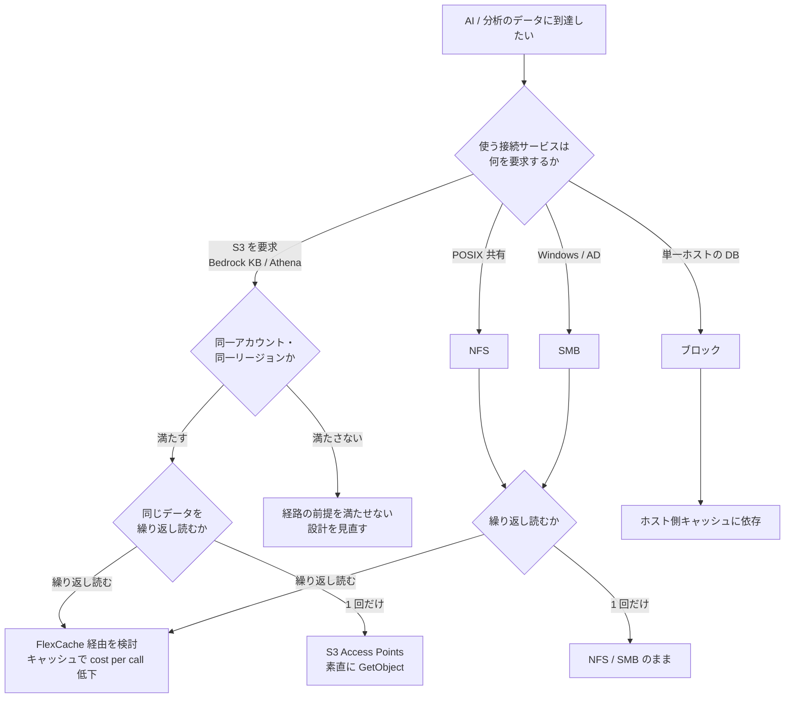

# AI のアクセス経路の選び方

[🏠 リポジトリトップ](../../../../README.md) | [Reference](../README.md) | [比較マトリクス](README.md)

---

## 結論

**AI / 分析ワークロードで FSx for ONTAP のデータに到達する経路に、どの状況でも最適な 1 つはありません。** 分かれ目は 3 つで、順に当たります。

1. **アクセス性** — 使いたい接続サービス（Bedrock, SageMaker, Athena など）がその経路で到達できるか
2. **読まれ方** — 同じデータを繰り返し読むか、1 回だけか
3. **コスト** — 確保課金で押さえるか、消費課金に流すか

**FinOps for AI の観点では、2 の「読まれ方」がトークン隣接コスト（[adjacent cost](../../domains/cost/notes/finops-for-ai-adjacent-cost.md)）の cost per call に最も効きます。** 繰り返し読むならキャッシュ、1 回だけなら素直な経路が向きます。

> **Evidence**: `documented` — 到達可否とコストの発生点は AWS / ベンダーの公式ドキュメントに基づきます（**取得日 2026-11-09**）。**性能数値は Spoke で実測済みで、[性能実測の所在マップ](../performance-evidence-map.md) からたどります。** 価格・提供リージョン・製品名は変動するため、選定時に最新の情報で確認してください。

---

## 比較

| 観点 | S3 Access Points | NFS | SMB | ブロック（iSCSI / NVMe/TCP） | FlexCache 経由 |
|---|---|---|---|---|---|
| **向いている状況** | オブジェクト単位で分析・RAG に読ませる。Bedrock KB / Athena / Glue | POSIX 共有が要る推論・学習・HPC | Windows ベースの前処理・ポータル | 単一ホストの DB・ベクトルストア | 同じデータを繰り返し読む RAG・学習の反復 |
| **アクセス性の前提** | 同一アカウント・同一リージョン・VPC 内。S3 標準の全操作は通らない | マウント先からの到達性 | AD 参加 / NTFS ACL・Windows クライアント | 単一アタッチが基本 | Origin への到達性・Cache 側の制約 |
| **パフォーマンス特性** | オブジェクトのレイテンシ。小ファイル多数で不利 | 低レイテンシ。単一接続は 1 フロー上限 | NFS と同種。Multichannel で分散 | 最低レイテンシ。単一接続はデプロイ依存 | 初回ミス、以降ヒットで低レイテンシ |
| **コスト特性** | SSD 確保 + 容量プール消費 + リクエスト課金 | 確保（SSD・スループット） | 確保（同上） | 確保（SSD・スループット・IOPS） | Cache の SSD 確保。ヒットで Origin 呼び出しが消える |
| **cost per call への効き** | GetObject 回数 × 単価が直接乗る | 確保スループットを複数クエリで分け合う | 同上 | 単一ホストで占有 | 繰り返し読むほど下がる |
| **トレードオフ** | メタデータ操作の一部が失敗する。繰り返し読むとリクエスト課金が積む | 単一接続のスループットに上限。台数で分散が要る | AD / Windows への依存 | 共有は設計が要る。多重度で線形に伸びない | キャッシュが温まらないと効かない。Cache 側の制約（セキュリティスタイル変更不可など） |

**トレードオフは推奨案の制約も含めて対称に書いています。** FlexCache を「繰り返し読むなら有利」とだけ書くと主張になります。**1 回しか読まないデータでは温まる前に捨てられて効かず、Cache 側には作成後に変更できない設定がある**、という制約を併記しています。

---

## 選び方

**上から順に当てはめてください。先に当たった条件が経路を決めます。**

| # | 確認項目 | 判断への影響 |
|---|---|---|
| 1 | 使う接続サービスが何を要求するか | Bedrock Knowledge Bases は S3 を要求します。S3 Access Points 経由にするなら前提を満たす必要があります |
| 2 | 同一アカウント・同一リージョンの前提を満たせるか | S3 Access Points の前提です。満たせないなら別経路か構成の見直しです |
| 3 | 同じデータを繰り返し読むか、1 回だけか | 繰り返し読むなら FlexCache が cost per call を下げます。1 回だけならキャッシュは効きません |
| 4 | 容量プールに落とす予定のデータが定期的に読まれるか | 読まれるならリクエスト課金が積みます。SSD か FlexCache が向きます |
| 5 | 確保量を実際に下げられるか | 重複排除・圧縮で空いても、確保量を下げなければ請求は変わりません |
| 6 | 単一ホストで占有してよいか、共有が要るか | ブロックは単一アタッチが基本です。共有は設計が要ります |

**決めきれない場合**は [AI のアクセス経路別のコストと性能](../../domains/cost/notes/access-path-cost-and-performance-by-service.md) に定性軸の詳細が、[性能実測の所在マップ](../performance-evidence-map.md) に数値の所在があります。

---

## よくある誤解

| 誤解 | 実際 |
|---|---|
| どの状況でも最適な経路が 1 つある | 分かれ目は「到達性」「読まれ方」「コスト」の 3 つで、状況で答えが変わります |
| S3 Access Points なら S3 標準と同じ | 同一アカウント・同一リージョンが前提で、メタデータ操作の一部が失敗します |
| 繰り返し読むデータは階層化すれば安い | 読み取りのリクエスト課金が積みます。繰り返し読むなら SSD かキャッシュです |
| FlexCache は常に cost per call を下げる | 1 回しか読まないデータには効きません |
| 経路は性能だけで選べる | 到達性で先に絞られます |
| cost per call はトークン単価のこと | 1 呼び出しあたりの BOM 全体（データ入出力・キャッシュ含む）です |

---

## 比較時点

2026-11-09 時点の情報です。性能数値の実測時点は各 Spoke のドキュメントを確認してください。

---

## 関連ドキュメント

- [AI のコストはトークンだけではない](../../domains/cost/notes/finops-for-ai-adjacent-cost.md) — トークン隣接コストと Tokenomics の骨子
- [AI のアクセス経路別のコストと性能](../../domains/cost/notes/access-path-cost-and-performance-by-service.md) — プロトコル × サービスの 3 軸整理
- [外部情報ソースの追跡](../external-sources.md) — Tokenomics / FOCUS / クラウド各社の最新情報の取り込み
- [性能実測の所在マップ](../performance-evidence-map.md) — NFS / SMB / S3 AP / FlexCache の実測の所在
- [FSx for ONTAP S3 AP は「S3 として使える」わけではない](../../domains/data-utilization/notes/s3-access-point-constraints.md)
- [知見の分類ポリシー](../../evidence-policy.md)

---

[🏠 リポジトリトップ](../../../../README.md) | [Reference](../README.md) | [比較マトリクス](README.md)
