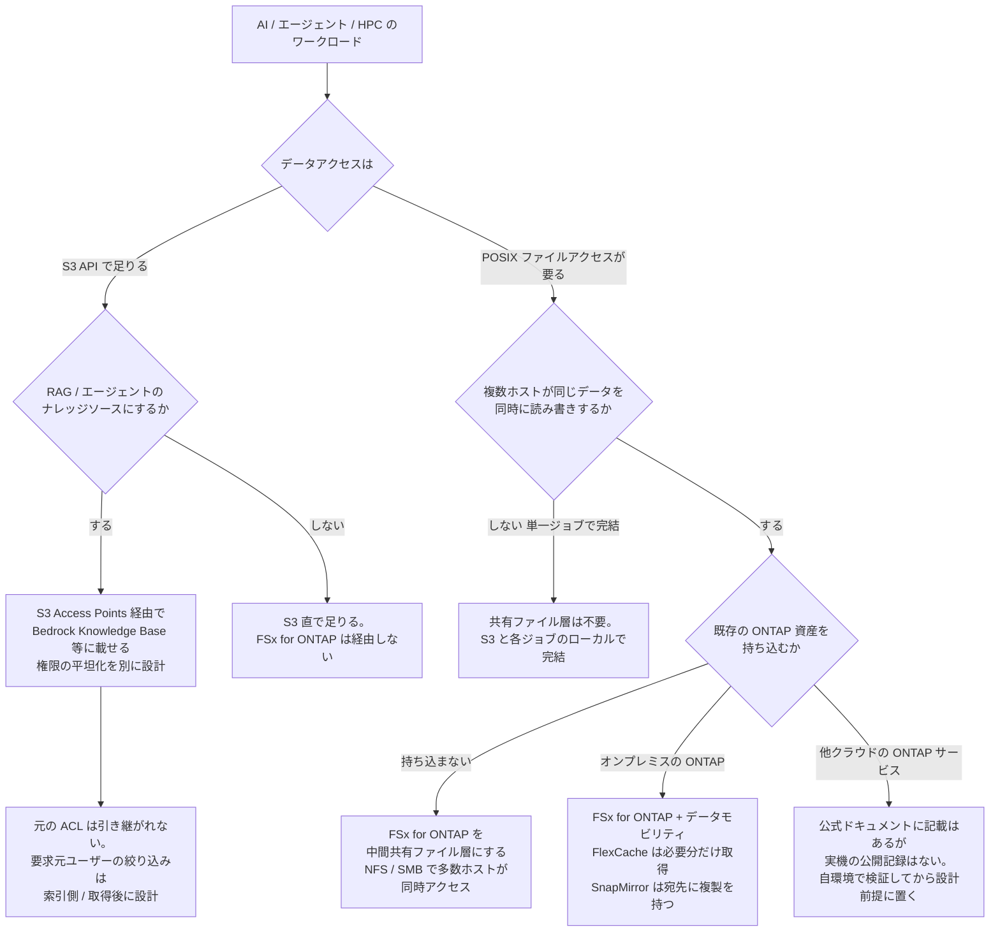

# AI・HPC ワークロードのデータ層に FSx for ONTAP を経由させるかを決める

[🏠 リポジトリトップ](../../../../README.md) | [Reference](../README.md) | [決定木](README.md) | [Domain — データ活用](../../domains/data-utilization/README.md)

---

## 結論

**生成 AI・エージェント・HPC のワークロードで「データ層に FSx for ONTAP を経由させるか」は、業種では決まりません。ワークロードの形で決まります。** 鉄道の予兆検知も、ゲノムの二次解析も、ロボット学習も、物流の書類照合も、同じ 4 つの問いで分岐します。

**ただし、4 問に入る前に 1 つ確かめます。実行基盤が共有ファイル層を自分で提供していないかです**（[後述](#実行基盤が共有ファイル層を提供する場合の先決)）。AWS HealthOmics の run は提供するので、run の内側に FSx for ONTAP を置く必要はなく、マウントする手段も AWS の文書にありません。

**そのうえで、最初の問いが最も強い制約です。**

| 順 | 問い | なぜここが先か |
|---|---|---|
| 1 | データへのアクセスは S3 API で足りるか、POSIX ファイルアクセスが要るか | **要らないなら S3 と各マネージドサービスで完結し、FSx for ONTAP は経由しません。** プロトコルの要求が候補を最初に絞ります |
| 2 | 複数ホストが同じデータを同時に読み書きするか | 単一ジョブが独立に完結するなら共有ファイル層は要りません |
| 3 | 既存の ONTAP 資産（オンプレミス / 他クラウド）を持ち込むか | あるなら SnapMirror / FlexCache でデータモビリティが重なります。**他クラウド ONTAP との FlexCache は、公式ドキュメントに記載はあるが実機の公開記録がない（後述）** |
| 4 | RAG / エージェントのナレッジソースにするか | するなら S3 Access Points 経由でナレッジベースに載せ、権限の平坦化を別に設計します |

> **区分**: `documented` — 分岐の条件は AWS / NetApp 公式ドキュメントと AWS 公開事例の記載に基づきます（2026-11-02 に確認）。**各分岐で前提にする FSx for ONTAP の性能（NFS / SMB の台数試験、S3 Access Points のスループット・レイテンシ、FlexCache の読み取り）は Spoke で実測済みで、所在と測定環境は [性能実測の所在マップ](../performance-evidence-map.md) にあります。** 他クラウド ONTAP サービス（Google Cloud NetApp Volumes, Azure NetApp Files）との FlexCache だけは、Spoke にも実機の記録がありません。各社の公式ドキュメントの記載（2026-11-03 に確認）は、向きごとに [クロスクラウドのノート](../../domains/data-utilization/notes/cross-cloud-analytics-without-extra-copies.md#構成ごとの確認状況) に分けて書いています。

---

## この決定木が手前の決定木と違うところ

**[どの AWS ファイルストレージかを決める](file-storage-selection.md) は「そもそもどのファイルストレージか」を汎用に扱います。** この決定木はその先で、**AI・エージェント・HPC という具体的なワークロードが、データ層のどこに FSx for ONTAP を置くか/経由させないか**を扱います。手前でファイルストレージとして FSx for ONTAP が残ったあと、どの役割で使うかの判断です。

---

## 選択のフロー

**同じ内容を表でも書きます。** mermaid が描画されない環境があり、スクリーンリーダーからも確実には読めず、クローラも抽出できないためです。**図の中だけに存在する判断を作りません。**

| # | 問い | 答え | 行き先 |
|---|---|---|---|
| 1 | データアクセスは | S3 API で足りる | 4（ナレッジソース判定）へ |
| 1 | 同上 | POSIX ファイルアクセスが要る | 2 へ |
| 2 | 複数ホストが同じデータを同時に読み書きするか | しない（単一ジョブで完結） | **共有ファイル層は不要。** S3 と各ジョブのローカルで完結します |
| 2 | 同上 | する | 3 へ |
| 3 | 既存の ONTAP 資産を持ち込むか | 持ち込まない | **FSx for ONTAP を中間共有ファイル層にする。** NFS / SMB で多数ホストが同時アクセス |
| 3 | 同上 | オンプレミスの ONTAP | **FSx for ONTAP + データモビリティ。** FlexCache は必要な分だけ取得し、SnapMirror は宛先に複製を持つ。読み取り主体でワーキングセットが小さければ FlexCache。**Cache には S3 Access Points を付けられない**ので、S3 API で読ませるなら SnapMirror の宛先を使う |
| 3 | 同上 | 他クラウドの ONTAP サービス | **公式ドキュメントに記載はありますが、実機の公開記録はありません。** ネットワーク到達性と FlexCache の成立は別の問いです。自環境で検証してから設計前提に置く（向きごとの記載は[クロスクラウドのノート](../../domains/data-utilization/notes/cross-cloud-analytics-without-extra-copies.md#構成ごとの確認状況)） |
| 4 | RAG / エージェントのナレッジソースにするか | する | **S3 Access Points 経由で Bedrock Knowledge Base 等に載せる。** 権限の平坦化を別に設計（元の ACL は引き継がれない） |
| 4 | 同上 | しない | **S3 直で足りる。** FSx for ONTAP は経由しません |

---

## FSx for ONTAP に到達しない終端

**この決定木は 2 つの終端で FSx for ONTAP を経由しません。** どちらも正しい設計です。

| 終端 | どういう状況か | FSx for ONTAP を経由しない理由 |
|---|---|---|
| **S3 と各ジョブのローカルで完結** | POSIX は要るが、各ジョブが独立にオブジェクトを取得して完結し、ホスト間で同じデータを同時に触らない | 共有ファイル層が不要です。無理に経由させると、要らない共有層のコストと運用が増えます |
| **S3 直で足りる** | S3 API で足り、RAG のナレッジソースにもしない | S3 がそのまま正本で足ります。FSx for ONTAP を挟む理由がありません |

**「FSx for ONTAP を使う」ことが目的ではありません。** ワークロードの形が共有ファイル層を要求するか、ONTAP 資産のモビリティが効くかで決まります。要求しないなら経由させないのが正しい判断です。

---

## 各分岐の根拠と公開事例

**分岐ごとに、同じ形を採っている AWS / NetApp の公開事例を添えます。** 構成や数値は各組織が同意した範囲の記載で、ONTAP バージョン・リージョン・構成は明記されていないことが多いので、設計の根拠にする前に自環境で測ってください。

| 分岐 | 何に基づくか | 同じ形の公開事例 |
|---|---|---|
| POSIX 要求で共有ファイル層へ | 多くのバイオインフォ / CAE / レンダリングツールはファイルパスとランダムアクセスを前提にします。[ゲノムパイプラインのデータは 3 か所に分かれる](../../domains/data-utilization/notes/where-genomics-pipeline-data-lives.md) | [EDA（Arm）](https://aws.amazon.com/solutions/case-studies/arm-ltd-case-study/)、[CAE + SOCA](https://aws.amazon.com/blogs/industries/the-business-and-engineering-benefits-of-fsx-for-netapp-ontap-for-product-engineering-workloads/)、[レンダリング（『すずめの戸締まり』）](https://www.netapp.com/customers/cwf-case-study/) |
| 複数ホスト同時で共有ファイル層へ | 多数ホストが同じデータを叩く形では、当たる上限がデータを共有しているかで変わります。[単一接続で測った値はストレージの性能ではない](../../domains/performance/notes/a-single-connection-measures-the-client.md) | [seismic HPC（Petrobras / EC2 Spot）](https://aws.amazon.com/jp/blogs/news/petrobras-optimizes-cost-and-capacity-of-hpc-applications-with-amazon-ec2-spot-instances/)、[ADAS HIL（S3-Burst）](https://github.com/Yoshiki0705/S3-Burst-on-ONTAP-Files) |
| オンプレミス ONTAP の持ち込みでデータモビリティ | FlexCache の 3 構成にオンプレミス ONTAP ⇄ FSx for ONTAP が含まれます。[コピーを増やさずに届く](../../domains/data-utilization/notes/reaching-data-without-copies.md#flexcache-が効く条件) | [ハイブリッド HPC（理研ら、FlexCache）](https://www.netapp.com/ja/blog/hybrid-hpc/)、[ハイブリッド ML 推論](https://aws.amazon.com/blogs/storage/hybrid-ml-inferencing-on-amazon-eks-with-amazon-fsx-for-netapp-ontap-and-on-premises-netapp/)、[AstraZeneca データファブリック](https://www.netapp.com/customers/astrazeneca-data-fabric-case-study/) |
| 他クラウド ONTAP との FlexCache | GCNV と ANF のドキュメントの記載は向きごとに違い、AWS のドキュメントが挙げる 3 構成には含まれません。実機の公開記録もありません。[クロスクラウドのノート](../../domains/data-utilization/notes/cross-cloud-analytics-without-extra-copies.md#構成ごとの確認状況) | — |
| RAG ナレッジソースで S3 Access Points 経由 | S3 Access Points 経由で Bedrock Knowledge Base のデータソースにできます（実装で検証済み）。[AWS の AI エージェントを FSx for ONTAP に使う](../../ai-agents/bedrock-knowledge-base/README.md) | [航空データレイク（AgentCore + Knowledge Base）](https://aws.amazon.com/jp/blogs/news/building-aviation-ai-operations-platform-with-bedrock-and-kiro/)、[物流書類 OCR（オプティマ AI）](https://aws.amazon.com/jp/blogs/news/nissin-optimaai/) |
| RAG で権限が平坦化されること | S3 Access Point は全リクエストを 1 つの ID で認可し、元の ACL は引き継がれません。[コピーを増やさずに届く](../../domains/data-utilization/notes/reaching-data-without-copies.md#権限が平坦化されることの意味) | [Agentic Access-Aware RAG](https://github.com/Yoshiki0705/FSx-for-ONTAP-Agentic-Access-Aware-RAG) |

---

## 実行基盤が共有ファイル層を提供する場合の先決

**上の 4 問に入る前に、実行基盤が共有ファイル層を自分で提供しているかを確かめます。** AWS HealthOmics のワークフローは、run ごとに一時的な共有ファイルシステム（run storage）をサービスが提供するので、run の内側では問い 2 に当たりません。FSx for ONTAP を run の内側で使う手段は AWS の文書になく、試されてもいません（[根拠と範囲](../../domains/data-utilization/notes/where-genomics-pipeline-data-lives.md)）。出番は run の外側（入力を渡す前の置き場、結果の解析、オンプレミスとの行き来）です。AWS Batch は EC2 起動タイプなら共有ファイル層を自分で用意し、Fargate 起動タイプは FSx for ONTAP をマウントできません。基盤ごとの扱いは [ゲノム・HPC パイプラインのデータは 3 か所に分かれる](../../domains/data-utilization/notes/where-genomics-pipeline-data-lives.md#サーバーレスな実行基盤での共有ファイル層の要否) にあります。

---

## この決定木が答えないこと

| 問い | 置き場所 |
|---|---|
| そもそもどの AWS ファイルストレージか | [どの AWS ファイルストレージかを決める](file-storage-selection.md) |
| S3 Access Points 経由の認可の評価順序 | [S3 Access Points 経由のリクエストはどう判定されるか](access-point-authorization.md) |
| FlexCache / SnapMirror の機構・権限・制約 | [コピーを増やさずにデータへ届く](../../domains/data-utilization/notes/reaching-data-without-copies.md) |
| RAG の権限設計（索引を分ける / 取得後に判定する） | [権限が平坦化されることの意味](../../domains/data-utilization/notes/reaching-data-without-copies.md#権限が平坦化されることの意味) |
| 共有ファイル層のスループットが何で決まるか | [スループットは 1 つの設定値では決まらない](../../domains/performance/notes/where-throughput-is-determined-and-shared.md) |
| エージェントごとの適合判断（DevOps / FinOps / Quick 等） | [AWS の AI エージェントを FSx for ONTAP に使う](../../ai-agents/README.md) |
| 他クラウド ONTAP と組む FlexCache の実機挙動 | **公開できる実機記録がありません**（公式ドキュメントの記載は[クロスクラウドのノート](../../domains/data-utilization/notes/cross-cloud-analytics-without-extra-copies.md#構成ごとの確認状況)） |

---

## よくある誤解

| 誤解 | 実際 |
|---|---|
| AI / HPC のデータ層は業種で決まる | **ワークロードの形で決まります。** 鉄道もゲノムもロボット学習も、同じ 4 問で分岐します |
| マネージドな AI / 分析サービスを使うなら FSx for ONTAP は要らない | 要否は別です。**複数ホストが POSIX で同時に触る中間層が要るなら、マネージドサービスと併用します** |
| サーバーレスな基盤なら共有ファイル層はどれも不要 | **基盤ごとに違います。** HealthOmics の run は共有ファイルシステムをサービスが提供するので run の内側では不要です。AWS Batch の EC2 起動タイプは自分で用意し、Fargate 起動タイプは FSx for ONTAP をマウントできません |
| S3 に置けば RAG のナレッジソースになる | なりますが、**S3 Access Points 経由では元の ACL が引き継がれません。** 権限は別に設計します |
| ネットワークが他クラウドに届けば ONTAP のモビリティも組める | **到達性と FlexCache / SnapMirror の成立は別の問いです。** 他クラウド ONTAP との FlexCache は、公式ドキュメントの記載が向きごとに違い、実機の公開記録もありません |
| FSx for ONTAP を使うほどよい | **経由させない終端が 2 つあります。** S3 直で足りる形、各ジョブのローカルで完結する形では、経由させないのが正しい判断です |

---

## 関連ドキュメント

- [決定木](README.md) — 他の決定木
- [どの AWS ファイルストレージかを決める](file-storage-selection.md) — この決定木の手前、汎用のファイルストレージ選択
- [ゲノム・HPC パイプラインのデータは 3 か所に分かれる](../../domains/data-utilization/notes/where-genomics-pipeline-data-lives.md) — POSIX 共有層の要否とサーバーレス HPC
- [クロスクラウド分析でコピーを増やさない](../../domains/data-utilization/notes/cross-cloud-analytics-without-extra-copies.md) — ONTAP のデータモビリティの構成ごとの確認状況
- [コピーを増やさずにデータへ届く](../../domains/data-utilization/notes/reaching-data-without-copies.md) — FlexCache / FlexClone / SnapMirror / S3 Access Points
- [AWS の AI エージェントを FSx for ONTAP に使う](../../ai-agents/README.md) — エージェントごとの適合判断
- [業種別リソースマップ](../industry-resource-map.md) — 業種とワークロードの形からの入口
- [知見の分類ポリシー](../../evidence-policy.md)

---

[🏠 リポジトリトップ](../../../../README.md) | [Reference](../README.md) | [決定木](README.md) | [Domain — データ活用](../../domains/data-utilization/README.md)
