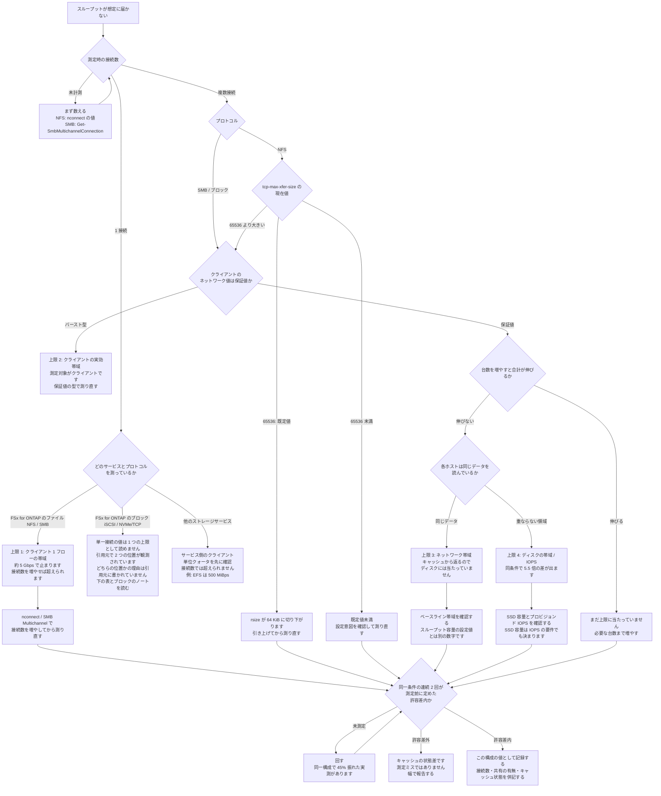

# 手元のスループット値は何を測ったのかを判定する

[🏠 リポジトリトップ](../../../../README.md) | [Reference](../README.md) | [決定木](README.md) | [Domain — 性能](../../domains/performance/README.md)

---

## 結論

**「思ったより遅い」という数字を持ってきたとき、最初にすべきことはチューニングではなく、その数字が何の上限を測ったのかの切り分けです。**

上限は 4 か所にあり、**当たっている場所によって打つ手が正反対になります。**

| # | 上限の場所 | 当たっている合図 | 打つ手 |
|---|---|---|---|
| 1 | **クライアント 1 フローの帯域**、またはサービス側のクライアント単位クォータ | 単一マウント・単一セッションで止まる | **どちらかを先に切り分けます。** 1 フロー上限なら接続数を増やせば超えられ、サービス側クォータなら超えられません |
| 2 | **クライアントの実効帯域** | 複数接続にしても伸びず、時間経過で落ちる | クライアントの型を保証値のものに替える |
| 3 | **ファイルシステムのネットワーク帯域** | 台数を増やすと合計が天井に張り付く | スループット容量ではなくベースライン帯域を確認する |
| 4 | **ディスクの帯域 / IOPS** | 読むデータがキャッシュに無いときだけ遅い | SSD 容量とプロビジョンド IOPS、キャッシュの効き方を見る |

**1 と 2 はクライアント側、3 と 4 はファイルシステム側です。** 順序を守って切り分けないと、効かない側を触り続けることになります。

> **区分**: `documented` — 分岐の条件は AWS 公式ドキュメントの記載と、[プロジェクト間の引用索引](../cross-repo-index.md) に登録した sibling プロジェクトの実測に基づきます。**確認日は出どころごとに違います。** AWS・NetApp の記載は 2026-09-05 に確認し、再確認していません。sibling プロジェクトの実測値は、引用元の `main` と 2026-10-15 に突き合わせました（ブロックの行は 2026-10-14 に読み直して書き、2026-10-15 にも突き合わせています）。
> **このリポジトリでは再測定していません。** 実測値そのものは [単一接続で測った値はストレージの性能ではない](../../domains/performance/notes/a-single-connection-measures-the-client.md) に条件付きで転記しています。
> **引用元の測定環境は削除済みです。**

---

## 切り分けのフロー

---

## 各分岐の根拠

| 分岐 | 何に基づくか |
|---|---|
| FSx for ONTAP のファイルプロトコル（NFS / SMB）の単一接続で約 5 Gbps | AWS は 1 ネットワークフローあたり全二重 5 Gbps の上限を明記しています。実測では NFS 591.62 MB/s（4.7 Gbps）、SMB 574.24 MB/s（4.6 Gbps）。**この分岐に根拠を与えているのはファイルプロトコルの測定だけです** |
| FSx for ONTAP のブロック（iSCSI / NVMe/TCP）の単一接続は、1 つの上限として読めないこと | 引用元の多重度 1 の値は、デプロイごとに約 591 MB/s（4.73 Gbps）と約 1,135 MB/s（9.08 Gbps）の 2 つの位置に出ています。引用元が両プロトコルを測った 2 つのデプロイでは、同じデプロイの中で iSCSI と NVMe/TCP が同じ位置に来ていて、NVMe/TCP で接続を 4 回やり直しても変わりませんでした（[引用元の測定結果](https://github.com/Yoshiki0705/S3-Burst-on-ONTAP-Files/blob/main/docs/ja/verification/perf-matrix-results.md#1-接続の値がデプロイごとに-2-つの位置に出ること)）。**どちらの位置になるかを決める要因を、引用元は確認していません**（配置・インスタンス・ENA の構成のいずれも切り分けていない）。**どちらの位置になるかの理由は、引用元に書かれていません。** 上の 5 Gbps の記載とこの 2 つの位置を結びつける説明は、この決定木にはありません。引用元の F-5 の節は、4.73 Gbps と 9.08 Gbps が、documented とする単一フローの 5 Gbps と 10 Gbps の位置にあたると書いていますが、どちらの位置になるかを決めるものは引用元も確認していません（10 Gbps 側の AWS の記載は、この決定木では確認していません）。値は raw device の測定で、窓は 300 秒（バーストを含みます）です。ファイル側との差と設計上の扱いは [パスはフェイルオーバーの仕組みそのもの](../../domains/block-storage/notes/paths-are-the-failover-mechanism.md#ブロックの値がデプロイごとに-2-つの位置に出たこと) にあります。引用元は 2026-10-14 に `main` で確認しました |
| 他サービスは別の上限に当たりうること | 同じ測定で Amazon EFS の素マウントは 499.79 MB/s でした。**これは 5 Gbps ではなく EFS のクライアント単位クォータ 500 MiBps に一致します。** 引用元は当初この 3 行を同じ上限として説明し、あとで訂正しています |
| `tcp-max-xfer-size` の既定値 | 既定 65,536 のままだとクライアントの `rsize` が 64 KiB に切り下がります。65,536 未満は既定値未満の設定として意図を確認します |
| クライアントの保証値とバーストの違い | インスタンス型によってネットワーク性能が保証値かバーストかが違います。バースト型では測定対象がクライアントになります |
| 同じデータか重ならない領域か | 8 台・128 接続の実測で、同一ファイル共有 11,916.29 MB/s に対し重ならない領域が 2,173.37 MB/s（0.18 倍）でした |
| スループット容量とベースライン帯域が別 | 実測構成はスループット容量 6,144 MBps で、ネットワークのベースラインは 12,500 MBps でした |
| 45% の幅 | 同一設定・同一パラメータ・同一測定器で 2 回測って 3,551.18 と 5,148.56 MB/s。差はキャッシュの状態だけです |

許容差は測定目的ごとに測定前に定めます。**45% はこの実測環境で観測した幅であり、一般的な合否閾値ではありません。**

数値の測定条件は [単一接続で測った値はストレージの性能ではない](../../domains/performance/notes/a-single-connection-measures-the-client.md#測定条件) に全項目あります。

---

## この決定木が答えないこと

| 問い | 置き場所 |
|---|---|
| 接続数を増やす手段の選び方 | [スループットを上げる手段の比較](../comparison/throughput-levers.md) |
| スループット容量の設定値が何を決めているか | [スループットは 1 つの設定値では決まらない](../../domains/performance/notes/where-throughput-is-determined-and-shared.md) |
| p99 レイテンシをどう見るか | [ボリュームの操作時間メトリクスから p99 は出せない](../../domains/performance/notes/what-you-cannot-read-from-cloudwatch.md) |
| ブロック（iSCSI / NVMe/TCP）の単一接続の値をどう読むか | **この決定木の「約 5 Gbps」の分岐に根拠を与えているのはファイルプロトコルの測定だけで、ブロックには当てはめません。** ブロックの単一接続の値は引用元で 2 つの位置に出ていて、1 つの上限として読めません。ファイル側との差と設計上の扱いは [パスはフェイルオーバーの仕組みそのもの](../../domains/block-storage/notes/paths-are-the-failover-mechanism.md#ブロックの値がデプロイごとに-2-つの位置に出たこと) にあります |
| 世代差 | **未測定です。** 引用元が未測定として挙げている範囲は [引用元が未測定としている範囲](../../domains/performance/notes/a-single-connection-measures-the-client.md#引用元が未測定としている範囲) にあります |
| S3 API との比較、S3 Access Points の測定がどこにあるか | 同一データでの比較の状況は [引用元が未測定としている範囲](../../domains/performance/notes/a-single-connection-measures-the-client.md#引用元が未測定としている範囲) にあります。S3 Access Points の結果文書の所在は [性能結果の所在マップ](../performance-evidence-map.md) にあります |
| コストとの兼ね合い | [EBS が安くなくなる境目](../../domains/block-storage/notes/when-ebs-stops-being-the-cheaper-answer.md) |

---

## 関連ドキュメント

- [決定木](README.md) — 他の決定木
- [Domain — 性能](../../domains/performance/README.md) — このモジュールのハブ
- [スループットを上げる手段の比較](../comparison/throughput-levers.md) — 上限 1 に当たっているときの選択肢
- [プロジェクト間の引用索引](../cross-repo-index.md) — この数値をどこから引いているか
- [知見の分類ポリシー](../../evidence-policy.md)
