# GCP と Amazon FSx for NetApp ONTAP の read-only 事前確認とサンプル検証

[🏠 リポジトリトップ](../../../README.md) | [Reference](README.md)

> **対象読者**
>
> AWS または Google Cloud の操作経験が浅い担当者が、既存環境を変更せずに到達性とデータ整合性を確認するための手順です。日本語版を技術的な基準とし、英語版は同じ構造で記載しています。
>
> **証拠の扱い**
>
> 公開文書は placeholder-only です。本文の `field-observation` は、識別子を公開しない既存環境で観測した状態を示します。環境、日付、アカウント、IP、DNS、ARN、secret 名、パスワードは private run ledger にだけ記録します。

## 結論

この手順で実行するのは read-only の身元確認、コンソール確認、経路確認、TCP 2049 の確認、既存マウントの検査、専用ディレクトリへの 48 ファイル fixture の作成、manifest と SHA-256 の照合、DP ボリュームの read-only 確認です。AWS または Google Cloud の作成、変更、停止、再開、reverse、削除はこの authoring run では実行しません。

SnapMirror、Reverse Resync、FlexCache、cluster peering、SVM peering は、後半の guarded mutation handoff に precondition、公開資料にあるコマンドまたはコンソールの場所、期待状態、逆操作、承認、停止条件を分けて記載します。provider の control-plane interface が未確定の操作は `Open` のままにします。

| 判定 | この手順での意味 |
|---|---|
| `documented` | 公開資料から確認できる前提または操作の形。実環境での成立を示さない。 |
| `field-observation` | 一つの環境で観測した状態。一般的な上限やサービス保証ではない。 |
| `verified` | run ID、環境、日付、設定、出力を private ledger に保持した再現結果。公開文書では実値を出さない。 |
| `open` | 必要な証拠、逆操作、または provider interface が揃わず、実行手順として確定していない。 |

> **Authoring boundary**
>
> この文書の作成、編集、deck の再生成では AWS/GCP の mutation を実行しません。読み取りコマンドの出力も、secret、アカウント、内部 IP、DNS、ARN を標準出力やログへ残さない方法で扱います。

## はじめかた

| 段階 | 目的 | 合格条件 | 不合格時の扱い |
|---|---|---|---|
| 1 | intake と対象固定 | owner、方向、run ID、対象が ledger と一致 | 停止して owner に返す |
| 2 | 身元とコンソール確認 | AWS/GCP の read-only identity と対象一覧を保存 | 対象不一致なら停止 |
| 3 | EC2 と認証経路の確定 | 既存 host または承認済み disposable host | 作成承認がなければ停止 |
| 4 | 経路確認 | forward route、return route、TCP 2049 が確認済み | route や firewall を変更せず停止 |
| 5 | NFS と fixture | mount source、FSTYPE、48 件、manifest が一致 | fixture を作らず停止 |
| 6 | DP read-only と記録 | write が成功せず、結果を ledger に保存 | 成功または別エラーなら停止 |

### 実行チェックリスト

- [ ] mutation を実行しない authoring boundary を参加者が確認した。
- [ ] private ledger に対象、owner、方向、run ID、作業時間帯を記録した。
- [ ] AWS/GCP identity が想定した profile、project、region と一致した。
- [ ] 既存 EC2 を第一候補として所有者、VPC、subnet、接続経路を確認した。
- [ ] cluster management endpoint と SVM endpoint を区別した。
- [ ] GCP の learned route と AWS の return route を別々に確認した。
- [ ] TCP 2049 が GCP の検証 host から成功した。
- [ ] mount source、FSTYPE、export path が ledger と一致した。
- [ ] fixture directory が新規で、48 件と manifest が一致した。
- [ ] DP 側の write probe が `Read-only file system` になった。
- [ ] expected output、停止理由、cleanup 境界を ledger に保存した。

## よくある誤解

- `gcloud` または AWS CLI の identity が正しければ、GCP の client から NFS が到達できるとは限りません。経路、戻り経路、security rule、export policy を別々に確認します。
- SVM の管理 endpoint と file system の cluster management endpoint は同じ役割ではありません。`fsxadmin` を使う ONTAP CLI の SSH は cluster management endpoint を対象にします。
- Cloud Shell やローカル端末からの probe は、GCP VPC 内の EC2 相当 host の NFS 到達性を証明しません。
- TCP 2049 が開いていても、mount source が想定 volume とは限りません。`findmnt` の結果を必ず照合します。
- 48 ファイルの件数一致だけでは内容一致を証明しません。manifest と SHA-256 を照合します。
- `touch` が失敗しただけでは DP read-only の証拠になりません。エラーが `Read-only file system` かを確認します。

## 選択フロー

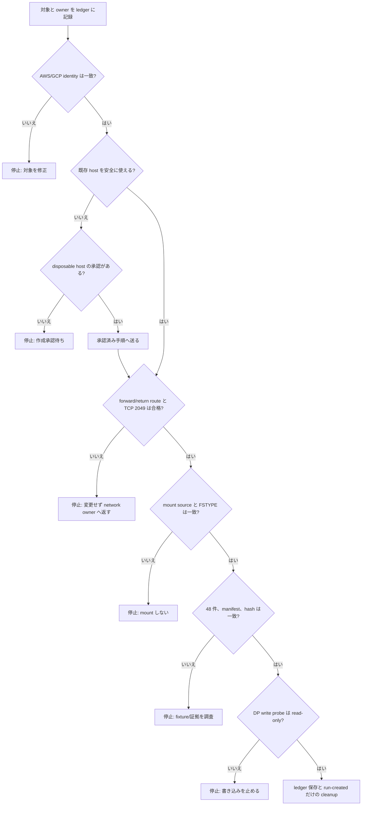

このフローは、provider の mutation より先に read-only の不一致を閉じるためのものです。diagram だけを証拠にせず、各判定の出力を次の節の表と ledger に残します。

## 構成図

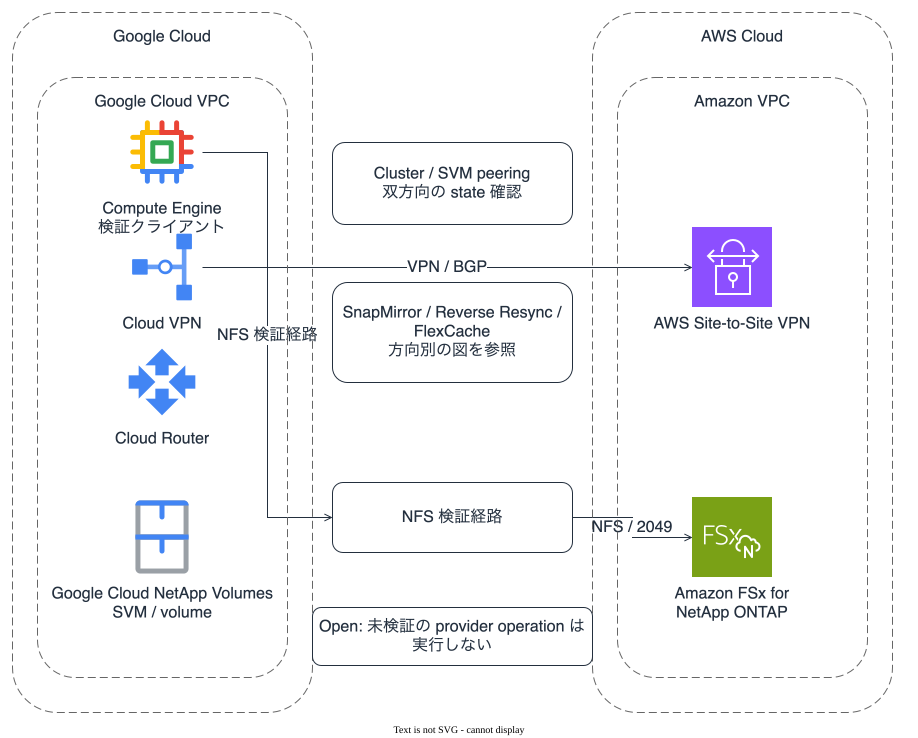

*図 1: GCP と Amazon FSx for NetApp ONTAP の route、NFS 検証経路、管理面の停止境界。*（[ダークテーマ版](../../_assets/images/gcp-fsx-ontap-peering-overview-dark.svg)）

方向別の図は [SnapMirror FSx for ONTAP → GCNV](../../_assets/images/gcp-fsx-ontap-snapmirror-fsx-to-gcnv.svg)、[Reverse Resync GCNV → FSx for ONTAP](../../_assets/images/gcp-fsx-ontap-reverse-resync-gcnv-to-fsx.svg)、[FlexCache FSx for ONTAP origin → GCNV cache](../../_assets/images/gcp-fsx-ontap-flexcache-fsx-origin-to-gcnv-cache.svg)、[FlexCache GCNV origin → FSx for ONTAP cache](../../_assets/images/gcp-fsx-ontap-flexcache-gcnv-origin-to-fsx-cache.svg) です。各図の dark theme は同じディレクトリにあります。

## 前提条件と台帳

### Intake

開始前に AWS 担当、GCP 担当、network owner、storage owner、承認者を決めます。source、destination、direction、対象 volume、検証 host、実行時間帯、rollback owner が一つでも未確定なら開始しません。

### Environment ledger

実値は private ledger にだけ保存します。公開文書の値は置換用の形式です。

| 項目 | placeholder | 記録する状態 |
|---|---|---|
| GCP project / region | `<gcp-project-id>` / `<gcp-region>` | active project と region |
| GCP VPC / VPN / Router | `<gcp-vpc>` / `<vpn-name>` / `<router-name>` | owner と tunnel/BGP 状態 |
| GCP client | `<gce-instance-id>` | owner、zone、VPC、subnet、OS |
| AWS account / region / VPC | `<aws-account-id>` / `<aws-region>` / `<aws-vpc-id>` | caller identity と対象 VPC |
| AWS VPN / route table | `<vpn-id>` / `<route-table-id>` | owner、association、return route |
| file system / SVM | `<file-system-id>` / `<fsx-svm-name>` | state と management endpoint の種類 |
| NFS endpoint / export | `<nfs-endpoint>` / `<export-path>` | source と export policy の確認結果 |
| run | `<sample-run-id>` | 開始時刻、終了時刻、operator、承認 |

### 停止条件

owner、project、account、region、VPC、SVM、volume、endpoint、direction、run ID のいずれかが ledger と一致しない場合は停止します。共有 VPN、Cloud Router、route table、security rule、SVM、volume は、run-created であることを証明できない限り変更または削除しません。

## 身元とコンソールの read-only 確認

### AWS identity

AWS 担当は、値を保存する場合も account ID を公開文書へ転記しません。

```bash
aws sts get-caller-identity \
  --query '{Account:Account,Arn:Arn,UserId:UserId}'
aws fsx describe-file-systems \
  --region "<aws-region>" \
  --file-system-ids "<file-system-id>" \
  --query 'FileSystems[].{Id:FileSystemId,Lifecycle:Lifecycle,Endpoints:OntapConfiguration.Endpoints}'
aws fsx describe-storage-virtual-machines \
  --region "<aws-region>" \
  --filters "Name=file-system-id,Values=<file-system-id>" \
  --query 'StorageVirtualMachines[].{Id:StorageVirtualMachineId,Name:Name,State:Lifecycle}
```

出力は private ledger の permission-controlled record へ保存します。secret、password、endpoint の実値を issue、chat、shell history、deck、公開 Markdown へ貼りません。

### GCP identity

GCP 担当は、active account と project のみを read-only で確認します。

```bash
gcloud auth list --filter=status:ACTIVE --format='value(account)'
gcloud config get-value project
gcloud projects describe "<gcp-project-id>" \
  --format='value(projectId,projectNumber)'
gcloud compute instances describe "<gce-instance-name>" \
  --zone "<gce-zone>" \
  --project "<gcp-project-id>" \
  --format='yaml(name,zone,networkInterfaces,labels)'
```

Google Cloud NetApp Volumes の SVM、volume、external replication の exact resource selector は、現在の Google Cloud console と公開 CLI 仕様を確認してから ledger に記録します。公開仕様で確認できない selector は推測しません。

## EC2 の選択

### Existing host

既存 host を第一候補にします。EC2 console の **Instances** で instance ID、state、owner tag、VPC、subnet、security group、route table、SSM の接続可能性を read-only で確認します。次のいずれかに該当したら使いません。

- owner または用途が ledger と一致しない。
- 共有 host で、fixture の作成範囲と cleanup owner が決まっていない。
- GCP 側との route、DNS、TCP 2049 の経路が対象と異なる。
- OS、NFS client、SSH または SSM の接続経路が確認できない。
- local mount が検証対象と同じ path を使っている。

### Disposable host

既存 host を使えない場合の選択肢として、承認済みの disposable EC2 を用意します。これは AWS mutation なので、この authoring run では実行しません。作成前に AMI、subnet、security group、IAM instance profile、SSM または SSH 経路、費用上限、termination owner、termination 後の証拠保存期間を ledger と承認記録に固定します。

AWS EC2 console の **Instances > Launch instances** が公開された作成場所です。作成後は対象 VPC、subnet、route、security group、OS の NFS client、接続経路を fresh read し、期待値と違えば利用せず停止します。

## Credential と endpoint の扱い

### Secrets Manager JSON

secret 名は `<fsx-admin-secret-id>` のような placeholder で扱います。JSON は次のようなキーを想定しますが、キー名も target secret の schema と照合してから使います。

```json
{
  "username": "<admin-username>",
  "password": "<not-published>"
}
```

AWS Secrets Manager の **Secrets > secret > Retrieve secret value** で値を確認し、SSH の interactive password prompt にだけ入力します。CLI を使う場合は標準出力へ表示せず permission-controlled temporary file に redirect し、検査後に消去します。

```bash
umask 077
secret_file="$(mktemp)"
trap 'rm -f "$secret_file"' EXIT
aws secretsmanager get-secret-value \
  --secret-id "<fsx-admin-secret-id>" \
  --query SecretString \
  --output text >"$secret_file"
jq -e '.username | type == "string" and length > 0' \
  "$secret_file" >/dev/null
jq -e '.password | type == "string" and length > 0' \
  "$secret_file" >/dev/null
```

password を `echo`、`printf`、command argument、shell history、debug log、PowerPoint、public document に出しません。`sshpass`、CLI の password option、貼り付けた password を含む command は使いません。

### SSH endpoint

FSx for ONTAP の cluster management endpoint と SVM management endpoint を ledger に別の欄で記録します。AWS の管理者 password 更新手順は file system または SVM の management port への SSH を案内しています。今回の read-only handoff では `fsxadmin` の ONTAP CLI を cluster management endpoint へ接続する経路を選び、SVM endpoint で認証が成立しない場合に再試行を繰り返しません。

```bash
ssh "<fsx-admin-user>@<cluster-management-endpoint>"
```

接続後も、read-only command だけを実行します。`cluster peer create`、`vserver peer accept`、`volume flexcache create`、`snapmirror initialize`、`snapmirror resync` などは guarded mutation handoff の承認がない限り入力しません。[AWS の管理者 password と SSH の説明](https://docs.aws.amazon.com/fsx/latest/ONTAPGuide/updating-admin-password.html)も参照してください。

## AWS VPC リソース作成手順

この節は、既存の共有 network resource を変更する手順ではなく、承認済みの disposable 構成を作る場合の順序です。今回の authoring run では実行していません。既存の VPC、subnet、route table、security group、NACL、VGW、VPN、Cloud Router は、run-created と証明できない限り変更しません。

### 作成順序

作成順序は次のとおりです。

1. AWS / GCP の CIDR、owner、費用上限、cleanup owner を ledger に記録します。
2. VPC と subnet を作成し、route table を subnet に関連付けます。
3. AWS Site-to-Site VPN の virtual private gateway、remote-site gateway、VPN connection を作成します。
4. route propagation または承認済みの static route を設定します。
5. security group と NACL に、必要な管理・NFS・intercluster 通信だけを追加します。
6. FSx for ONTAP endpoint、Cloud VPN、Cloud Router、BGP、return route を read-only で確認します。
7. TCP 22、TCP 2049、intercluster TCP 11104 / 11105 を検証します。

AWS は virtual private gateway の ASN を作成時に決め、後から変更できないと説明しています（[How AWS Site-to-Site VPN works](https://docs.aws.amazon.com/vpn/latest/s2svpn/how_it_works.html)）。ASN、CIDR、gateway type は作成前に承認します。

### VPC と subnet

**Preconditions** は non-overlapping CIDR、AZ、subnet type、route table、DNS、owner、cleanup、FSx for ONTAP の利用 subnet です。

```bash
set -euo pipefail
export AWS_REGION="<aws-region>"
export VPC_CIDR="<aws-vpc-cidr>"
export SUBNET_CIDR="<aws-fsx-subnet-cidr>"
export AZ="<availability-zone>"

aws ec2 create-vpc \
  --region "$AWS_REGION" \
  --cidr-block "$VPC_CIDR" \
  --tag-specifications 'ResourceType=vpc,Tags=[{Key=Name,Value=<run-vpc-name>}]'
aws ec2 create-subnet \
  --region "$AWS_REGION" \
  --vpc-id "<vpc-id>" \
  --cidr-block "$SUBNET_CIDR" \
  --availability-zone "$AZ"
aws ec2 create-route-table \
  --region "$AWS_REGION" \
  --vpc-id "<vpc-id>"
aws ec2 associate-route-table \
  --region "$AWS_REGION" \
  --route-table-id "<route-table-id>" \
  --subnet-id "<subnet-id>"
```

**Expected state** は VPC CIDR と subnet CIDR が重複せず、FSx for ONTAP が使う subnet と route table の association が明示されることです。VPC や subnet が shared または既存なら作成せず、その owner に返します。

### Virtual Private Gateway と remote-site gateway

AWS Site-to-Site VPN を virtual private gateway で構成する場合の識別子を作成します。GCP Cloud VPN の public endpoint、BGP ASN、AWS 側 ASN は ledger の値を使います。

```bash
aws ec2 create-vpn-gateway \
  --region "$AWS_REGION" \
  --type ipsec.1 \
  --amazon-side-asn "<aws-private-asn>"
aws ec2 attach-vpn-gateway \
  --region "$AWS_REGION" \
  --vpn-gateway-id "<vgw-id>" \
  --vpc-id "<vpc-id>"
aws ec2 create-customer-gateway \
  --region "$AWS_REGION" \
  --type ipsec.1 \
  --public-ip "<gcp-vpn-public-ip>" \
  --bgp-asn "<gcp-bgp-asn>"
```

remote-site gateway が NAT の背後にある場合の public IP、UDP 500 / 4500、NAT traversal の前提は [AWS gateway options](https://docs.aws.amazon.com/vpn/latest/s2svpn/cgw-options.html) に従います。IP、ASN、owner が一致しない場合は VPN connection を作成しません。

### VPN connection と route propagation

```bash
aws ec2 create-vpn-connection \
  --region "$AWS_REGION" \
  --type ipsec.1 \
  --customer-gateway-id "<customer-gateway-id>" \
  --vpn-gateway-id "<vgw-id>" \
  --options "StaticRoutesOnly=<true-or-false>"
aws ec2 enable-vgw-route-propagation \
  --region "$AWS_REGION" \
  --route-table-id "<route-table-id>" \
  --gateway-id "<vgw-id>"
```

static route を使う構成では、GCP client CIDR と AWS VPC CIDR の両方向を記録し、[Route tables and AWS Site-to-Site VPN route priority](https://docs.aws.amazon.com/vpn/latest/s2svpn/vpn-route-priority.html) に沿って route target を確認します。BGP を使う場合は route propagation と learned route を両側で確認します。

### Security group と NACL

security group は必要な source CIDR に限定します。FSx for ONTAP に対する代表的な検証ポートは次のとおりです。

| Port | 用途 | source |
|---|---|---|
| TCP 22 | cluster management endpoint への SSH | 承認済み EC2 client CIDR |
| TCP 2049 | NFS | GCP client CIDR または承認済み EC2 CIDR |
| TCP 11104 / 11105 | ONTAP intercluster communication | origin / cache の intercluster CIDR |
| ICMP | intercluster 到達性確認 | 承認済み intercluster CIDR |

```bash
aws ec2 create-security-group \
  --region "$AWS_REGION" \
  --group-name "<run-security-group>" \
  --description "Temporary FSx for ONTAP validation" \
  --vpc-id "<vpc-id>"
aws ec2 authorize-security-group-ingress \
  --region "$AWS_REGION" \
  --group-id "<security-group-id>" \
  --protocol tcp --port 2049 --cidr "<gcp-client-cidr>"
```

TCP 22 は EC2 client の管理 CIDR だけに許可し、TCP 11104 / 11105 は FlexCache または cluster peering を実行する承認済み intercluster CIDR に限定します。NACL は stateful ではないため、戻りの ephemeral port と protocol を含めて確認します。security group、NACL、export policy の変更は別承認が必要です。

### 作成後の確認と rollback

作成後は AWS CLI、AWS console、GCP console、ONTAP CLI の順で fresh read します。

```bash
aws ec2 describe-vpc-endpoints --region "$AWS_REGION" --filters "Name=vpc-id,Values=<vpc-id>"
aws ec2 describe-route-tables --region "$AWS_REGION" --route-table-ids "<route-table-id>"
aws ec2 describe-vpn-connections --region "$AWS_REGION" --vpn-connection-ids "<vpn-connection-id>" \
  --query 'VpnConnections[].VgwTelemetry'
```

**合格条件** は tunnel、BGP、learned route、return route、security rule、NFS endpoint、ONTAP endpoint が台帳と一致することです。どれか一つでも不一致なら client の mount や fixture 作成に進みません。

rollback は、作成した EC2 client、security rule、route、VPN connection、remote-site gateway、virtual private gateway、subnet、VPC の依存順を記録してから行います。shared resource、active tunnel、FSx for ONTAP が依存する route table、owner 不明の resource は削除しません。作成成功レスポンスだけを rollback 完了の証拠にせず、削除後の state を fresh read します。

### AWS console screen map

次の順序で AWS console の左メニューをたどります。画像の ID、名前、CIDR、IP、account 情報はマスク済みです。

<details>
<summary>AWS VPC resource screens</summary>

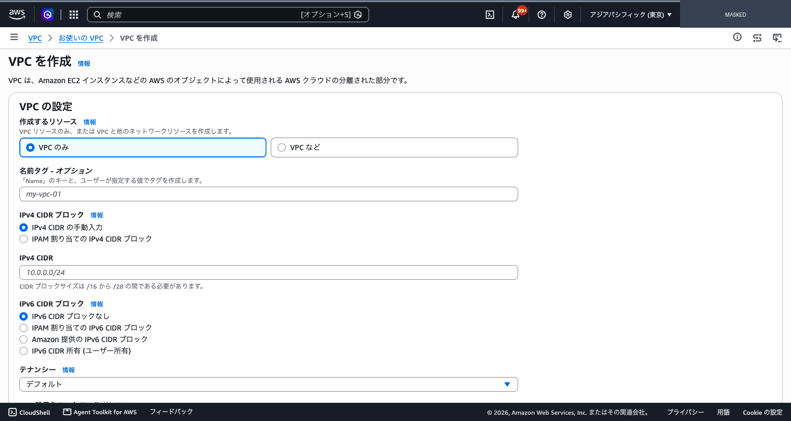

*図 4: VPC 作成画面。作成前に CIDR、IPv6、tenancy、tag を確認する。*

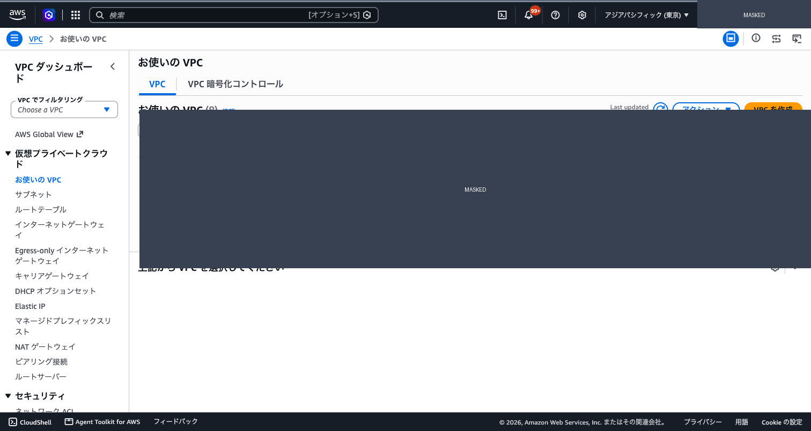

*図 5: VPC 一覧。対象 VPC を選択する画面。*

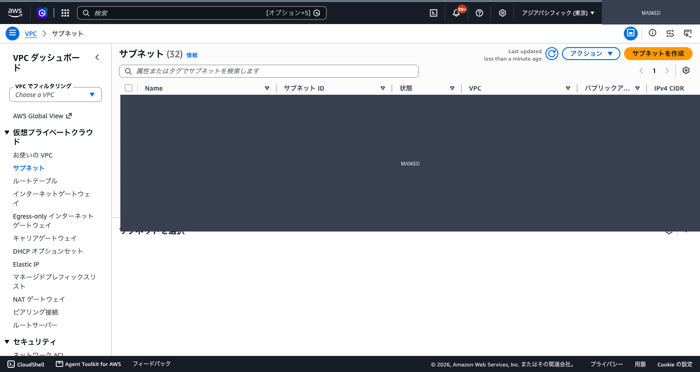

*図 6: Subnet 一覧。VPC、AZ、CIDR、route table association を確認する画面。*

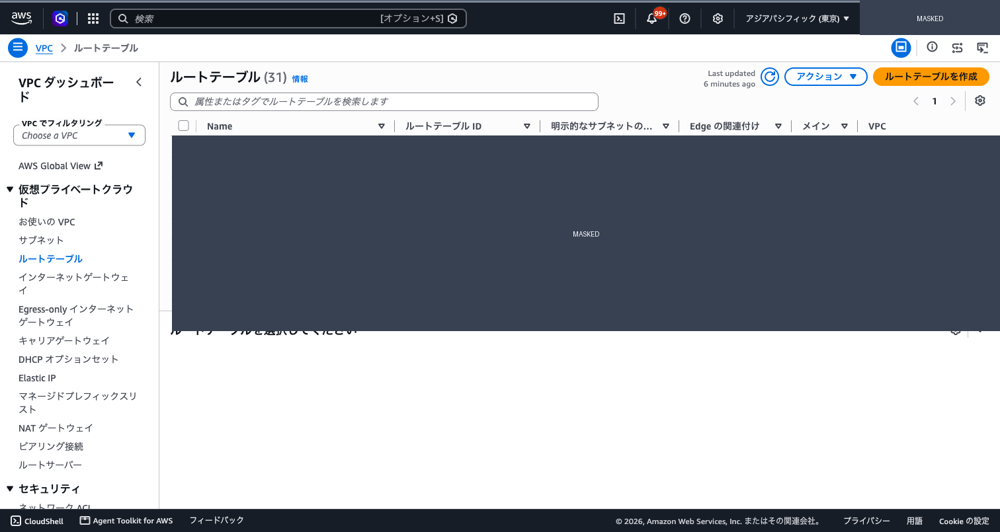

*図 7: Route table 一覧。subnet association と remote CIDR route を確認する画面。*

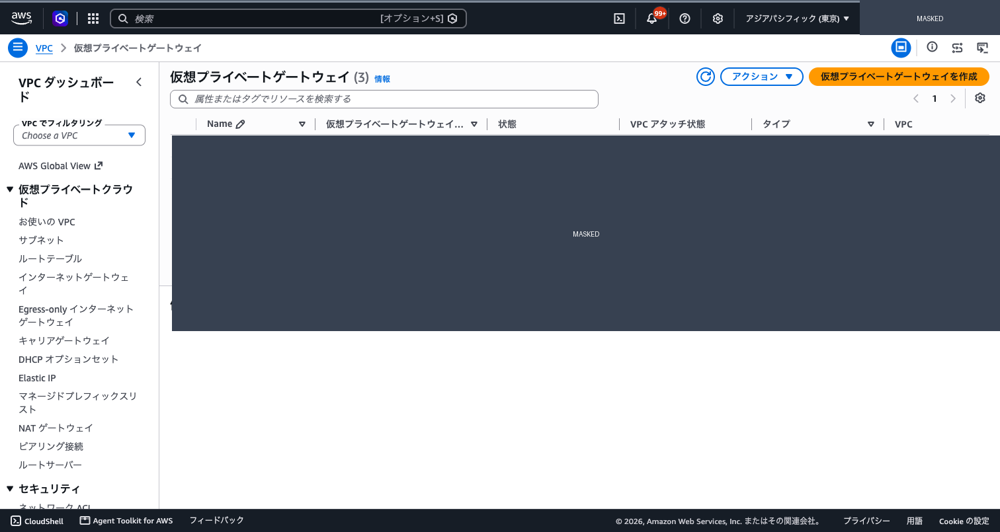

*図 8: Virtual Private Gateway 一覧。VPC attachment state を確認する画面。*

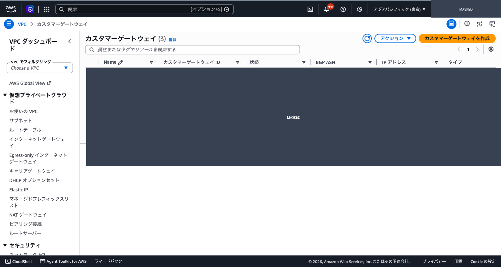

*図 9: Remote-site gateway 一覧。public endpoint、BGP ASN、type を確認する画面。*

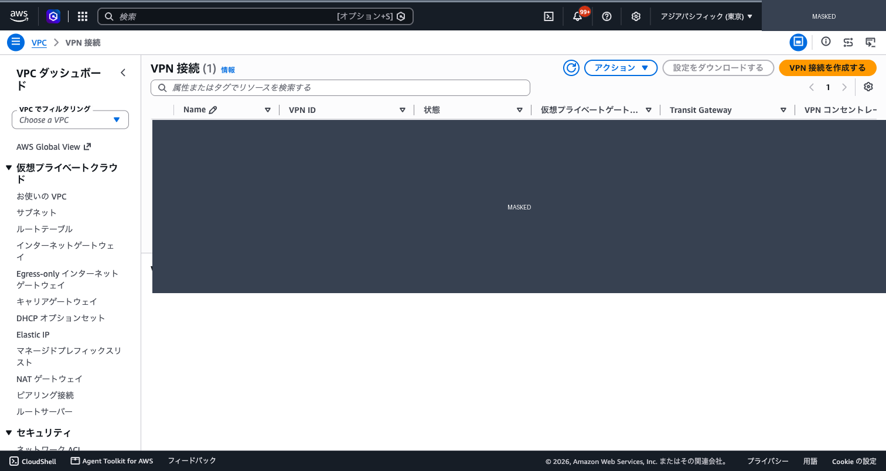

*図 10: VPN connection 一覧。state と virtual private gateway association を確認する画面。*

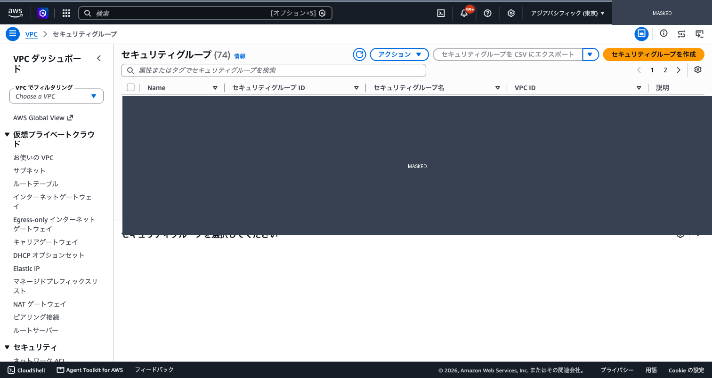

*図 11: Security group 一覧。VPC association と rule 管理画面への入口。*

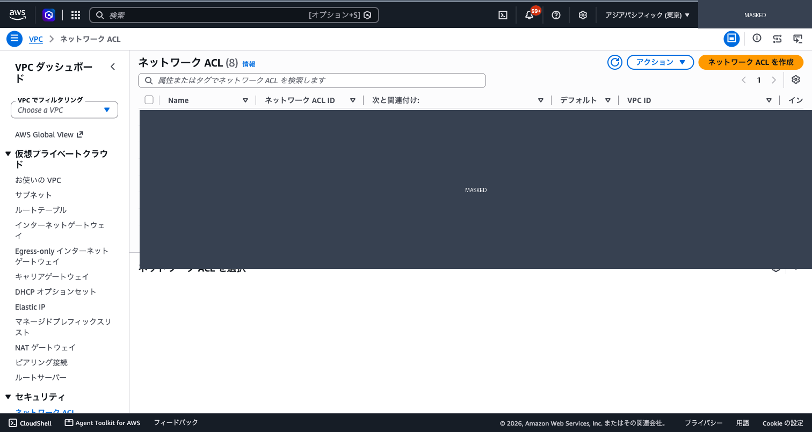

*図 12: Network ACL 一覧。inbound / outbound rule と subnet association を確認する画面。*

</details>

## Network 到達性

### GCP route

Cloud VPN tunnel、Cloud Router の BGP 状態、AWS VPC CIDR の learned route を GCP console または次の read-only command で確認します。

```bash
gcloud compute vpn-tunnels list \
  --project "<gcp-project-id>" \
  --regions "<gcp-region>" \
  --filter="name:<vpn-name>" \
  --format='table(name,status,router,peerIp)'
gcloud compute routers get-status "<router-name>" \
  --project "<gcp-project-id>" \
  --region "<gcp-region>" \
  --format=json
```

GCP console の **VPC network > VPN > Cloud VPN tunnels** と **Network services > Cloud Routers** も同じ対象を確認します。tunnel、BGP、learned route のいずれかが不一致なら AWS 側を変更せず停止します。Cloud Shell など VPC 外の host からの成功は client の到達性の証拠にしません。

### AWS return route

AWS console の **VPC > Route tables** と **VPC > Site-to-Site VPN**、または次の command で NFS subnet の route table と VPN telemetry を確認します。

```bash
aws ec2 describe-vpn-connections \
  --region "<aws-region>" \
  --vpn-connection-ids "<vpn-id>" \
  --query 'VpnConnections[].VgwTelemetry'
aws ec2 describe-route-tables \
  --region "<aws-region>" \
  --filters "Name=association.subnet-id,Values=<nfs-subnet-id>" \
  --query 'RouteTables[].{Id:RouteTableId,Routes:Routes}'
```

GCP client CIDR への return route、next hop、association が ledger と一致することを確認します。security group、NACL、export policy の変更が必要なら、変更せず network または storage owner へ返します。

### TCP 2049

GCP VPC 内の検証 host から endpoint へ一度だけ probe します。

```bash
NFS_ENDPOINT="<nfs-endpoint>"
timeout 5 bash -c "</dev/tcp/$NFS_ENDPOINT/2049"
```

失敗、timeout、想定外 endpoint、想定外 source CIDR の場合は mount しません。probe の時刻、host、endpoint の placeholder、結果、run ID を ledger に保存します。

## NFS mount の安全確認

### Mount verification

fixture 作成前に mount root が実際の NFS であることを確認します。既存 mount を unmount しません。

```bash
SAMPLE_MOUNT="<existing-or-approved-mount-root>"
EXPECTED_SOURCE="<nfs-endpoint>:<export-path>"
mountpoint -q "$SAMPLE_MOUNT"
findmnt -T "$SAMPLE_MOUNT" -o TARGET,SOURCE,FSTYPE,OPTIONS
actual_source="$(findmnt -n -T "$SAMPLE_MOUNT" -o SOURCE)"
actual_type="$(findmnt -n -T "$SAMPLE_MOUNT" -o FSTYPE)"
test "$actual_type" = nfs || test "$actual_type" = nfs4
test "$actual_source" = "$EXPECTED_SOURCE"
```

`mountpoint` の失敗、local filesystem、source 不一致、export path 不一致、既存 marker の存在は停止条件です。root 権限が必要な mount の作成は mutation なので、この手順では行いません。

### NFS security boundary

NFS endpoint の security group、NACL、ONTAP export policy が GCP client CIDR から TCP 2049 を許可することを、各管理面の read-only 表示で確認します。export policy を確認できる正式な ONTAP interface がない場合は `Open` と記録し、書き込みへ進みません。

## Fixture と hash 検証

### 48-file manifest

新規 directory に 48 ファイルを作成し、元のファイルを変更せずに manifest を保存します。seed は秘密情報を含めない固定文字列です。

```bash
RUN_ID="<sample-run-id>"
FIXTURE_ROOT="$SAMPLE_MOUNT/gcp-fsx-ontap-$RUN_ID"
python3 - "$FIXTURE_ROOT" <<'PY'
from pathlib import Path
import hashlib
import sys

root = Path(sys.argv[1])
if root.exists():
    raise SystemExit(f"refusing existing fixture: {root}")
root.mkdir(parents=True)
manifest = []
for index in range(1, 49):
    name = f"sample-{index:03d}.txt"
    seed = f"gcp-fsx-ontap-sample-{index:03d}"
    payload = hashlib.sha256(seed.encode("ascii")).hexdigest().encode("ascii") + b"\n"
    path = root / name
    path.write_bytes(payload)
    manifest.append((hashlib.sha256(payload).hexdigest(), name))
(root / "manifest.sha256").write_text(
    "".join(f"{digest}\t{name}\n" for digest, name in sorted(manifest)),
    encoding="ascii",
)
PY

test "$(find "$FIXTURE_ROOT" -type f -name 'sample-*.txt' -print | wc -l)" -eq 48
test "$(awk -F '\t' 'END {print NR}' "$FIXTURE_ROOT/manifest.sha256")" -eq 48
```

fixture directory が存在する、件数が 48 でない、manifest が 48 行でない場合は停止します。過去に観測した 48/48 の結果は、元の run ID、環境、日付、fixture 方式、manifest が retained record として揃うまで `open` とします。

### SHA-256 と DP read-only

DP 側の mount source と volume role が ledger と一致した後にだけ照合します。

```bash
DP_ROOT="<verified-dp-mount>/gcp-fsx-ontap-<sample-run-id>"
MANIFEST="$DP_ROOT/manifest.sha256"
ACTUAL="$(find "$DP_ROOT" -type f -name 'sample-*.txt' -print -exec basename {} \; | sort)"
test "$(find "$DP_ROOT" -type f -name 'sample-*.txt' | wc -l)" -eq 48
(
  cd "$DP_ROOT"
  sha256sum -c <(awk -F '\t' '{print $1 "  " $2}' "$MANIFEST")
)
if touch "$DP_ROOT/.write-test" 2>"$DP_ROOT/.write-error"; then
  rm -f "$DP_ROOT/.write-test" "$DP_ROOT/.write-error"
  exit 1
fi
grep -Fx 'touch: cannot touch' "$DP_ROOT/.write-error" >/dev/null || true
```

実行環境により `touch` のエラー文は異なるため、最後の判定はログの固定文字列だけで済ませません。`Read-only file system` を含むことを operator が確認し、permission denied、I/O error、timeout、network error は合格にしません。個別 hash、real path、resource ID は private ledger にだけ保存します。

## Expected output と停止条件

### Expected output

private ledger に次を一つの `sample_run_id` で保存します。

- AWS/GCP caller、project、region、対象 resource の placeholder 化済み識別子。
- forward route、return route、TCP 2049 probe の結果。
- mount source、FSTYPE、export path、protocol。
- fixture total 48、manifest lines 48、hash success 48、failed 0、missing 0、extra 0。
- DP volume role、write probe の exact error category、実行時刻。
- 実行した command の command name と exit status。secret と credential は含めない。
- stop condition、owner、承認、cleanup の結果。

### Stop conditions

次のいずれかで直ちに停止します。

- AWS/GCP identity、owner、region、direction、endpoint、volume role が ledger と違う。
- tunnel、BGP、learned route、return route、TCP 2049 のどれかが不合格。
- mount が local filesystem、source 不一致、既存 fixture、既存 marker を示す。
- fixture、manifest、件数、hash、missing、extra が不一致。
- DP への write が成功した、または read-only 以外の error になった。
- provider state が contradictory、control-plane interface が不明、逆操作が不明。
- secret が画面、shell history、stdout、ログ、deck、public document に出た。

## Cleanup 境界

### Run-created resource

fixture directory と、この run で作成した mount だけを対象にします。既存 mount は owner の承認なしに解除しません。disposable EC2、security rule、route、BGP advertisement は、run-created と fresh read で確認でき、かつ承認がある場合だけ後続の cleanup 手順へ送ります。

### Shared resource

既存の VPN、Cloud Router、VGW、route table、SVM、volume、peering、replication relationship、active transfer は残します。依存関係や transfer が残る状態で break、delete、stop をしません。cleanup も mutation なので、この authoring run では実行しません。

## Guarded mutation handoff

次の節は実行記録ではなく、承認後に別 run で使う handoff です。各操作の command は公開資料の placeholder syntax だけを示します。target、owner、current state、expected state、inverse、承認がそろわなければ `Open` として停止します。provider の response が contradictory なら、次の command を試さず停止します。

### Shared gate

各 mutation の直前に次を実施します。

1. `sample_run_id`、対象、方向、owner、承認者を再読する。
2. AWS/GCP の current state と ONTAP の `snapmirror show`、`cluster peer show`、`vserver peer show` を fresh read する。
3. source、destination、volume role、relationship state、health、dependency、逆操作を ledger と照合する。
4. command または console location が公開資料と一致することを確認する。
5. expected post-state と rollback window を承認記録に残す。
6. 一つでも不足、矛盾、予期しない state があれば実行せず `Open` とする。

### fsxadmin password update

**Preconditions** は、対象 file system の owner、password rotation 承認、secret schema、管理 endpoint、更新後の検証方法が確定していることです。AWS console の **Amazon FSx for NetApp ONTAP > File systems > target > Administration > ONTAP administrator password > Update** が公開された場所です。AWS CLI の公開形は次の placeholder です。

```bash
aws fsx update-file-system \
  --file-system-id "<file-system-id>" \
  --ontap-configuration FsxAdminPassword="<password-not-on-command-line>"
```

password を command line に置く形は実行せず、承認済み secret handoff を使います。**Expected state** は update 完了後に cluster management endpoint へ SSH し、read-only command が一度成功することです。**Inverse** は旧 password を secret から復元して再更新する documented path ですが、旧値が安全に保持されていない場合は逆操作不能です。**Approval gate** は password rotation と lockout 回避の明示承認です。password が不明、secret の target tag が不一致、SSH endpoint が SVM endpoint しかない、response と ONTAP state が矛盾する場合は STOP です。[AWS の file system 更新](https://docs.aws.amazon.com/fsx/latest/ONTAPGuide/updating-file-system.html) と [password requirements と SSH](https://docs.aws.amazon.com/fsx/latest/ONTAPGuide/updating-admin-password.html)を参照します。

### SVM と volume の作成

**Preconditions** は file system、subnet、SVM name、root security style、volume type、size、junction path、export policy、owner、cleanup、費用承認です。SVM は AWS console の **Amazon FSx for NetApp ONTAP > Storage virtual machines > Create new storage virtual machine**、volume は **Amazon FSx for NetApp ONTAP > Volumes > Create volume** が公開された場所です。[SVM 作成](https://docs.aws.amazon.com/fsx/latest/ONTAPGuide/creating-svms.html) と [volume 作成](https://docs.aws.amazon.com/fsx/latest/ONTAPGuide/creating-volumes.html)に沿って入力値を固定します。

**Expected state** は SVM が作成済み、volume が `Created`、role が ledger と一致し、mount 前の endpoint と export policy が確認できることです。**Inverse** は作成した SVM/volume の依存関係を fresh read してからの削除ですが、共有または peering 済みなら実行しません。**Approval gate** は容量、費用、削除可否、security style、DP/RW role の承認です。existing resource の名前推測、SnapLock、snapshot locking、terminal retention の設定は別承認なしに行いません。state が `Creating` のまま、target が違う、依存 relationship がある場合は STOP です。

### Cluster と SVM peering

**Preconditions** は両 cluster の intercluster LIF、TCP 11104/11105、ICMP、security group、同一 passphrase の安全な受け渡し、両側の actor、peer identity、expiry、逆操作です。AWS の FlexCache 手順には `cluster peer create`、`cluster peer show`、`vserver peer create`、`vserver peer accept` の ONTAP CLI 形があります。

```text
<cache-cluster>::> cluster peer create -address-family ipv4 -peer-addrs <peer-intercluster-addresses>
<source-cluster>::> cluster peer show
<cache-cluster>::> vserver peer create -vserver <cache-svm> -peer-vserver <origin-svm> -peer-cluster <origin-cluster> -local-name <local-name> -application <application>
<source-cluster>::> vserver peer accept -vserver <origin-svm> -peer-vserver <cache-svm> -local-name <local-name>
<source-cluster>::> vserver peer show
```

これは GCNV の generated command や acceptance interface を代用しません。**Expected state** は両 cluster の availability、authentication、SVM `peered`、application、identity が fresh read で一致することです。**Inverse** は public provider guidance と dependency を確認した後の `cluster peer delete` または SVM peer removal ですが、last replication、active transfer、共有 peer がある場合は使えません。**Approval gate** は peering、passphrase、network rule、両 provider owner の承認です。片側だけ `peered`、cluster peer が `Unavailable`、GCNV interface が不明、identity が違う場合は STOP とし、`Open` のままにします。[AWS FlexCache の peer prerequisites と CLI](https://docs.aws.amazon.com/fsx/latest/ONTAPGuide/create-flexcache.html)を参照します。

### SnapMirror の create と initialize

**Preconditions** は FSx for ONTAP source、GCNV destination、DP role、source/destination SVM、cluster/SVM peering、schedule、network、GCNV external replication resource、generated hybrid command、destination-side operator、common snapshot です。GCNV console の **NetApp Volumes > Data protection > External replications** で対象を確認できますが、create の現在の provider contract が ledger にない場合は `Open` です。

NetApp の公開 ONTAP 手順が示す initialize の形は次のとおりです。initialize は destination SVM または destination cluster から実行します。

```text
<destination-cluster>::> snapmirror initialize \
  -source-path <source-svm>:<source-volume> \
  -destination-path <destination-svm>:<destination-volume>
<destination-cluster>::> snapmirror show \
  -destination-path <destination-svm>:<destination-volume>
```

**Expected state** は baseline transfer 完了後の mirror state、relationship status、health、source/destination が ledger と一致することです。**Inverse** は initialize の途中停止ではなく、provider が示す stop または delete sequence です。途中状態で任意の `break`、`delete`、再 initialize をしません。**Approval gate** は baseline の時間、destination read-only、RPO、費用、GCNV generated command の確認です。GCNV resource がない、peering が片側、destination role が RW、state が contradictory、generated command が取れない場合は STOP です。[initialize の前提と destination-side command](https://docs.netapp.com/us-en/ontap/data-protection/initialize-replication-relationship-task.html)、[GCNV external replication overview](https://docs.cloud.google.com/netapp/volumes/docs/protect-data/replicate-ontap/overview)、[AWS SnapMirror の設計例](https://aws.amazon.com/blogs/storage/highly-scalable-solution-design-to-replicate-data-using-amazon-fsx-for-netapp-ontap-and-snapmirror/)を参照します。

### Stop / pause

**Preconditions** は current state が GCNV external replication と ONTAP の両方で一致し、active transfer の扱い、destination を RW にする影響、resume inverse が承認されていることです。GCNV の公開 CLI 形は次のとおりです。

```bash
gcloud netapp volumes replications stop "<replication-name>" \
  --volume="<destination-volume>" \
  --location="<region>"
```

GCNV console は **NetApp Volumes > Data protection > External replications > target > Stop** です。ONTAP destination の場合は GCNV が表示する `snapmirror show` の state を確認し、画面が要求する command だけを使います。**Expected state** は transfer stopped、destination RW など provider が示す post-state と ONTAP state が一致することです。**Inverse** は GCNV `resume` と、必要なら generated `snapmirror resync` です。**Approval gate** は destination の書き込み許可とデータ保護影響です。active transfer、state 不一致、command 非表示、逆操作不明なら STOP です。[GCNV stop guidance](https://docs.cloud.google.com/netapp/volumes/docs/protect-data/replicate-ontap/manage-external-replication)を参照します。

### Resume

**Preconditions** は stopped state、checkpoint、destination identity、resume の影響、GCNV が提示する ONTAP state predicate です。公開 CLI の形は次のとおりです。

```bash
gcloud netapp volumes replications resume "<replication-name>" \
  --volume="<destination-volume>" \
  --location="<region>"
```

ONTAP destination では GCNV の指示に従って `snapmirror show` を先に読み、条件が満たされる場合だけ次の形を使います。

```text
<ontap>::> snapmirror resync -destination-path <svm-name>:<ontap-volume-name>
<ontap>::> snapmirror show -destination-path <svm-name>:<ontap-volume-name>
```

**Expected state** は transfer が `Preparing` または `Mirrored` など provider が指定する状態へ進み、direction と destination が変わらないことです。**Inverse** は同じ relationship の stop/pause と provider が示す sequence です。**Approval gate** は stopped data の上書き、checkpoint、RPO、実行時間帯です。`snapmirror show` が要求 state でない、対象が違う、resync command が GCNV response にない場合は STOP です。[GCNV resume guidance](https://docs.cloud.google.com/netapp/volumes/docs/protect-data/replicate-ontap/manage-external-replication)を参照します。

### Reverse と Reverse Resync

**Preconditions** は replication が stopped、current destination の変更を失う影響を承認済み、new source/destination、common checkpoint、GCNV external replication resource、generated ONTAP command、direction-specific content test が確定していることです。公開 CLI の reverse 形は次のとおりです。

```bash
gcloud netapp volumes replications reverse "<replication-name>" \
  --volume="<gcnv-volume>" \
  --location="<region>"
gcloud netapp volumes replications list \
  --volume="<gcnv-volume>" \
  --location="<region>"
```

GCNV が ONTAP destination 用の `hybridReplicationUserCommands` を返した場合だけ、その response の exact command を承認記録へ転記します。NetApp の一般的な reverse resync 形は次のとおりですが、target-specific generated command の代用にはしません。

```text
<original-source-cluster>::> snapmirror resync \
  -source-path <current-source-svm>:<current-source-volume> \
  -destination-path <original-source-svm>:<original-source-volume>
```

**Expected state** は new direction、mirror state、relationship status、content evidence が別々に合格することです。common snapshot がない場合、公開手順では resync が失敗し initialize が必要になります。**Inverse** は再度 stop と reverse を含む別承認の sequence で、無条件の reverse again は inverse とみなしません。**Approval gate** は新 destination の過去 checkpoint への戻り、書き込みの消失、client cutover、RPO/RTO、generated command の有効時間です。provider state が contradictory、stop 前、common snapshot 不在、GCNV interface 不明の場合は STOP して `Open` のままにします。[GCNV reverse guidance](https://docs.cloud.google.com/netapp/volumes/docs/protect-data/replicate-ontap/manage-external-replication) と [ONTAP reverse resync sequence](https://docs.netapp.com/us-en/ontap/data-protection/reactivate-original-source-volume-task.html)を参照します。

### FlexCache の作成

**Preconditions** は origin/cache の両方向の topology、intercluster LIF、TCP 11104/11105、cluster/SVM peering、cache volume の size、security style、junction path、write mode、owner、NFS/SMB client path、post-state query です。AWS の公開手順が示す ONTAP CLI の形は次のとおりです。

```text
<cache-cluster>::> volume flexcache create \
  -vserver <cache-svm> \
  -size <size> \
  -volume <cache-volume> \
  -origin-volume <origin-volume> \
  -origin-vserver <origin-svm> \
  -junction-path <junction-path> \
  -aggr-list <aggregate>
<cache-cluster>::> volume flexcache show
```

**Expected state** は cache identity、origin identity、cache state、write mode、SVM peer、content read が一致することです。**Inverse** は依存 relationship、client mount、cache state を確認した上での volume deletion ですが、公開資料だけで target GCNV cache の inverse を確定できない場合は `Open` です。**Approval gate** は origin/cache 方向、write-back の選択、データアクセス経路、費用、削除承認です。GCNV cache create interface、owner、post-state が不明、方向が逆、peering が片側の場合は STOP です。[AWS FlexCache workflow](https://docs.aws.amazon.com/fsx/latest/ONTAPGuide/create-flexcache.html)、[ONTAP FlexCache volume sequence](https://docs.netapp.com/us-en/ontap/flexcache/create-volume-task.html)、[TR-4743 index](https://docs.netapp.com/us-en/ontap-technical-reports/nas-containers.html)を参照します。

### Delete

**Preconditions** は replication が stopped、ONTAP connection が存在しないか `Broken-off`、active transfer がなく、依存 relationship、cluster peer、SVM peer、volume、network rule の所有者と順序が確定していることです。GCNV の公開 CLI の形は次のとおりです。

```bash
# GCNV 側の current state を確認した後だけ実行する。
gcloud netapp volumes replications delete "<replication-name>" \
  --volume="<destination-volume>" \
  --location="<region>"
```

ONTAP 側は GCNV の画面が要求する state を確認し、`Broken-off` の場合にだけ次の形を検討します。

```text
<ontap>::> snapmirror show -destination-path <svm-name>:<ontap-volume-name>
<ontap>::> snapmirror delete -destination-path <svm-name>:<ontap-volume-name>
```

**Expected state** は GCNV と ONTAP の両方から対象 relationship が消え、共有でない peer と network dependency が残っていないことです。**Inverse** は安全な一発の復元ではありません。再作成、再 peering、再 initialize が必要になるため、削除前に別の restore design と承認を要します。**Approval gate** は destructive operation、最終 manifest、owner、保持要件、費用、再作成計画です。stopped でない、active transfer、last replication、共有 peer、state 不一致、逆操作不明の場合は STOP です。[GCNV deletion sequence](https://docs.cloud.google.com/netapp/volumes/docs/protect-data/replicate-ontap/manage-external-replication)を参照します。

## Security と監査

この手順は NFS 経路の network separation、least-privilege read-only role、TCP 2049 と intercluster port の明示、secret の非出力、command と結果の ledger 保存を要求します。暗号化、retention、監査要件への適合性は設計判断であり、法務・規制判断ではありません。secret の取得者、console 操作者、ONTAP actor、cleanup owner を分け、state-changing operation は承認記録と post-state を残します。

## 初心者向け実行手順

この手順は、読み取り確認、NFS 検証、証拠記録までを一人で進められるように並べています。AWS、GCP、ONTAP の管理面が同じ状態を示さない場合は、後続の mutation を実行せず停止します。ここで記載する mutation は承認前の確認用テンプレートです。

### 0. 実行前の入力値

次の値を private run ledger に記録します。公開文書には実値を記録しません。

| 変数 | 入力値 | 用途 |
|---|---|---|
| `AWS_REGION` | `<aws-region>` | AWS CLI のリージョン |
| `FILE_SYSTEM_ID` | `<file-system-id>` | 対象 FSx for ONTAP |
| `SVM_NAME` | `<fsx-svm-name>` | 対象 SVM |
| `SVM_ID` | `<svm-id>` | AWS CLI の SVM selector |
| `EC2_INSTANCE_ID` | `<ec2-instance-id>` | GCP 経路または ONTAP 経路を確認する client |
| `CLUSTER_MGMT_ENDPOINT` | `<cluster-management-dns>` | `fsxadmin` の SSH 接続先 |
| `NFS_ENDPOINT` | `<nfs-endpoint>` | NFS mount の接続先 |
| `SECRET_ID` | `<secret-name>` | `{"username":"...","password":"..."}` を保持する credential |
| `SAMPLE_RUN_ID` | `<sample-run-id>` | 証拠記録の識別子 |

`CLUSTER_MGMT_ENDPOINT` は SVM の管理 endpoint と別に確認します。今回の検証では、SVM endpoint では `fsxadmin` 認証が成立せず、FSx for ONTAP file system の cluster management endpoint で成功しました。AWS は file system の管理ポートから ONTAP CLI に SSH 接続する手順を案内しています（[Updating the fsxadmin account password](https://docs.aws.amazon.com/fsx/latest/ONTAPGuide/updating-admin-password.html)）。

### 1. AWS 対象状態の読み取り

AWS CLI の profile と credential を確認し、対象の file system、SVM、volume を読み取ります。

```bash
set -euo pipefail
export AWS_PROFILE="<aws-profile>"
export AWS_REGION="<aws-region>"
export FILE_SYSTEM_ID="<file-system-id>"
export SVM_NAME="<fsx-svm-name>"

aws sts get-caller-identity --profile "$AWS_PROFILE"
aws fsx describe-file-systems \
  --profile "$AWS_PROFILE" --region "$AWS_REGION" \
  --file-system-ids "$FILE_SYSTEM_ID" \
  --query 'FileSystems[0].{Lifecycle:Lifecycle,Type:FileSystemType,Endpoints:OntapConfiguration.Endpoints}'
aws fsx describe-storage-virtual-machines \
  --profile "$AWS_PROFILE" --region "$AWS_REGION" \
  --filters "Name=file-system-id,Values=$FILE_SYSTEM_ID" \
  --query 'StorageVirtualMachines[].{Name:Name,Id:StorageVirtualMachineId,Lifecycle:Lifecycle,Endpoints:Endpoints}'
aws fsx describe-volumes \
  --profile "$AWS_PROFILE" --region "$AWS_REGION" \
  --filters "Name=file-system-id,Values=$FILE_SYSTEM_ID" \
  --query 'Volumes[].{Name:Name,Id:VolumeId,SVM:OntapConfiguration.StorageVirtualMachineId,Lifecycle:Lifecycle,Type:OntapConfiguration.OntapVolumeType,Size:OntapConfiguration.SizeInMegabytes,Junction:OntapConfiguration.JunctionPath}'
```

期待する状態は、file system と SVM が使用可能または作成済みで、対象 volume の名前、SVM、volume type、サイズ、junction path が台帳と一致することです。`Lifecycle` が `FAILED`、対象が複数、名前と ID の対応が不明な場合は停止します。

SVM と volume の作成・状態確認に使う AWS CLI とコンソールの項目は、[Creating storage virtual machines](https://docs.aws.amazon.com/fsx/latest/ONTAPGuide/creating-svms.html) と [Creating volumes](https://docs.aws.amazon.com/fsx/latest/ONTAPGuide/creating-volumes.html) に対応します。

### 2. AWS マネジメントコンソールの状態確認

1. AWS コンソールで対象リージョンを選択します。
2. Amazon FSx の **Storage virtual machines** で SVM 名を検索します。
3. SVM 詳細の **Endpoints** で管理、NFS、iSCSI の各欄を確認します。
4. **Volumes** で対象 volume の `RW` / `DP`、サイズ、junction path、ライフサイクルを確認します。
5. 画面の ID、UUID、ARN、DNS、IP、account 情報を公開画像へ持ち込まないようにします。

AWS console で状態を読めることは、SnapMirror、Reverse Resync、FlexCache の mutation interface が利用可能であることを意味しません。

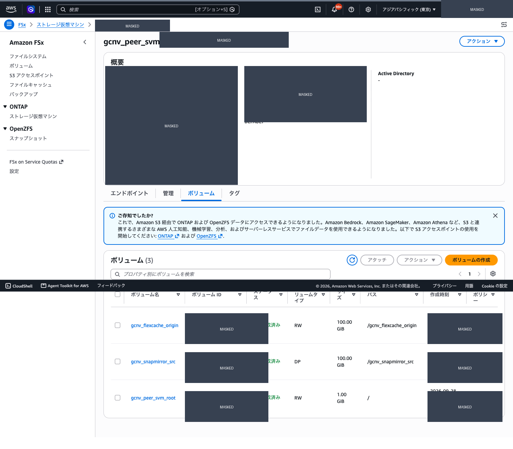

*図 2: `gcnv_peer_svm` の volume 一覧。実環境の識別子と時刻はマスク済み。*

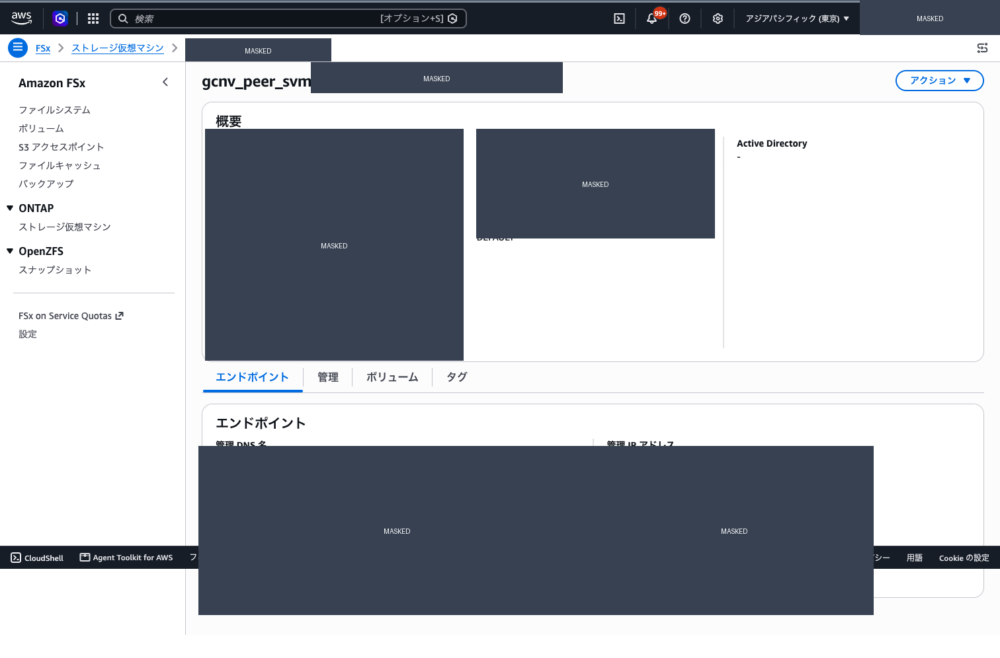

*図 3: SVM endpoint の表示欄。管理、NFS、iSCSI の実値はマスク済み。*

### 3. EC2 client の選択

既存 EC2 を使う場合は、次の read-only 条件を確認します。条件を満たさなければ disposable EC2 を用意します。

| 確認項目 | 合格条件 |
|---|---|
| VPC / route | FSx for ONTAP の cluster management endpoint と NFS endpoint へ到達できる |
| Security group | TCP 22 と TCP 2049 が必要な CIDR に限定して許可される |
| 認証 | SSH key、EC2 Instance Connect、または承認済みの別方式 |
| OS | `ssh`、`mountpoint`、`findmnt`、`sha256sum`、Python 3 が使える |
| cleanup | run-created と確認できる場合だけ停止・削除できる |

新規 client が必要な場合は、AWS の Amazon Linux イメージ、対象 VPC / subnet、restricted security group、temporary IAM role、SSH key を台帳に記録してから作成します。`0.0.0.0/0` の SSH 許可、共有 subnet の route 変更、既存 security group の上書きは行いません。

### 4. Credential の安全な取得

credential は AWS Secrets Manager の JSON 値として保存し、標準出力、シェル履歴、PowerPoint、公開文書へ出しません。以下は一時ファイルを `0600` で作成し、終了時に削除する例です。

```bash
set -euo pipefail
umask 077
SECRET_JSON="$(mktemp)"
trap 'rm -f "$SECRET_JSON"' EXIT
aws secretsmanager get-secret-value \
  --profile "$AWS_PROFILE" --region "$AWS_REGION" \
  --secret-id "<secret-name>" \
  --query SecretString --output text > "$SECRET_JSON"
python3 - "$SECRET_JSON" <<'PY'
import json
import sys
from pathlib import Path

value = json.loads(Path(sys.argv[1]).read_text(encoding="utf-8"))
if value.get("username") != "fsxadmin":
    raise SystemExit("unexpected ONTAP username")
if not value.get("password"):
    raise SystemExit("empty ONTAP password")
print("credential shape verified; password value was not printed")
PY
```

SSH 接続では、可能なら ONTAP の公開鍵認証を使います。パスワードを使う場合は、`expect` などが一時ファイルから読み取り、対話プロセスへ渡す構成にします。`ssh fsxadmin@...` の引数、環境変数、ログにパスワードを入れません。

### 5. ONTAP read-only 状態

SVM endpoint ではなく cluster management endpoint を使います。次のコマンドは読み取りだけです。

```bash
set -euo pipefail
export CLUSTER_MGMT_ENDPOINT="<cluster-management-dns>"
export SVM_NAME="<fsx-svm-name>"

ssh "fsxadmin@$CLUSTER_MGMT_ENDPOINT" version
ssh "fsxadmin@$CLUSTER_MGMT_ENDPOINT" "vserver show -vserver $SVM_NAME"
ssh "fsxadmin@$CLUSTER_MGMT_ENDPOINT" "volume show -vserver $SVM_NAME"
ssh "fsxadmin@$CLUSTER_MGMT_ENDPOINT" "snapmirror show -vserver $SVM_NAME"
ssh "fsxadmin@$CLUSTER_MGMT_ENDPOINT" "vserver peer show"
ssh "fsxadmin@$CLUSTER_MGMT_ENDPOINT" "cluster peer show"
```

`vserver peer show`、`cluster peer show`、`snapmirror show` の出力を同じ run ID に保存します。今回の実測では SVM peer と既存 SnapMirror relationship は確認できましたが、対応する cluster peer は `Unavailable` でした。この組み合わせでは mutation に進みません。

### 6. ネットワークと NFS 検証

1. GCP の Cloud VPN / Cloud Router の状態を読み取ります。
2. AWS の route table、VPN telemetry、security group、NACL を読み取ります。
3. EC2 client から cluster management endpoint の TCP 22 と NFS endpoint の TCP 2049 を確認します。
4. `findmnt` で NFS mount の `SOURCE` と `FSTYPE` を確認します。
5. [NFS サンプルデータとハッシュ検証の節](gcp-to-fsx-ontap-preflight-and-sample-validation.md) の fixture、manifest、48件比較を実行します。
6. DP volume では `touch` の失敗理由が `Read-only file system` であることを確認します。

mount、fixture、hash、DP volume の具体的なコマンドは本書の各節に分けています。順序を入れ替えて、mount source の確認前に書き込みを始めないでください。

### 7. 証拠記録と cleanup

次の項目を private ledger に記録します。

- `sample_run_id`、測定日、AWS / GCP リージョン。
- file system、SVM、volume の placeholder と role。
- cluster management endpoint を使用したこと。
- ONTAP version、SVM peer、cluster peer、SnapMirror の状態。
- NFS source、FSTYPE、fixture 件数、hash 成功数、failed、missing、extra。
- DP read-only の結果。
- run-created の fixture、mount、EC2、security rule の cleanup 結果。

共有 VPN、route、SVM、volume、peering、active transfer は削除しません。作成者、現在状態、依存関係、inverse operation が台帳にない resource は owner review に残します。

## 関連文書

- [GCP と FSx for ONTAP の peering と replication handoff](gcp-to-fsx-ontap-peering-and-replication-open-items.md)
- [Evidence policy](../evidence-policy.md)
- [Localization workflow](../../agent/localization.md)
- [Data protection](../domains/data-protection/)
- [Client access](../domains/client-access/)

## Sources

- [AWS: Updating file systems](https://docs.aws.amazon.com/fsx/latest/ONTAPGuide/updating-file-system.html)
- [AWS: Updating the fsxadmin password and SSH endpoint](https://docs.aws.amazon.com/fsx/latest/ONTAPGuide/updating-admin-password.html)
- [AWS: Creating SVMs](https://docs.aws.amazon.com/fsx/latest/ONTAPGuide/creating-svms.html)
- [AWS: Creating volumes](https://docs.aws.amazon.com/fsx/latest/ONTAPGuide/creating-volumes.html)
- [AWS: Creating a FlexCache volume](https://docs.aws.amazon.com/fsx/latest/ONTAPGuide/create-flexcache.html)
- [Google Cloud: External replication overview](https://docs.cloud.google.com/netapp/volumes/docs/protect-data/replicate-ontap/overview)
- [Google Cloud: Managing external replication](https://docs.cloud.google.com/netapp/volumes/docs/protect-data/replicate-ontap/manage-external-replication)
- [Google Cloud: ONTAP communication prerequisites](https://docs.cloud.google.com/netapp/volumes/docs/migrate/ontap/prerequisites-ontap-netapp-volumes)
- [NetApp: Creating a FlexCache volume](https://docs.netapp.com/us-en/ontap/flexcache/create-volume-task.html)
- [NetApp: Initializing a replication relationship](https://docs.netapp.com/us-en/ontap/data-protection/initialize-replication-relationship-task.html)
- [NetApp: Reactivating the original source volume](https://docs.netapp.com/us-en/ontap/data-protection/reactivate-original-source-volume-task.html)
- [NetApp TR-4743 index](https://docs.netapp.com/us-en/ontap-technical-reports/nas-containers.html)
- [NetApp TR-4015 index](https://docs.netapp.com/us-en/ontap-technical-reports/data-protection-disaster-recovery.html)
- [AWS Storage Blog: Replicating data with FSx for ONTAP and SnapMirror](https://aws.amazon.com/blogs/storage/highly-scalable-solution-design-to-replicate-data-using-amazon-fsx-for-netapp-ontap-and-snapmirror/)

<!-- lang-switcher:start -->
🌐 [日本語](gcp-to-fsx-ontap-preflight-and-sample-validation.md) | [English](../../en/reference/gcp-to-fsx-ontap-preflight-and-sample-validation.md) | [🏠 リポジトリトップ](../../../README.md)
<!-- lang-switcher:end -->
